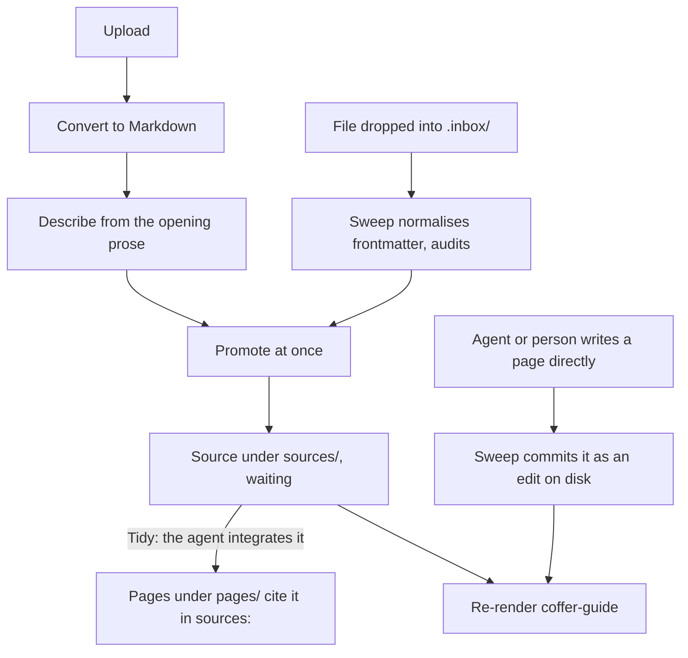
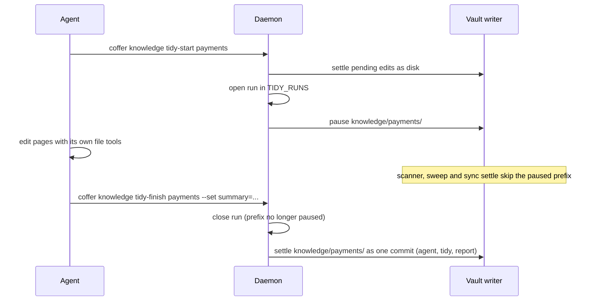
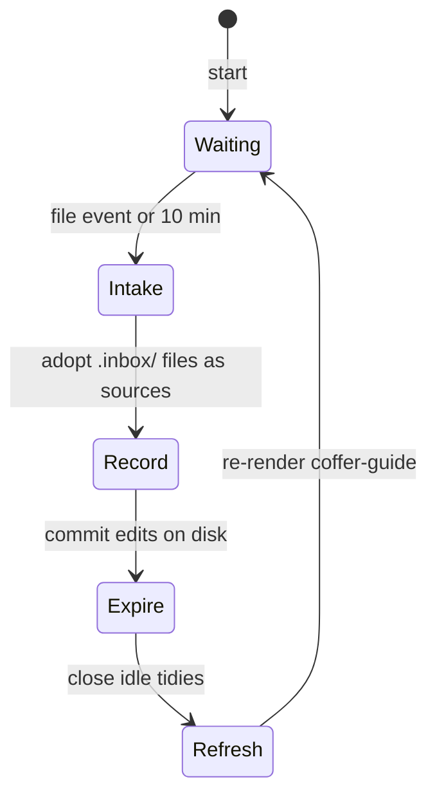

# Knowledge

This page explains how Coffer's knowledge layer is built: why it is plain files with no index, how a collection is a wiki of pages compiled from kept sources, how new material becomes a source at once, how pages link and how Coffer checks them, how a Confluence page is imported as a readable source, how an agent writes, integrates and tidies by rules the `coffer-guide` skill teaches, how a tidy becomes one change that can be undone, how every write is kept as a version git can show and an agent can bring back, how the catalogue reaches agents through that skill, and how it coexists with vault sync. It is for engineers who want the mechanism and the reasoning. For day-to-day use, see the [Knowledge guide](/guides/knowledge).

## The problem

Knowledge is what a developer has learned about their working environment: which team owns a service, the conventions of a repository, a pitfall and how to avoid it. Several agents need to read it, and people and agents both need to add to it. Four failure modes shaped the design:

- **Copies diverge.** If each agent keeps its own notes, what one learns in the morning is invisible to another in the afternoon.
- **Retrieval tools go unused.** A tool an agent has to remember to call is not retrieval. An audit of 448 Claude Code sessions, taken after a corpus had been built behind a set of knowledge tools and a delivered skill, found that the skill had never been loaded and no knowledge tool had ever been called. Every agent Coffer supports already has `Read` and `Grep`, and uses them constantly.
- **Hand-maintained links rot.** In the same corpus, 343 of 398 internal file references were dead, each one a file name written into prose and broken by a later rename.
- **Free-form documents do not compound.** When every upload stood alone as one more document, was rewritten in place as it was tidied into the rest, and documents were forbidden to name each other, a collection grew as a pile of carriers rather than as subjects: nothing recorded which uploads had been folded in, nothing traced a statement to its origin, and an agent found related material only by grepping for words.

Knowledge is also distinct from [memory](/architecture/memory). Knowledge is about the world and arrives because someone put it there. It is organised by collection and pulled through a skill. Memory is about the user and their projects. It accrues on its own in each agent's native memory, and Coffer syncs it between the agents.

## Design decisions

| Decision | Reason |
| --- | --- |
| A collection is one directory tree of Markdown files under `~/.coffer/vault/knowledge/<collection>/`. | Every agent reads the same bytes, so no copy can diverge. An edit made in any editor is live on the next read. |
| Each collection is a wiki: a `README.md` schema, kept `sources/` and edited `pages/`. | The LLM Wiki pattern: material is kept as it arrived, and the agent compiles it into pages about subjects that accumulate. See [Knowledge Is a Wiki of Pages Compiled From Kept Sources](https://github.com/wyx-sg/Coffer/blob/main/docs/decisions/knowledge-is-a-wiki-of-pages-compiled-from-kept-sources.md). |
| No index of any kind: no table, no FTS, no vectors, no cache. The link graph and the check are rebuilt from the files on every read. | Nothing derived can disagree with the files. There is nothing to rebuild or reconcile. |
| A file's path is where it is; a page's or a source's slug, its file name, is what links use. | A readable slug is what a person sees in a file manager and what an agent sees in a grep result, and it survives the folder moves a tidy makes. |
| Metadata lives in YAML frontmatter. | Only the file is visible to every writer: people, agents and Coffer. |
| An upload is kept as its converted Markdown, with its pictures under `assets/`; the uploaded file itself stays on the Mac that uploaded it, outside the vault. Sources are never edited. | Diagrams and screenshots carry meaning agents and people need, and once decorations and repeats are dropped they are small; originals are large binaries git would carry forever, and agents read the Markdown no worse. A statement in a page can be traced back to the source it cites. See [Knowledge Sources Keep Their Images; Originals Stay on This Mac](https://github.com/wyx-sg/Coffer/blob/main/docs/decisions/knowledge-sources-keep-their-images-and-originals-stay-on-this-mac.md). |
| Material becomes a source at once. An upload is kept as it arrives, and a file dropped into a hidden `.inbox/` is kept by the next sweep. | Nothing waits for a model connection or a pass. What was submitted is readable by every agent within the minute. |
| Which sources wait is derived from the pages' `sources:` lists. | A manifest of what was ingested would be a second record that can disagree with the pages. |
| Pages link by `[[slug]]` or by a standard relative Markdown link, and Coffer resolves every link on read. | A slug moves only with a rename and a relative link names a file that exists or does not; either way a link a move or rename breaks is reported at once instead of rotting silently. Standard links make a collection that was written with other tools, or is opened in an editor that follows them, navigable as it is. |
| Coffer computes mechanical findings on every read and fixes none of them. Fixing them, and the judgement beyond them, is the agent's inside the one **Tidy** hand-off, whose prompt carries the findings: it fixes what is certain and reports what is not. | Dead links and missing frontmatter are facts a walk can find; contradictions and staleness are judgements. A separate report-only hand-off duplicated Tidy, and "don't change anything yet" is one sentence in the session Tidy opens. |
| Knowledge stays current through flags: a page leaning on a source marked `superseded_by`, or whose `verified` date is older than the README's `verify_after_days`, is a finding the next tidy clears. Nothing is hidden or deleted. | No product we found carries an outdated source through to the pages built on it; a timer with a queue is what wikis that stay current use. Both are one comparison per page per read. See [Knowledge Stays Current Through Flags Coffer Computes and an Agent Clears](https://github.com/wyx-sg/Coffer/blob/main/docs/decisions/knowledge-stays-current-through-flags-coffer-computes.md). |
| Coffer runs no model over knowledge. Where a fact belongs, which pages answer the same question and which statement is stale are judged by the agent, by rules the `coffer-guide` skill teaches. | The agent a person already uses has file tools, a stronger model and the person watching. A second, unattended model of Coffer's own needed its own connection, and without one its work did not happen. |
| Tidying starts only when a person presses **Tidy** or **Tidy all**. Coffer starts no agent run of its own. | An unattended agent run would spend the person's quota without their knowledge and leave conversations nobody started. |
| A tidy is one commit: while the agent works, the collection is paused in the vault writer, and finishing commits every edit at once with the agent's report. A tidy can be undone as one new commit. | The history itself holds the boundary, so the change log, a file's history and sync see one unit, and undo is the inverse of one commit. A grouping kept anywhere else would be a second record of the history. |
| No background pass moves or renames a file. | A person's or agent's file stays where its writer put it, so a link into it, an editor's open tab and a collection laid out before `pages/` existed all stay valid. Moving files is a tidy's job, where the agent can fix the links in the same change. See [Knowledge Files Stay Where Their Writer Put Them](https://github.com/wyx-sg/Coffer/blob/main/docs/decisions/knowledge-files-stay-where-their-writer-put-them.md). |
| Every accepted write is one git commit naming its writer. | Agents rewrite the only copy. A history of who changed what makes every change inspectable and every version one `git` or one hand-off to an agent away, and it is the collection's change log. |
| The newer statement wins unless the older one is shown to be right. No writer is exempt. | A statement is judged by when it was made and the evidence behind it, never by who wrote it: a person's edit and an agent's can both be stale or wrong. The vault's history and a restore from a file's history are the recovery path. |
| No retrieval tool. The catalogue rides in Coffer's own skill. | Agents read files with the tools they already use. The layer's job is to put the right absolute paths in front of the model. |
| Agents add knowledge by writing a collection's pages with their own file tools. No agent-facing tool: Coffer's only always-listed built-in MCP tool is `coffer__search_tools`. | Agents already write files. The guide tells them where, and the sweep commits what they changed. |
| No gate per collection: no per-agent reach and no enabled switch. Every collection is served to every agent. | The skill hands every agent the whole knowledge root. A per-agent filter or a switched-off collection would narrow a list while still disclosing the root. |

## The collection tree

```text
~/.coffer/vault/knowledge/             # inside the vault repository
├── payments/                        # one collection = one knowledge Resource
│   ├── README.md                    # the schema; first paragraph is the description, then page types and rules
│   ├── index.md                     # optional collection files (index, log, schema) stay at the root
│   ├── sources/
│   │   ├── q3-review.md             # a source: converted Markdown + frontmatter
│   │   └── oncall-notes.md          # a source from a Markdown upload
│   ├── assets/
│   │   └── q3-review-1a2b3c4d/      # an upload's pictures: <title-slug>-<first 8 hex of its sha256>
│   │       └── image-1.png          # linked from the source as ../assets/q3-review-1a2b3c4d/image-1.png
│   │   └── confluence-1234-v7/  # a Confluence import's pictures, diagram sources and page.storage.xml
│   ├── pages/
│   │   ├── session-ownership.md     # a page
│   │   └── infra/
│   │       └── cache.md             # nesting is allowed and means nothing
│   └── .inbox/                      # drop zone, adopted into sources/ by the sweep (hidden)
│       └── rate-limit-change.md
└── personal/
    └── ...
```

- **A collection** is a top-level directory and one resource of kind `knowledge`, filed as `vault/resources/knowledge/<name>.json`. A person creates it deliberately, in the web UI. Reads, writes, files an agent drops elsewhere and working directories never provision one, and nothing derives a boundary from an agent's cwd. The knowledge layer adds no table anywhere.
- **The README** sits at the collection root and is the collection's schema. Its first paragraph before its first `##` section is the collection's description; the sections after it are the collection's rules. A new collection's README is written with the defaults spelled out (`collection_files.default_readme`): frontmatter `verify_after_days: 90`, the heading, the description, a **Page types** section listing `overview`, `concept`, `entity`, `how-to` and `decision`, and a **Rules** section, so the person sees what they can change. It is read from disk on every listing and never copied into the resource file, because a copy would be wrong the first time a person edited the README. What it says about page types and rules takes precedence over the guide's defaults, as the guide tells agents. The README is never listed as a page or a source, or counted. A collection has no title of its own: every surface shows it by its folder name, and the resource update refuses a title. Editing the description in the web UI rewrites exactly that first paragraph, or inserts it above the first section when there is none, and leaves the rest of the README alone, as one commit naming the user; the guide skill is re-rendered afterwards, because the description is how an agent recognises the collection.
- **What a file is** follows from where it is. The path module's `kind_of` says `page` for a Markdown file under `pages/`, `source` for one under `sources/`, and `file` for anything else. A `file` is a **collection file**: the root `index.md`, `log.md` or `schema.md`, a folder of a person's own, `assets/`. It is listed, readable, committed by the sweep as an edit on disk, carried by the collection's delete and its Undo, and exported with the vault; it is never checked as a page and nothing moves it. Its links count as navigation (see [Links](#links)).
- **Nesting** inside `pages/` and `sources/` is chosen by whoever writes a page, a person or an agent. Coffer assigns those folders no meaning; `pages/` and `sources/` are the only directories that make a file a page or a source.
- **`assets/`** holds the pictures taken out of uploads, one folder per upload (see [Pictures and originals](#pictures-and-originals)). It is visible on purpose: the vault ignores hidden entries, and the pictures must be committed and synced with the source that links them. A picture is a plain `file`.
- **Hidden entries** (dot-prefixed) are excluded from every count, from the catalogue and from the check, and no surface lists or reads one. Inside a collection the one Coffer reads is `.inbox/`, a drop zone: a Markdown file left there is adopted as a source by the next sweep. The vault repository's `.git/info/exclude` ignores every other hidden entry inside a collection, so it is neither committed nor synced. That includes `.obsidian/`, so a collection folder opened as an Obsidian vault keeps Obsidian's settings out of the history (see [Opening a collection in Obsidian](#opening-a-collection-in-obsidian)). `.history/` and `.raw/` do not exist: replaced text is in the git history, and an upload is kept in the collection as its Markdown source in `sources/` and its pictures in `assets/`.

### Path and slug

File names are slugs derived from the title. The slug is NFKC-normalised and lower-cased. CJK characters are kept, because a transliteration would be a name nobody recognises. It is capped at 80 characters. A collision appends `-2`, `-3` and so on:

```text
payments/pages/session-ownership.md
payments/pages/session-ownership-2.md
```

A file's path is its identity; frontmatter carries no `id` key, and nothing maps ids to paths. A page's or a source's **slug** is its file name without `.md`, and it is the name links use (see [Links and the check](#links-and-the-check)). Two pages sharing a slug, in different folders, is a finding, not something Coffer resolves.

### Frontmatter

A page:

```yaml
---
title: Session ownership
type: concept
description: Which team owns the session service and how to reach them.
sources: [q3-review, oncall-notes]
aliases: [sessions]
verified: '2026-10-12'      # when the page was last checked against its sources or the code
verify_after_days: 30       # optional; overrides the README's interval for this page
actor: agent
created_at: '2026-09-20T08:14:03.512+00:00'
updated_at: '2026-09-22T10:02:41.107+00:00'
reviewed_by: alice          # a key a person added; always preserved
---
```

A source:

```yaml
---
title: Q3 review
description: The quarterly review of the payments gateway.
actor: user
created_at: '2026-10-01T09:00:00.000+00:00'
updated_at: '2026-10-01T09:00:00.000+00:00'
original: q3-review.pdf     # the uploaded file, kept on the Mac that uploaded it
original_sha256: 1a2b3c4d…  # names that copy
---
```

Coffer writes a source's keys, in a fixed order: `title`, `description`, `actor` (`agent` or `user`), `created_at` and `updated_at`, then `original` and `original_sha256` on a source converted from an uploaded file. An agent may add three keys to a source, which describe it without changing what it says: `ingest: skipped`, `superseded_by: <slug>` naming the newer source that replaces it, and `summary`, one or two sentences on what it says. Coffer writes no page: a page's `title`, `type`, `description`, `sources` (source slugs), `evidence`, `aliases`, `verified`, `verify_after_days`, `actor` and timestamps are written by whoever writes the page, as the guide teaches. `evidence` is a free-form list (`code: <repo>/<path>@<rev>`, `config: …`, `observed: …`) that Coffer does not interpret; it stands in for `sources` on a page that rests on code, configuration or an observation. `verified` is returned on a page's read as written, and compared with the page's own `verify_after_days`, else the README's (see [The mechanical check](#the-mechanical-check)); Coffer never writes `verified`. `type` is free text: the README lists the types a collection uses (the defaults it is created with are `overview`, `concept`, `entity`, `how-to` and `decision`; others such as `comparison`, `synthesis` or `summary` are as valid), and `subject_kind` is an independent key Coffer does not interpret. A source imported from Confluence carries more keys (see [Importing a Confluence page](#importing-a-confluence-page)). Any other key a person added is kept, with its parsed value unchanged, whenever Coffer rewrites a file. This matters because dropping an unknown key would quietly delete a person's `tags:`.

Frontmatter parsing degrades rather than raising: a file with no fence, or with malformed YAML inside one, yields empty frontmatter and its body, so one hand-edited file with a stray colon cannot break a whole collection walk.

### One module owns every path

One module in the knowledge infrastructure (`infrastructure/knowledge/paths.py`) builds every path and names `pages/`, `sources/` and `assets/`; nothing else constructs one. Every segment passes a guard that refuses empty, all-dot, dot-prefixed and non-allowlisted segments, so `payments/.inbox/x.md` is not addressable from any surface. The resolved path is also checked against the knowledge root on its nearest existing ancestor, so a symlinked directory inside the root cannot carry a write out of it. Writes go through a sibling temp file opened with `O_EXCL | O_NOFOLLOW`, followed by one atomic rename, and are committed through the vault's one writer. The root is always `~/.coffer/vault/knowledge`; there is no override.

## From material to source

Every entrance Coffer serves ends in a source. None of them waits. Pages are written by people and agents, not by Coffer.

| Entrance | Surface | Ends in |
| --- | --- | --- |
| Upload, converted to Markdown first | The Knowledge page, `coffer knowledge upload` | A source, its pictures under `assets/`, and the original on this Mac |
| A Markdown file dropped into `<collection>/.inbox/` | An agent outside Coffer, another machine, or an older guide; the sweep adopts it | A source |
| A page written straight into `pages/` | An agent's own file tools, or a person's editor | A page, committed as an edit on disk |

There is no entrance that creates a page at a path, and the web UI has no form for typing one in: a person writes in their own editor or uploads. The web UI shows every file read-only and opens it in the editor.



### Submission

An upload checks that the collection exists, then writes one source under the collection's `sources/`. Its body is the converted text as it stands. Its frontmatter is filled from the text: `title` from the first `# ` heading (else the file name), `description` from the first prose paragraph (else the title), and `actor` for whoever submitted it. It is named by its title's slug and never overwrites an existing source, because two submissions with the same title are two sources. The commit names whoever submitted it, and one `knowledge_written` audit event is recorded. Coffer then announces the collection on the daemon's event stream as a `knowledge` event, because files change without any write to the collection's row.

Nothing is merged into a page by Coffer. Compiling a source into the pages is the agent's work when the person presses **Tidy** (see [Tidying is the agent's job](#tidying-is-the-agent-s-job)); until then the source waits.

The answer to an upload carries the new source's path.

### A file dropped into the inbox

A file can arrive at `<collection>/.inbox/<any-name>.md`, from an agent outside Coffer, from another machine's older build, or from an older guide. The sweep recognises a new inbox file that no Coffer surface wrote and **normalises** it, then promotes it into `sources/` by the same operation a submission uses:

- `title` is kept, else the first `# ` heading, else the file name's stem.
- `description` is kept, else the first prose paragraph, else the title, the same fallback an upload uses.
- `actor` is kept as written, because it is self-reported, else `agent`.
- `created_at` and `updated_at` are kept, else the time the sweep saw the file.
- Every other key the writer set is kept.

One `knowledge_written` audit event is recorded per file, marked when the actor came from the file. A Markdown file in a top-level directory that is not a collection is left alone and never catalogued, because only a person creates a collection. A non-Markdown file in an inbox is left in place, logged, and not promoted.

### Uploads

An upload goes through four steps, in order:

1. **Bounds the upload.** It takes one file per call, up to 20 MiB, and no folder. It refuses unknown collections before paying for conversion.
2. **Converts it.** A converter registry dispatches by extension. Passthrough (Markdown, text and source files) runs first, then CSV, then MarkItDown for everything else, which also takes the pictures out (see [Pictures and originals](#pictures-and-originals)). An unsupported type is refused with `INGEST_REJECTED` and `reason: unsupported_type`. A conversion that yields no text, such as an image-only PDF, is refused too. Nothing is written in either case: no source, no picture, no original and no inbox file.
3. **Describes it.** The description is the source's first prose paragraph, and failing that its title. It is never empty. No model writes it.
4. **Promotes the Markdown** with `actor: user` as `sources/<slug>.md`, its pictures under `assets/` in the same commit, and `original` and `original_sha256` in its frontmatter unless the passthrough converter ran. A Markdown upload that already has its own frontmatter ends with one frontmatter block, not two: when the body after the outer block itself opens with a fenced YAML block, that nested block is merged in (its keys win, except `actor`, `created_at` and `updated_at`, which Coffer writes), and `title` comes from it. A `description` that is just a frontmatter block flattened to one line is dropped. A collision suffixes the source's name (`-2`). Once the source is committed, the uploaded bytes are kept on this Mac; failing to keep them is logged and loses only the local copy.

The 20 MiB ceiling stays.

### Importing a Confluence page {#importing-a-confluence-page}

An upload of a Confluence page is kept as a readable source, with its pictures and diagram sources, by the same upload route and the same 20 MiB ceiling. Coffer never calls Confluence or any external renderer: the person, or an agent for them, fetches the page with a tool they are authorised to use (a Confluence CLI read with `--format storage --json`, say) and uploads the result. Holding no Confluence credential keeps the layer local-first, and the agent the person already works with is the one with access. See [Confluence Pages Import From an Export the Person Fetched](https://github.com/wyx-sg/Coffer/blob/main/docs/decisions/confluence-pages-import-from-an-export-the-person-fetched.md).

Three inputs are recognised, by content:

- **A page read result in JSON**: the Confluence REST content shape (`id`, `title`, `version.number`, `space.key`, `body.storage.value`, `_links`), or a CLI read result with `pageId`, `title`, `version`, `spaceKey`, `link`, `bodyFormat: storage`, `body` and `attachments[]` carrying `name`, `mimeType` and `dataBase64`.
- **A Storage Format file** named `*.storage.xml`, with no metadata beyond its name and no attachments.
- **A Markdown file carrying `skynet-confluence-storage:v1` markers**: each marker's Storage XML is converted in place, and the frontmatter rule above applies.

**Conversion.** The converter (`infrastructure/knowledge/converters/confluence/`) parses the Storage XML as HTML and writes Markdown. Layout macros (sections, columns, headings, details) are unwrapped to their body; generated navigation (`toc`, `children`, `anchor`) is dropped; `info`, `note`, `tip`, `warning` and `panel` become labelled blockquotes; `code` and `noformat` become fenced blocks; `status` and `jira` become their title and issue key; task lists become checkboxes; a table with merged cells or block content in a cell becomes a sanitised HTML table and any other table a Markdown table. A picture whose attachment is in the export is shown through a link into `assets/`; a draw.io diagram is shown by its attached picture with its `.drawio` source kept, a diagram embedded as `data-mxgraph` or a `viewer.diagrams.net` link carrying inline data is inflated locally into a `.drawio` file, and PlantUML source is kept as a fenced block and a `.puml` file. A macro the converter does not know keeps its body and is listed, and nothing is executed or fetched.

**Where things go.** The source is `sources/<title slug>.md`. Its files go to `assets/confluence-<pageId>-v<version>/` (a Storage Format file with no id uses the title slug and a short hash): every picture the body shows, every diagram source, and `page.storage.xml`, the Storage Format as it came. The same page and version reuses its folder; different bytes under the same name get a short hash suffix. The uploaded file stays on this Mac like any original.

**Frontmatter.** Besides the keys every source has, the source records `origin` (the page's URL), `page_id`, `page_version`, `space`, `retrieved_at` (when it was imported, not when it was checked), `representation`, `original_representation` (the kept `page.storage.xml`), `redaction`, `attachments` (each saved or missing, with its kept path), `import_status` and `import_issues`.

**The report.** An upload's answer carries `status` (`complete` or `partial`), `files` (the paths written beside the source), `issues` (each a `kind`, a `name` and a `reason`), `replaced` and `dry_run`. The issue kinds are `missing_attachment`, `external_embed` (a hosted diagram Coffer did not fetch), `external_image`, `unsupported_macro` and `not_rendered` (a diagram kept as source only). The status is `partial` whenever an issue other than `not_rendered` exists, so nothing is dropped silently.

**Re-import.** `coffer knowledge upload <collection> <file> --replaces sources/old.md` writes the new source and adds `superseded_by` to the old one in one commit: one change in the feed, one Undo, nothing deleted, and the pages that cite the old source become findings the next tidy clears. `--dry-run` runs the conversion and answers with the same report and the paths that would be written, writing nothing.

**Reading.** The Knowledge page renders the HTML a converted document may hold through a sanitiser that removes scripts, iframes, styles, comments and event handlers, and keeps tables, `details` and `colspan`/`rowspan`. A source still holding storage markers (an older upload of the marker form) is shown expanded in the preview: the read answers `display_body` beside the body, and the file is untouched. **Raw** shows the file.


### Pictures and originals {#pictures-and-originals}

**Pictures.** `infrastructure/knowledge/converters/images.py` takes them out. MarkItDown runs with `keep_data_uris`, so an Office or HTML document's pictures arrive inlined as `data:` URIs; each is decoded and replaced by a bare name (`image-1.png`). A PDF's text layer carries no pictures, so pdfminer reads the images on each page and they are listed after the text under `## Images`, one `Page N:` heading per page. What is kept is bounded: a picture under 48 px on a side is a decoration and is dropped with nothing left of it, one over 5 MB is dropped, a repeat (the same bytes, a logo on every slide) is kept once and every place it appeared links that one file, an upload keeps at most 40, and a format a browser cannot show is re-encoded as PNG through Pillow. An unreadable picture is skipped; an image-only PDF is still refused, because there is no text.

`infrastructure/knowledge/assets.py` names the upload's folder before the source is written, `<title-slug>-<first 8 hex of the upload's SHA-256>`, rewrites each bare name in the Markdown to `../assets/<folder>/image-N.ext`, and writes the pictures in the same vault transaction as the source, so the source and its pictures are one commit, one change in the feed and one Undo. Deleting a source leaves its folder; nothing cleans up orphan pictures.

`GET /api/v1/knowledge/asset?path=` serves a picture's bytes with its media type for `png`, `jpg`, `jpeg`, `gif`, `webp` and `svg`, up to 10 MB, resolved through the same path guard as a read and, for a linked folder, through its own guard. Anything else is `404 KNOWLEDGE_FILE_NOT_FOUND`. The web UI's reader resolves each relative image link in a Markdown document against the document's path, fetches it through this route (which needs the daemon's token, so the browser cannot load it as a plain URL) and shows it as a data URL; a picture opened from the tree is shown the same way. The route reads a plain file, so it has no command.

**Originals.** `infrastructure/knowledge/originals.py` keeps the uploaded bytes at `~/.coffer/local/knowledge-originals/<sha256><.ext>`, mode `0600`, written once per content through a temp file and a rename. It is in the machine-local class, so it is never committed or synced. A read resolves `original_path` from the source's `original` and `original_sha256`: the absolute path when the copy is here, `null` when the source came from another Mac. `GET /api/v1/knowledge/file` carries both `original` and `original_path`. The web UI shows **Original `<name>`** under a source's title, the name a button that asks the daemon to open the file with the default app (`POST /api/v1/fs/open`); with no local copy it shows that the original is on the Mac it was uploaded from. A Markdown or text upload keeps no original. Nothing deletes an original when its source goes, so a source brought back by Undo finds it again.

`markitdown` is imported lazily. An import-linter contract confines it to the knowledge converters and the channel's document extraction.

### Direct edits

Writing, editing or deleting a page directly, in your editor or with an agent's own file tools, is a complete way to change knowledge. No import or registration step is needed, and the change is live on the next read. The sweep commits it as an edit on disk (see [History](#history)). Deleting a page or a source through Coffer is a person's action in the web UI. Coffer offers no tool that deletes anything.

The web UI does not edit files: a file's pane is read-only (Preview and Source) with **Open in editor** and **Reveal in Finder**, so there is no save route, no file fingerprint and no stale-save refusal. Coffer's route table has nothing that writes a page's text.

## Links and the check

`infrastructure/knowledge/wiki.py` walks one collection once (`wiki_files.py` reads its Markdown, `wiki_links.py` reads and resolves its standard links) and builds an in-memory `WikiGraph`: every page with its parsed frontmatter and outbound links, every source with whether it is skipped, and the maps that resolve a name to a file. Nothing is stored; every read builds it again. A collection is hundreds of files at most, and a walk takes milliseconds.

### Links

There are two kinds of link, both read outside code spans and fenced blocks, so a link written as an example is not a link.

A **wiki link** is `[[target]]` or `[[target|text]]`. `target` resolves against every page's slug, every page's `aliases` and every source's slug. Matching ignores case and Unicode width, the same NFKC normalisation file names get, and tolerates a trailing `.md` or a leading folder. A target that names nothing is **dead**; one that names more than one distinct file is **ambiguous**. A page's `sources:` entries resolve against source slugs only; an entry that names none is a **missing source**.

A **standard link** is a Markdown link or image, `[text](path)` or ``. A target with a URL scheme (`https:`, `mailto:`) or starting with `#` is external and never checked. Any other target is a path, percent-decoded with a `#fragment` or `?query` dropped, resolved against the directory of the file that holds it, inside the knowledge root. A path that leaves the root is an **outside link**; a path that names no existing file is **dead**. A path naming a page of the same collection counts as an inbound link for the orphan check, and one into another collection is checked for existence only.

Links are checked in pages, in the README, in the root collection files and in a person's own folders. A source's links count for reachability but never produce a finding, because a source is kept as it came. A page that only the root `index.md` links to is reached, so it is not an orphan.

A page's read carries each wiki link and each standard link with the path it resolves to, or none, and each source entry with its path and title; a source's read carries the pages that cite it, whether it waits, its replacement (slug, path and title, the path none when it names no source) and its summary. A tree listing carries each file's kind and whether a source waits, so the web UI marks a waiting source without a second call.

### Waiting sources

A source **waits** while no page lists its slug in `sources:` and its frontmatter sets neither `ingest: skipped` nor `superseded_by`. That is derived from the pages on every read; Coffer keeps no other record of what was integrated. A page citing a source is what integrating it means.

### The mechanical check

From the graph Coffer computes a collection's findings on every read, keeps none of them and fixes none of them:

| Finding | Rule |
| --- | --- |
| `dead_link` | A wiki link or relative path that resolves to nothing, with the file that holds it and the target. |
| `ambiguous_link` | A wiki link that resolves to more than one file. |
| `outside_link` | A relative link that leaves the knowledge root, with the target as written. |
| `duplicate_slug` | Two pages share a slug, or an alias names two pages. |
| `missing_source` | A `sources:` entry that names no source, or a source's `superseded_by` that names none. |
| `superseded_source` | A page that cites a superseded source and no later source in its chain of replacements. `others` holds the newest replacement. |
| `incomplete_page` | A page missing `title`, `type` or `description`. |
| `unsourced_page` | A page with neither `sources:` nor `evidence:`, whose `type` is not listed in the README's `sourceless_types`. |
| `stale_page` | A page whose `verified` is missing, not a date, or older than its interval. The target is `verified` as written, none when missing. |
| `orphan_page` | A page no other page, collection file or source links to, when the collection holds two or more pages. Pages whose `type` is `overview` are exempt: an overview is an entry point. |
| `waiting_source` | A waiting source. |

**Supersession.** `superseded_by` resolves against source slugs like a `sources:` entry, and a replacement counts only when it names exactly one source. `WikiGraph.successors` walks the chain from a source (v1 → v2 → v3) and stops where it repeats, so a loop cannot hang a read. A page is flagged only when it cites none of the later sources, and the finding names the last one, which is what a tidy should recheck it against. A superseded source never waits.

**The recheck interval.** `wiki.build` reads `verify_after_days` from the README's frontmatter on every build: 90 when absent, `0` turns `stale_page` off, and a negative value or one that is not a whole number falls back to 90 rather than failing the read. A page's own `verify_after_days` overrides it by the same rule. `verified` is read as a date (a timestamp by its date part); a missing or null `verified` is due a recheck, and Coffer never writes it. **Sourceless types.** `sourceless_types: [overview, how-to]` in the README's frontmatter names the page types exempt from `unsourced_page`; the default is none.

`GET /api/v1/knowledge/collections/{uid}/check` returns the collection and its findings, and `coffer knowledge check` prints them. The collection listing carries `page_count`, `source_count`, `waiting_source_count` and `finding_count`, computed per collection with one walk each, the tidy hand-off and `tidy_running`. No route fixes a finding.

`GET /api/v1/knowledge/collections/{uid}/files` (`coffer knowledge files`) returns every page and source of one collection with its title, description, writer, time, kind, page type, whether a page is `stale`, and for a source its waiting mark, `superseded_by` (the path it resolves to), `summary`, `cited_count` and `skipped`, from the same walk the tree uses. Contents lists the sources waiting first, then current, superseded last. The collection page's **Contents** groups it by page type; it is a separate route so the listing stays cheap.

## Tidying is the agent's job

Compiling a source into pages, putting a fact where it belongs, folding pages that answer the same question into one, splitting one that answers several, and correcting what is wrong are judgements. Coffer makes none of them. The agent the person already works with has file tools and the person watching, so the judgement lives in the `coffer-guide` skill it loads, and the person starts it with one button. See the decision [Tidying Knowledge Is the Agent's Job, One Hand-Off Recorded as One Change](https://github.com/wyx-sg/Coffer/blob/main/docs/decisions/tidying-knowledge-is-the-agents-job.md).

### What the guide teaches

While the knowledge feature is on, the guide's knowledge sections describe the layout — the README as the schema whose page types and rules win over the guide's defaults, and its `verify_after_days`; kept `sources/` and edited `pages/` — and carry three instructions.

**Writing a page.** When an agent learns something durable, it puts the fact straight into the collection's pages with its own file tools, by seven rules:

1. **Find its home.** Read the catalogue and grep `pages/` for the subject. Fold the fact into the page that owns it, in the section it belongs in, and create a page under `pages/` only when no page owns the subject.
2. **Lose nothing.** Integrate; never regenerate. Every fact already in a rewritten page survives.
3. **Organise by subject, never by provenance.** No sections like "Added today".
4. **The newer statement wins unless the older one is shown to be right** by a source, a date, a command's output or the code, whoever wrote either. The superseded statement stays legible, with the date it was corrected.
5. **Link pages by `[[slug]]` or a standard relative Markdown link.** Keep a link whole when renaming or moving a page: update the links to it, or keep the old slug in `aliases`.
6. **Never edit a source**, except to add `ingest: skipped`, `superseded_by` or `summary`.
7. **Give every page frontmatter**: a `title`, a `type`, a one-line `description` saying what question the page answers, its `sources` (or, for a page resting on code, configuration or an observation, `evidence`), any `aliases`, when it was last checked as `verified: YYYY-MM-DD`, optionally its own `verify_after_days`, and `actor: agent`; the `type` comes from the README's list. Keys a person added are left alone. Provenance belongs in `sources` and `verified`, never in a body paragraph listing what was read.

The same section tells the agent to **write back what it works out**: an answer found by reading a source, the code or a system, which the pages do not already say, goes into the page that owns the subject before the agent finishes, with `sources` and `verified` set and one line telling the person what it added. Not a guess, an opinion or something true only of that conversation.

**Integrating sources.** Read each waiting source in full, oldest first, and the README; fold what it says into the pages that own its subjects, create pages for subjects with none, add the source's slug to the `sources` of every page changed with it, give the source a `summary`, mark an older source it replaces `superseded_by` and recheck the pages citing that one, and mark a source with nothing worth keeping `ingest: skipped`.

**Tidying a collection.** One collection at a time: run `coffer knowledge tidy-start <collection>` before changing anything; integrate its waiting sources; fix the mechanical findings the prompt lists or `coffer knowledge check` prints; recheck each stale page against its sources or the code and set its `verified` to today, leaving a page it cannot recheck for the report; give every source without a `summary` one; read the README and every page's title and description, then the pages in full; merge pages that answer the same question, keeping every fact and every source and the merged-away slug in the survivor's `aliases`; split one that answers several, linking the parts; correct what is wrong, stale or contradictory and a description that does not say what question its page answers, and give a subject owned by no page a page of its own; leave alone what it is not sure about — two pages that disagree with nothing to tell which is right, a deletion of much text, a change to the README's page types — and list it in the report; then run `coffer knowledge tidy-finish <collection> --set summary="<report>"`, the report naming the sources integrated or skipped, what was merged, split, corrected, rechecked and deleted, and what is left for the person, and ending with **Gaps**: questions the pages cannot answer, subjects owned by no page, and sources worth finding. Asked only for a check or a review, the agent reports and changes nothing.

Code enforces none of these rules. They are prose in the skill, and the guard against a bad edit is the history and the mechanical check, not a refusal at a write.

### The Tidy hand-off

The daemon writes the prompt, from the same hand-off module every other hand-off uses (`application/knowledge/tidy_handoff.py`, rendered by `domain/handoff`). Reading a collection carries `tidy_handoff`, which names the collection, gives its absolute path, its page count, its waiting-source count and its mechanical findings grouped by kind with their paths (at most 40 lines, then how many were left out), and lists the steps: `tidy-start`, integrate the waiting sources, fix the findings, merge, split and correct, recheck stale pages and summarise sources, leave what is uncertain to the report, `tidy-finish` with a report that ends with the gaps. `GET /api/v1/knowledge/tidy-handoff` returns the same kind of prompt for every collection at once: it names the knowledge root and each collection with its path and its page, waiting-source and finding counts, asks the agent to work through them one at a time by the same steps, and tells it to read each collection's findings with `coffer knowledge check <collection>`.

The web UI offers **Tidy** on a collection's page and **Tidy all** in the Knowledge page's header. Pressing either starts the default hand-off agent in the preferred terminal with that prompt as its first message, through the same path as every other hand-off. With no managed agent available the button offers **Copy prompt** only. The person pressed a button named for the job, the prompt only edits Coffer's own files, and the tidy can be undone as a whole.

There is no second, report-only hand-off. A check that changed nothing duplicated Tidy's own steps; a person who wants a review asks for one in the session Tidy opened, and the guide tells the agent to change nothing then.

### A tidy is one change

The agent edits files with its own tools, and an edit found on disk is normally committed as a `disk` write once it is quiet. A tidy would then be a run of `disk` commits with no boundary and no report. Instead, the agent brackets its work with two commands the prompt names:



- **Start** (`POST /api/v1/knowledge/collections/{uid}/tidy/start`) first commits whatever already changed in the collection as `disk`, so the tidy holds only the agent's work, then opens a run in `TIDY_RUNS` (`infrastructure/knowledge/tidy_runs.py`). Starting an open tidy again keeps it.
- **While open**, `VaultWriter.set_paused` gives the writer the collection's path prefix, read from the registry on every call. `pending()` and `settle()` skip paused paths, so neither the vault's scanner, the sweep, another Coffer write nor a sync round commits them. A sync round whose incoming changes touch a paused file waits, as it does for any uncommitted edit. Reads see the files as they are on disk.
- **Finish** (`POST .../tidy/finish`, body `{summary}`) closes the run and then settles the collection's pending paths as one commit: writer `agent`, operation `tidy`, the report (whitespace folded, cut at 4,000 characters) as its summary, `Coffer-Status: reported`. It answers the change, or `change: null` when nothing changed. Finishing with no tidy open still commits the collection's pending edits as a tidy.
- **Idle expiry.** Each run keeps a fingerprint — the collection's pending paths and their digests. On every tick the sweep compares it; a change resets the run's idle clock, and a run idle for 30 minutes is closed with no report and `Coffer-Status: expired`. So no collection stays paused because an agent stopped.
- **Memory only.** The registry is bookkeeping about a session in progress, not knowledge, so it is neither stored nor synced. A daemon restart forgets an open run; the next settle commits its edits as ordinary `disk` writes, losing only the grouping.

The collection read carries `tidy_running`, and the collection page says a tidy is in progress. Start and finish are each audited as `knowledge_edited` (`tidy: started`, `tidy: finished` with the version and file count). The decision and the alternatives — trailers on each disk commit grouped at read time, grouping by time in the UI, a separate store of runs — are in [Tidying Knowledge Is the Agent's Job, One Hand-Off Recorded as One Change](https://github.com/wyx-sg/Coffer/blob/main/docs/decisions/tidying-knowledge-is-the-agents-job.md).

### Undoing a tidy

`POST /api/v1/knowledge/changes/{version}/undo` (`coffer knowledge undo`, body `{force}`) puts every knowledge file the change touched back as it was just before it (`collection_writes.undo_change`). For each path it reads three versions: the bytes at the change, the bytes on disk now and the bytes at the change's parent. If now differs from the change for any path, a later edit exists, and the undo is refused with `409 KNOWLEDGE_UNDO_CONFLICT` whose `details.documents` lists those paths, writing nothing, unless `force` is set. Otherwise each path gets its parent's bytes, or is removed when it did not exist before, all in one recording transaction: one commit by the user, operation `restore`, `Coffer-Undoes: <version>`. A version that touched no knowledge file, or whose files already match their parent, is refused with `400 KNOWLEDGE_NOT_A_CHANGE`. The undo is audited as `knowledge_edited` with `undoes`, the paths and the later edits it discarded. The tidy stays in the history before its undo; discarded edits stay in it too.

The route works on any change that touched knowledge files; the web UI offers it as **Undo this tidy…** on a tidy's Change log entry, and the confirmation lists the files edited since by title before it sends `force`.

### Nothing tidies unattended

Tidy runs only when a person presses it or asks their own agent. Scheduling agent runs would spend the person's quota without their knowledge, and would leave conversations nobody started. The mechanical sweep and the mechanical check stay Coffer's; judgement does not.

### Precedence

Two rules are about judgement and so live in the guide, not in code:

- **The newer statement wins, unless the older one is shown to be right.** When new material contradicts a page, the page is corrected unless a source, a date, a command's output or the code shows the older statement is right. The superseded statement stays legible with the date it changed, for example "(previously recorded as X; corrected 2026-09-20)".
- **No writer is exempt.** A person, an agent and a tidy are judged by when a statement was made and the evidence behind it, never by who wrote it.

What protects the data is mechanical. Coffer saves no text of a person's on the page, so a stale copy in the browser cannot revert an agent's edit. A rewrite that Coffer itself makes keeps every frontmatter key it did not set. Every agent edit is a version in the history, and a version can be restored from the file's history.

## Opening a collection in Obsidian

A collection's layout is what Obsidian reads natively: plain Markdown, `[[slug]]` links that resolve by file name, and `aliases` frontmatter. Obsidian is in the daemon's list of detected editors (`application/fs/editor_service.py`), and the web UI offers **Open in Obsidian** in a collection's and a file's ⋯ menu only when `GET /api/v1/fs/editors` lists it, opening the path with it through `POST /api/v1/fs/open`. Obsidian keeps its settings in `.obsidian/`, a hidden entry the vault ignores. An Obsidian save is an edit on disk like any editor's; a note Obsidian creates outside `pages/` and `sources/` stays where it was made, a collection file, so the guide suggests pointing Obsidian's default location for new notes at `pages/` to make them pages.

## Linked folders

A **linked folder** is a collection the person keeps with their own tools anywhere on this machine, an Obsidian vault say, which Coffer only shares with agents. It is the same `knowledge` kind with a different config, and it has none of a collection's machinery: no tree under the knowledge root, no wiki layout, no history, no sweep, no check and no tidy. The reasoning is in [A Linked Knowledge Folder Is Shared in Place, Read-Only to Coffer, and Recorded Machine-Local](https://github.com/wyx-sg/Coffer/blob/main/docs/decisions/linked-knowledge-folders-are-read-only-and-machine-local.md).

### The machine-local row

`POST /api/v1/knowledge/collections/link` (`application/knowledge/linking.py`, `coffer knowledge link`) checks the folder and registers one resource whose config is `{"folder": "<absolute path>"}`. `KnowledgeConfig` has that one optional field; a collection Coffer keeps leaves it unset and stays `{}` on disk. The kind's `storage_row` hook (`application/knowledge/kind.py`) files a row that names a folder in the `local` class, so the file is `~/.coffer/local/resources/knowledge/<name>.json`, with the home written as `${HOME}`, and is never committed or synced; agents and channels are kept machine-local the same way. The name defaults to the folder's own and is only a label: `on_rename` does nothing for a linked folder, and `on_delete` skips the directory cleanup and only re-renders the guide, so Disconnect leaves every file where it is.

### The read path

`infrastructure/knowledge/linked.py` is the only code that touches a linked folder, and it only reads. It has its own path guard, because the folder lies outside the root that `paths.py` guards and a person's own file names may hold characters `paths.py` refuses: it rejects a hidden segment, a backslash or NUL, and any path that resolves outside the folder, a symlink pointing out of it included. Surfaces still address a linked folder name-first, `<name>/<path inside the folder>`, so the tree and file routes serve it unchanged; `KnowledgeService.find_collection` sends the read to `linked.py` when the row names a folder. A walk skips hidden directories, `node_modules` and `__pycache__`, and stops at 5000 Markdown files; a file over 2 MB is listed but its body is not read. A note's title is its frontmatter `title`, else its first `# ` heading, else its file name. The collection list carries `linked`, `note_count`, `rules_file` (the first of `AGENTS.md`, `CLAUDE.md` and `README.md` at the root) and the description from the folder's own `README.md`; a folder that has gone missing lists with no notes.

### In the guide

`guide_render.py` gives a linked folder a section of its own in the `coffer-guide` catalogue, after the collections Coffer keeps: `### <name> (linked folder)`, its README description, its path with the home written as `~` (which keeps the render byte-identical across machines), a line telling the agent to follow the folder's own rules file before writing anything there, or with none to write only the way its notes are written, and that Coffer's `pages/`, `sources/`, inbox and tidy do not apply; then its notes by folder-relative path and title. When the catalogue shortens itself to counts, a linked folder lists its note count. The guide's manual has a paragraph saying the same in general terms, and the skill's description names the folder's subject when it has notes.

### What is refused

`KnowledgeService.collection_rows()` returns only the collections Coffer keeps, so the sweep, Tidy all and the history never see a linked folder. Every write, tidy, check and description edit asks `owned_collection(uid)` or `require_collection(relpath)`, which raise `CollectionIsLinked`, answered as `409 KNOWLEDGE_COLLECTION_LINKED`; upload and file delete reach the same refusal. Linking a folder that does not exist, a relative path, or Coffer's own home or a folder holding it (the home folder, the disk root) is `400 KNOWLEDGE_FOLDER_REFUSED`; a taken name, or a folder already linked, is `409 KNOWLEDGE_COLLECTION_EXISTS`.

## The sweep

The sweep is a background worker in the daemon on the shared wakeable loop, and it calls no model. It runs when a file under `knowledge/` changes (it borrows the vault scanner's file watch, and a burst of events is one run), when the `knowledge` feature is switched on, and otherwise every 10 minutes.



On each run the worker does exactly four things, and moves no file:

1. **Adopts `.inbox/` files.** Each new Markdown file in a collection's inbox is normalised and kept as a source under `sources/` (see [A file dropped into the inbox](#a-file-dropped-into-the-inbox)). Whatever it promotes, it announces as a `knowledge` event.
2. **Commits edits on disk.** Anything changed in the tree since the last commit, such as a person's editor or an agent's file tools, is committed as an edit on disk through the vault writer, so the history stays current and nothing an agent wrote is counted as Coffer's. A collection with an open tidy is paused and left alone (see [A tidy is one change](#a-tidy-is-one-change)). A file outside `pages/` and `sources/` is committed the same way and left where it is.
3. **Closes idle tidies.** A tidy whose collection has not changed for 30 minutes is committed, at the first run after that, as one change with no report and status `expired`.
4. **Re-renders the guide skill**, so a page added by hand is catalogued. A render that produces the same bytes writes nothing.

A failed duty is logged and never ends the loop. While the `knowledge` feature is switched off the sweep skips its rounds, and the collections stay on disk untouched. Shutdown cancels the task without waiting.

The sweep runs on every machine. It writes only what it promotes, and those writes go through the vault's ordinary writer like any other, so it holds nothing against a [vault sync](/architecture/vault-sync) round and waits for none. Because it rewrites the content of no file and moves none, two machines sweeping the same vault cannot fold the same item into two different pages.

## History

Every accepted write to a collection is one git commit naming its **writer**, following the decision that every vault write is a validated commit naming its writer. A file's history is therefore a list of versions, each with a writer, a time and a diff, read with git, and any version can be brought back. A collection's history is its change log; there is no `log.md` to keep.

### Writers

| Writer | What it covers |
| --- | --- |
| `user` | A person's upload, delete, undo of a delete or undo of a tidy, a collection's description edit, and collection create, rename and remove. |
| `agent` | A tidy (operation `tidy`, the agent's report as its summary), and an agent's submission promoted on arrival, naming the agent, such as a file it dropped into the inbox. |
| `daemon` | The sweep adopting an inbox file, and the layout commits (operation `layout`) that an older version's sweep made when it filed loose documents; they stay in the history under this label. The web UI shows it as **Coffer**. |
| `curation` | A commit an earlier version of Coffer made as a curation pass. It stays in the history under this label. |
| `sync` | Paths that vault sync applied. |
| `disk` | Anything else found changed in the tree: a person's own editor, an agent's own file tools. |

Changes made outside Coffer are never counted as Coffer's. The vault's scanner commits whatever a person or an agent's own tools changed as **Edited on disk** once the file has been quiet, and it does the same at every sweep tick and before every read of the changes feed, except in a collection paused by an open tidy.

### Where it lives

The history is the vault repository's own: collections sit under `knowledge/` in `~/.coffer/vault`, so a file's history is that file's history in the one repository, read with `git -C ~/.coffer/vault log -p -- knowledge/<collection>/<path>`. Coffer's knowledge routes read it for the changes feed (`GET /api/v1/knowledge/changes`, filterable to one collection), which a collection page's **Change log** lists and a delete's undo reads. The Change log shows a tidy as one entry with its report, and groups `disk` changes that follow each other within 10 minutes into one entry for reading; that grouping is the page's, and nothing in the history changes.

Knowledge commits carry the vault's trailers plus the knowledge ones (`Coffer-Writer`, `Coffer-Operation`, `Coffer-Actor`, `Coffer-Agent`, `Coffer-Collection`, `Coffer-Item`, `Coffer-Status`, `Coffer-Restored-From`, `Coffer-Undoes`); a tidy's `Coffer-Status` is `reported` or `expired`. Git runs with the user's global and system configuration pinned to `/dev/null`, so a personal hook, signing rule or alias cannot change what is recorded. The vault needs git: without it the daemon [waits for git](/architecture/daemon#waiting-for-git) and hands the install to an agent.

### Undoing a delete, and older versions

A file's **History** button opens its history over the whole Knowledge area (`?history=1` in the address), which lists its versions, shows the diff of the chosen one and restores it, through `GET /api/v1/vault/history`, `GET /api/v1/vault/diff` and `POST /api/v1/vault/restore` (see [Persistence](/architecture/persistence)). The tree and the file make way while it is open, and the old `/history` path segment redirects to it. Which collections and folders the tree has open is kept in the browser's local storage (`coffer.knowledge.tree.*`), so the tree comes back as it was left. The sidebar's Knowledge entry returns to the collection and document last open (kept in memory for the window, `lib/knowledge/lastLocation.ts`), not to the bare landing. A restore is Coffer's own write: one new commit by the user with `Coffer-Operation: restore` and `Coffer-Restored-From: <commit>`, recorded as a `vault_file_restored` audit event. It is refused with `VAULT_FILE_STALE` when the file changed since the history was read; the history before it stays intact. A deleted file has no pane to open its history from once the delete's toast is gone, but its versions stay in the vault's git history, so git can bring it back from the version before its deletion.

A delete has its own undo, while the toast's **Undo** is open. A delete, of one file or of a whole collection, is itself a change in the feed, listing every file it removed. Undo (`POST /knowledge/changes/{version}/restore`) reads each removed file from the commit before the delete and writes it back byte for byte, as one new commit naming the user and carrying `Coffer-Restored-From`. A file goes back into its collection. A collection gets its pages, its sources, its README and any files still in its inbox first, then a new resource file under its old name last, so a failure part-way leaves no row and no partial directory. Nothing is written when the restore would overwrite: a file at the same path or a collection of the same name is refused, as is restoring a change that is not a delete. A restore records a `knowledge_edited` audit event naming the delete it undid. Because a collection's registration cannot be brought back from git, **Delete collection** asks first; a file delete does not, since its file is one restore away.

## The coffer-guide skill

The catalogue reaches agents through `coffer-guide`, Coffer's own skill. It is an ordinary `skill` Resource: one master folder under `~/.coffer/derived/skills/coffer-guide/`, one derived resource file with a `builtin` source, and delivered into each agent as the same directory link any imported skill uses. See [Skills](/guides/skills). The knowledge layer contributes the **text** and nothing else.

### Rendering

The renderer (`application/knowledge/guide_render.py`) is pure: text in, text out, with no port and no filesystem access beyond its own package asset. It renders:

- **The frontmatter description.** This is the only part that is always in a model's context. It names Coffer and its builtin tools, the subjects the collections cover, each taken from the first sentence of the collection's README, and, while knowledge is on, that the skill teaches how to write, tidy and check knowledge, so an agent asked to organise it recognises it. It is capped at 1024 characters, the tightest limit among skill importers, by dropping whole subjects from the tail rather than cutting a sentence. It is emitted through a YAML dumper with unlimited width, so a README containing `: ` or ` #` cannot break or silently truncate the block.
- **The body.** First comes the hand-written manual shipped as package data. It covers the built-in tool, the tool-tiering contract, the knowledge root, and that no Coffer tool waits on an approval. While the knowledge feature is on it also carries the layout and the three instructions of [Tidying is the agent's job](#tidying-is-the-agent-s-job). The generated catalogue follows: the knowledge root, and for each collection its README's path, its pages grouped by `type` (an untyped page under "untyped") with each page's collection-relative path, title and description, every source with its path and title, marked *(waiting)* or *(superseded by `sources/<file>`)* and followed by its `summary`, and how many sources it holds in all. The manual tells the agent to read files with its own tools, to grep `sources/` for an exact fact a page does not carry, and to write what it learns straight into the collection's pages.

A body is paid for only when a model opens it; a description is resident in every session. That is why Coffer ships one skill rather than a set. A catalogue entry costs roughly 40 tokens; one measured catalogue of 58 documents came to about 5.2K tokens. The catalogue has a budget of 60,000 characters: past it, the whole catalogue drops every description and summary and lists only the waiting sources; past it again, it lists only each collection's page, source and waiting counts and the directories to search. Either way it says it was shortened.

### Deterministic, byte-identical output

The rendered `SKILL.md` is a pure function of the build and the catalogue it is given. No absolute home directory, timestamp or build path enters it. The knowledge root is written as `~/.coffer/vault/knowledge`.

Determinism pays off locally. The skill kind's builtin seeding step compares the rendered text with the master folder, and if they are identical it writes, audits and re-delivers nothing. A boot or sweep tick that changed nothing therefore leaves no trace, and the resource's version hash means "the content moved" rather than "time passed".

### Why it is withheld from sync

The guide depends on this machine's own inputs: where its knowledge root sits. Two machines with identical knowledge but different roots render different bytes, each correct where it is. If either published its copy, the other would overwrite it, re-render on its next tick and publish back, producing a commit and an audit event per tick on both machines indefinitely. So the skill kind files this one resource in the derived class: its resource file and its folder live under `~/.coffer/derived/`, outside the vault repository, so sync cannot carry them in either direction. Each machine renders its own. See [Vault sync](/architecture/vault-sync).

### The join and its triggers

The knowledge and skill kinds may not import each other. The renderer and the skill kind's seed meet in exactly one module of the composition root, and the seam is a Markdown string. The refresh serialises concurrent calls with a lock and never raises: a failed render or write leaves the previous master in place. It runs:

- at boot, after the skill drift heal and before the background workers start;
- after the sweep adopts a file, or a submission arrives;
- when a collection is created or deleted;
- on every sweep tick, so a page someone added by hand is catalogued.

## Why no retrieval tool and no embeddings

The layer exposes no tool. Coffer's only always-listed built-in MCP tool is `coffer__search_tools`, which finds upstream tools; there is no `list`, `grep`, `read`, `search`, `write` or `delete` tool for knowledge. The session audit showed that such tools were never called, while `Read`, `Grep`, `Edit` and `Write` are used all day. So reading is a file read and writing is a file write, and the effort goes into what the agent is told, through a skill description that carries matchable subjects and a body that carries absolute paths and the writing, integrating, tidying and checking rules. The gateway's `initialize` instructions name the built-in tool and point at the skill. They carry no catalogue.

Coffer embeds nothing. It has no vector store, no embedding model and no FTS index. An import-linter contract bans `llama_index`, `mem0`, `chromadb`, `sentence_transformers`, `sqlite_vec` and `fastembed` repository-wide. Each of those libraries wants to own a derived store, and a derived store can diverge from the files. A knowledge graph store (GraphRAG and its kind) was rejected for the same reason: typed `[[links]]` in plain Markdown give most of the relational benefit without a database a person cannot open. The design relies on a model reading a catalogue, which works while the catalogue fits in context: into the hundreds of pages, with the budget above shortening it past that. Literal matching is a placeholder, not a verdict against semantic retrieval. Semantic retrieval may return later only as a disposable sidecar over files that remain the truth.

## Trade-offs

- **Agents rewrite pages, and Coffer reviews nothing before they do.** The safeguards are the ones any file edit has, plus the check: every change is a version naming its writer, any file can be brought back to any version from its history or through git, the mechanical check reports a broken link or a page missing its sources at once, and a tidy ends with the agent's own report of what it integrated, merged, split, corrected and deleted and what it left for the person. A tidy that went wrong is undone as a whole, or one file is restored from before it.
- **Sources wait until someone tidies.** An upload or a dropped file stands as a source until the agent integrates it. The person sees the waiting count and the **Tidy** button, and nothing compiles pages behind their back.
- **Compiling costs agent tokens.** An ingest is expensive compared with retrieving from raw sources, so the guide keeps grep over `sources/` as the fallback for an exact fact.
- **A bad conversion can be checked against the uploaded file only on the Mac that uploaded it.** The original is kept there and nowhere else, and it is lost with that Mac; the Markdown and its pictures survive everywhere.
- **Pictures grow the vault, and leftovers stay.** Every kept picture is in the git history for good. Deleting a source leaves its `assets/` folder, and its original on the uploading Mac; neither is cleaned up automatically.
- **A tidy holds its collection's edits uncommitted.** Until the agent finishes, or the collection sits unchanged for 30 minutes, its edits are only on disk, and a sync round that would change one of them waits. A restart loses the grouping, never an edit.
- **Files stay where they were put.** A document an agent writes outside `pages/` and `sources/` is a collection file, not a page: it is listed, readable and committed, but never checked or catalogued as a page until a tidy moves it into `pages/` and fixes its links in the same change.
- **The history grows with every write.** Nothing prunes it. It sits beside the files and holds text that was later folded away or deleted.
- **User content can leave the machine only through the agent the person chose.** Coffer sends no knowledge to any model. Tidy sends it to the agent's own provider, as every conversation does.
- **Nothing here is access control.** An agent with shell tools can read any file under the knowledge root. Every collection is named to every agent; the only way to keep a collection from agents is to delete it.
- **Agents' own file tools leave no read telemetry.** Coffer sees neither the reads nor the writes an agent makes with its own tools. The agents' own transcripts are the retroactive measure of reads, and the vault history names what changed on disk.
- **A linked folder gets none of this machinery.** No history, check, tidy or sync through Coffer: its own tools keep it, and on a second Mac the person links that Mac's copy.
- **An adopted item's actor is self-reported.** The sweep keeps the `actor` an agent wrote; nothing verifies it. Frontmatter on a page is advisory: a page with no sources is a finding, not an error.

## Where it lives in the code

| Package | Responsibility |
| --- | --- |
| `application/knowledge/` | Collections, submission and promotion into `sources/`, normalising a dropped inbox file, uploads, the sweep, the tidy prompts (`tidy_handoff.py`), a tidy's start, finish and expiry (`tidy_service.py`), the changes feed, undoing a delete or a tidy (`collection_writes.py`), linking a folder (`linking.py`), and the `coffer-guide` text and catalogue (`guide_render.py`) |
| `infrastructure/knowledge/` | Paths, their guards and what kind a file is, file reads and writes, frontmatter, naming, the catalogue, the wiki graph, links and findings (`wiki.py`, `wiki_files.py`, `wiki_links.py`), converters and the Confluence import (`converters/confluence/`), the history repository and its paused collections (`history.py`), the open tidies (`tidy_runs.py`), reading a linked folder (`linked.py`), converters and taking pictures out (`converters/images.py`), an upload's pictures (`assets.py`), the machine-local originals (`originals.py`) |
| `domain/handoff` | The one place every hand-off prompt, Tidy included, is rendered |
| `surfaces/http/` | Sweep wiring and start; the renderer-to-skill-seed join; the web UI's knowledge routes, the check and contents routes, the tidy start, finish and undo routes, and the history hand-off |

All paths are under `backend/coffer/`.

## Related

- Spec: [knowledge](https://github.com/wyx-sg/Coffer/blob/main/openspec/specs/knowledge/spec.md), [knowledge data model](https://github.com/wyx-sg/Coffer/blob/main/openspec/specs/knowledge/data-model.md), [skill-manager](https://github.com/wyx-sg/Coffer/blob/main/openspec/specs/skill-manager/spec.md)
- Decisions: [Knowledge Files Stay Where Their Writer Put Them](https://github.com/wyx-sg/Coffer/blob/main/docs/decisions/knowledge-files-stay-where-their-writer-put-them.md), [Confluence Pages Import From an Export the Person Fetched](https://github.com/wyx-sg/Coffer/blob/main/docs/decisions/confluence-pages-import-from-an-export-the-person-fetched.md), [Knowledge Is a Wiki of Pages Compiled From Kept Sources](https://github.com/wyx-sg/Coffer/blob/main/docs/decisions/knowledge-is-a-wiki-of-pages-compiled-from-kept-sources.md), [Knowledge Is a Directory of Markdown Files, Not an Index](https://github.com/wyx-sg/Coffer/blob/main/docs/decisions/knowledge-is-plain-files.md), [Tidying Knowledge Is the Agent's Job, One Hand-Off Recorded as One Change](https://github.com/wyx-sg/Coffer/blob/main/docs/decisions/tidying-knowledge-is-the-agents-job.md), [Every Vault Write Is One Validated, Compare-and-Swap Commit That Names Its Writer](https://github.com/wyx-sg/Coffer/blob/main/docs/decisions/every-vault-write-is-a-validated-commit-naming-its-writer.md), [Coffer Ships Its Own Skill](https://github.com/wyx-sg/Coffer/blob/main/docs/decisions/coffer-ships-its-own-skill.md), [Knowledge Stays Current Through Flags Coffer Computes and an Agent Clears](https://github.com/wyx-sg/Coffer/blob/main/docs/decisions/knowledge-stays-current-through-flags-coffer-computes.md), [A Linked Knowledge Folder Is Shared in Place, Read-Only to Coffer, and Recorded Machine-Local](https://github.com/wyx-sg/Coffer/blob/main/docs/decisions/linked-knowledge-folders-are-read-only-and-machine-local.md), [Knowledge Sources Keep Their Images; Originals Stay on This Mac](https://github.com/wyx-sg/Coffer/blob/main/docs/decisions/knowledge-sources-keep-their-images-and-originals-stay-on-this-mac.md), [Principles → Governance](/architecture/principles#governance)
- Research: [Knowledge structures](https://github.com/wyx-sg/Coffer/blob/main/docs/research/knowledge-structures.md)
- Pages: [Knowledge guide](/guides/knowledge), [Memory](/architecture/memory), [Vault sync](/architecture/vault-sync), [MCP gateway](/architecture/mcp-gateway), [Resource framework](/architecture/resource-framework), [MCP tools reference](/reference/mcp-tools), [`coffer knowledge`](/reference/cli/knowledge)
