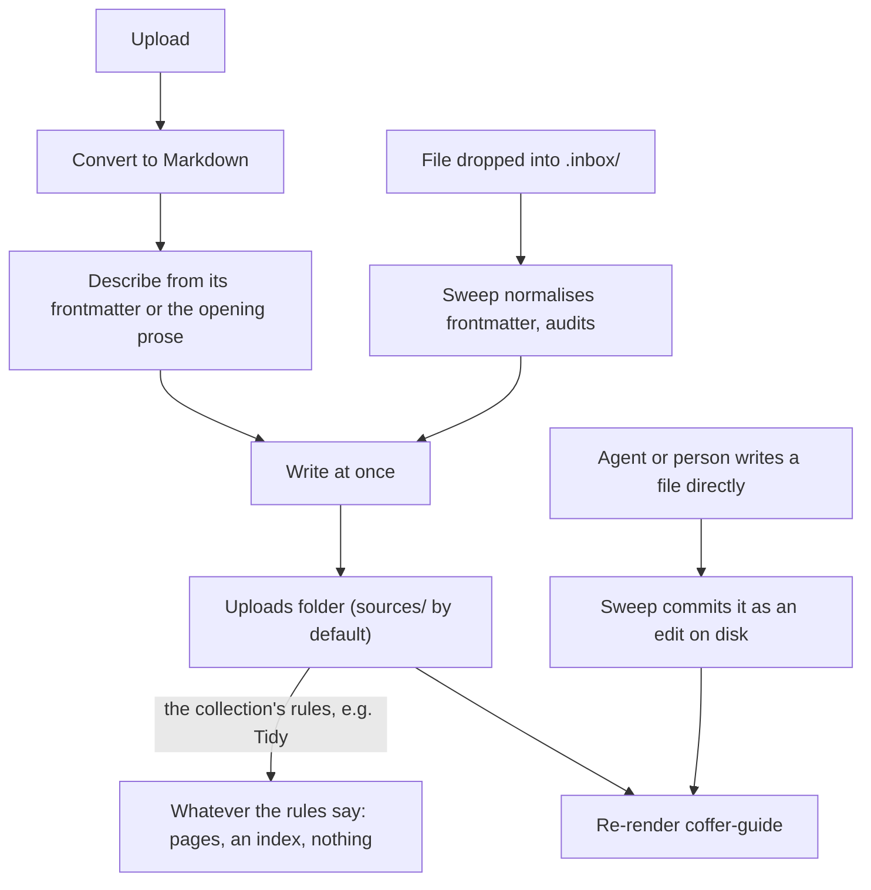
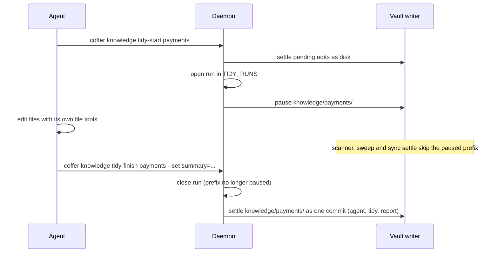
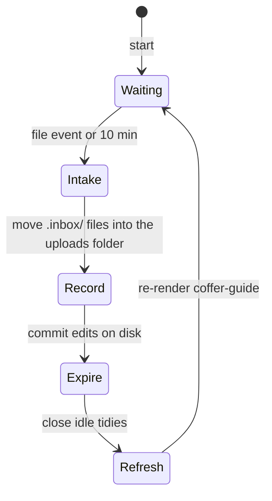

# Knowledge

This page explains how Coffer's knowledge layer is built: why it is plain files with no index, why a collection's format is its own and what little Coffer reads of it, how new material lands in a collection's uploads folder at once, how links resolve and how Coffer reports broken ones, how a collection starts from a template, how an agent writes and tidies by the collection's own rules file, how a tidy becomes one change that can be undone, how every write is kept as a version git can show and an agent can bring back, how the catalogue reaches agents through the `coffer-guide` skill, and how it coexists with vault sync. It is for engineers who want the mechanism and the reasoning. For day-to-day use, see the [Knowledge guide](/guides/knowledge).

## The problem

Knowledge is what a developer has learned about their working environment: which team owns a service, the conventions of a repository, a pitfall and how to avoid it. Several agents need to read it, and people and agents both need to add to it. Four failure modes shaped the design:

- **Copies diverge.** If each agent keeps its own notes, what one learns in the morning is invisible to another in the afternoon.
- **Retrieval tools go unused.** A tool an agent has to remember to call is not retrieval. An audit of 448 Claude Code sessions, taken after a corpus had been built behind a set of knowledge tools and a delivered skill, found that the skill had never been loaded and no knowledge tool had ever been called. Every agent Coffer supports already has `Read` and `Grep`, and uses them constantly.
- **Hand-maintained links rot.** In the same corpus, 343 of 398 internal file references were dead, each one a file name written into prose and broken by a later rename.
- **One format does not fit every collection.** A wiki compiled from kept sources (Karpathy's "LLM Wiki") makes knowledge compound and traceable, and Coffer once fixed that format for every collection: `pages/` and `sources/`, five page types, required frontmatter and eleven computed findings. Real collections then brought schemas of their own (their own page types, a source catalogue, two review intervals), so an agent had two sets of instructions to reconcile, the rules lived in Coffer's code where a collection could not change them, and a linked Obsidian vault was already read by its own `AGENTS.md`. Coffer could not enforce the format anyway: agents write with their own tools, and a "required" key was only ever a finding after the fact.

Knowledge is also distinct from [memory](/architecture/memory). Knowledge is about the world and arrives because someone put it there. It is organised by collection and pulled through a skill. Memory is about the user, how to work with them and their projects' state. It accrues on its own in each agent's native memory, and Coffer syncs it between the agents. What an agent filed in its memory as task notes (how an outside system or team works) belongs here; the person asks an agent to write it into a collection.

## Design decisions

| Decision | Reason |
| --- | --- |
| A collection is one directory tree of Markdown files under `~/.coffer/vault/knowledge/<collection>/`. | Every agent reads the same bytes, so no copy can diverge. An edit made in any editor is live on the next read. |
| A collection's format is its own, written in its own rules file. Coffer gives no folder, page type or frontmatter key a meaning beyond the uploads folder it writes into, and requires no key of any file. | Comparable tools (Obsidian, Logseq, Dendron, Foam, LLM-wiki implementations) keep the format in the vault's own files. A format in Coffer's code was a second set of instructions a collection could not change. See [Knowledge Collections Own Their Format; Coffer Checks Only Links](https://github.com/wyx-sg/Coffer/blob/main/docs/decisions/knowledge-collections-own-their-format.md). |
| The README declares, all optional, what Coffer needs to know: its description (first paragraph), `rules`, `entry` and `uploads`. A linked folder is read by the same declarations. | Four facts are all Coffer needs to hand a collection to an agent and to put an upload somewhere. One reader serves kept and linked collections alike. |
| A new collection is copied from a template once — `llm-wiki` (default) or `blank` — and Coffer never reads the template again. | A copied file is the collection's own, so an upgrade of Coffer never changes a collection's rules under it. The wiki's value survives as a starting point rather than a rule. |
| No index of any kind: no table, no FTS, no vectors, no cache. Links and broken links are rebuilt from the files on every read. | Nothing derived can disagree with the files. There is nothing to rebuild or reconcile. |
| A file's path is where it is; its slug, its file name, is what a `[[link]]` uses. File names may hold any character but `/`, `\`, control characters and a leading dot. | A readable name is what a person sees in a file manager and an agent in a grep result. A file an agent's own tools could write must be readable in the web UI. |
| An upload is kept as its converted Markdown in the uploads folder, an upload with pictures as a folder holding the file and its pictures; the uploaded file itself stays on the Mac that uploaded it, outside the vault. | Diagrams and screenshots carry meaning agents and people need, and once decorations and repeats are dropped they are small; originals are large binaries git would carry forever, and agents read the Markdown no worse. See [Knowledge Sources Keep Their Images; Originals Stay on This Mac](https://github.com/wyx-sg/Coffer/blob/main/docs/decisions/knowledge-sources-keep-their-images-and-originals-stay-on-this-mac.md). |
| Material lands at once. An upload is kept as it arrives, and a file dropped into a hidden `.inbox/` is moved into the uploads folder by the next sweep. | Nothing waits for a model connection or a pass. What was submitted is readable by every agent within the minute. |
| Files link by `[[slug]]` or by relative path, and Coffer resolves every link on read, relative to the file that holds it; an ambiguous slug prefers the linking file's own folder. | A slug survives a move; a relative path is what every Markdown reader and agent already writes. Either way a link that breaks is reported at once instead of rotting silently. See [Knowledge Files Stay Where Their Writer Put Them](https://github.com/wyx-sg/Coffer/blob/main/docs/decisions/knowledge-files-stay-where-their-writer-put-them.md). |
| Coffer reports broken links — dead, ambiguous and outside — and nothing else, and fixes none of them. Files in the uploads folder are not checked. | A broken link depends on no format, so it is the one check worth having in every collection, and nearly every comparable tool reports it. Whether a page is complete, current or well-sourced is judgement, made by the agent by the collection's rules. Imported material keeps its exporter's text, so a `[[` in it is not a link. |
| Coffer runs no model over knowledge. What a tidy checks and fixes, where a fact belongs and which statement is stale are judged by the agent, by the collection's rules file. | The agent a person already uses has file tools, a stronger model and the person watching. A second, unattended model of Coffer's own needed its own connection, and without one its work did not happen. |
| Tidying starts only when a person presses **Tidy** or **Tidy all**. Coffer starts no agent run of its own. | An unattended agent run would spend the person's quota without their knowledge and leave conversations nobody started. |
| A tidy is one commit: while the agent works, the collection is paused in the vault writer, and finishing commits every edit at once with the agent's report. A tidy can be undone as one new commit. | The history itself holds the boundary, so the change log, a file's history and sync see one unit, and undo is the inverse of one commit. A grouping kept anywhere else would be a second record of the history. |
| Coffer moves no file. | A move breaks every relative link to the file. The writer decides where a file lives; Coffer reports what is broken. |
| A Confluence page export becomes a readable Markdown file: macros read for what they show, attachments kept beside it in its own folder, the export kept as the original on this Mac, its metadata in the one frontmatter block, and a report of what was left out. A re-import is explicit and marks the older file `superseded_by` the new one. | A file nobody can read is not knowledge, and a silent loss looks like a clean import. See [Confluence Pages Import as Readable Sources](https://github.com/wyx-sg/Coffer/blob/main/docs/decisions/confluence-pages-import-as-readable-sources.md). |
| Every accepted write is one git commit naming its writer. | Agents rewrite the only copy. A history of who changed what makes every change inspectable and every version one `git` or one hand-off to an agent away, and it is the collection's change log. |
| No retrieval tool. The catalogue rides in Coffer's own skill, which names each collection's rules file and start page and teaches no format. | Agents read files with the tools they already use. The layer's job is to put the right absolute paths in front of the model, and the collection's rules in front of its writes. |
| Agents add knowledge by writing a collection's files with their own file tools. No agent-facing tool: Coffer's only always-listed built-in MCP tool is `coffer__search_tools`. | Agents already write files. The rules file tells them where, and the sweep commits what they changed. |
| No gate per collection: no per-agent reach and no enabled switch. Every collection is served to every agent. | The skill hands every agent the whole knowledge root. A per-agent filter or a switched-off collection would narrow a list while still disclosing the root. |

## The collection tree

```text
~/.coffer/vault/knowledge/             # inside the vault repository
├── payments/                        # one collection = one knowledge Resource (started from llm-wiki)
│   ├── README.md                    # first paragraph is the description; frontmatter declares rules, entry, uploads
│   ├── AGENTS.md                    # its rules file, copied from the template and now its own
│   ├── index.md                     # its start page
│   ├── pages/
│   │   ├── session-ownership.md
│   │   └── infra/
│   │       └── cache.md
│   ├── sources/                     # its uploads folder (the default)
│   │   ├── notes.md                 # an upload without pictures: converted Markdown + frontmatter
│   │   ├── q3-review/               # an upload with pictures: one folder, named by its title slug
│   │   │   ├── q3-review.md         # the upload, named like its folder
│   │   │   └── image-1.png          # linked from it as image-1.png
│   │   └── account-core/            # an imported Confluence page and its attachments
│   └── .inbox/                      # drop zone, moved into the uploads folder by the sweep (hidden)
│       └── rate-limit-change.md
└── personal/                        # started blank: a README and whatever its writers add
    └── ...
```

- **A collection** is a top-level directory and one resource of kind `knowledge`, filed as `vault/resources/knowledge/<name>.json`. A person creates it deliberately, in the web UI or with `coffer knowledge create`. Reads, writes, files an agent drops elsewhere and working directories never provision one, and nothing derives a boundary from an agent's cwd. The knowledge layer adds no table anywhere.
- **The README** sits at the collection root. Its first paragraph before its first `##` section is the collection's description. It is read from disk on every listing and never copied into the resource file, because a copy would be wrong the first time a person edited the README. It is not counted among the collection's files. A collection has no title of its own: every surface shows it by its folder name, and the resource update refuses a title. Editing the description in the web UI rewrites exactly that first paragraph, or inserts it above the first section when there is none, and leaves the rest of the README alone, as one commit naming the user; the guide skill is re-rendered afterwards, because the description is how an agent recognises the collection.
- **Everything else is the collection's own.** Coffer gives no folder a meaning except the uploads folder it writes uploads into, and no file a kind: every visible Markdown file is listed, counted, catalogued and link-checked alike, and none is asked for a key. Coffer never moves a file.
- **An upload with pictures is a folder** in the uploads folder, holding the converted file and its pictures or attachments side by side (see [Pictures and originals](#pictures-and-originals) and [Confluence pages](#confluence-pages)), so it moves, renames and deletes as a whole. It is visible on purpose: the vault ignores hidden entries, and the pictures must be committed and synced with the file that links them.
- **Hidden entries** (dot-prefixed) are excluded from every count, from the catalogue and from the check, and no surface lists or reads one. Inside a collection the one Coffer reads is `.inbox/`, a drop zone: a Markdown file left there is moved into the uploads folder by the next sweep. The vault repository's `.git/info/exclude` ignores every other hidden entry inside a collection, so it is neither committed nor synced. That includes `.obsidian/`, so a collection folder opened as an Obsidian vault keeps Obsidian's settings out of the history (see [Opening a collection in Obsidian](#opening-a-collection-in-obsidian)).

### What a collection declares {#what-a-collection-declares}

`infrastructure/knowledge/collection_settings.py` reads a collection's README frontmatter on every call and resolves three keys against its files, every one optional:

| Key | Resolves to | Fallback |
| --- | --- | --- |
| `rules` | A collection-relative path of a file that exists, not hidden. It may climb into another collection (`../shared/rules.md`): the bound is the knowledge root for a kept collection, the folder itself for a linked one. | The first of `AGENTS.md`, `CLAUDE.md` and `README.md` at the root; empty when none exists. |
| `entry` | The same, for the page to start reading at. | Empty: the catalogue lists the collection's files instead. |
| `uploads` | A plain folder inside the collection; not absolute, not hidden, not `..`. | `sources`. |

A declaration that does not resolve is ignored rather than refused, so a typo in a README never breaks a read. The listing carries `rules_file`, `entry_file` and `uploads_dir`, the web UI shows the first two as links on the collection's page, and the guide names them in each collection's catalogue entry. No other key, in the README or anywhere else, means anything to Coffer: a collection made before collections set their own format keeps its `type`, `sources` and `verified` keys as its own. See [Knowledge Collections Own Their Format; Coffer Checks Only Links](https://github.com/wyx-sg/Coffer/blob/main/docs/decisions/knowledge-collections-own-their-format.md).

### Templates {#templates}

`POST /api/v1/knowledge/collections` takes `template`, `llm-wiki` by default or `blank`; any other value is a 422. `application/knowledge/templates.py` copies the template's files from `skill_assets/templates/<name>/` into the new folder in the commit that creates the collection, filling `{name}` and `{description}` into the README. `llm-wiki` writes a README declaring `rules: AGENTS.md` and `entry: index.md`, an `AGENTS.md` holding the wiki's rules (layout, page types, a 90-day check interval, writing a page, integrating sources, what a tidy checks), and an empty `index.md`. `blank` writes the README only. Coffer reads no template again, so changing one in a later release leaves existing collections alone.

### Path and slug

A file's path is its identity; frontmatter carries no `id` key, and nothing maps ids to paths. Its **slug** is its file name without `.md`, the name a `[[link]]` uses (see [Links and broken links](#links-and-broken-links)). A file Coffer writes is named by its title's slug: NFKC-normalised and lower-cased, CJK kept, capped at 80 characters, with `-2`, `-3` and so on on a collision. A file someone else writes may be named anything a path segment allows.

### Frontmatter

Coffer requires none and reads two keys of any file, only to show it: `title` (else the first `# ` heading, else the file name; `collection_settings.title_of`) and `aliases`, extra names a `[[link]]` may use, as Obsidian reads it. A file's `description` is shown in the catalogue when it has one.

A file Coffer writes into the uploads folder:

```yaml
---
title: Q3 review
description: The quarterly review of the payments gateway.
actor: user
created_at: '2026-10-01T09:00:00.000+00:00'
updated_at: '2026-10-01T09:00:00.000+00:00'
original: q3-review.pdf     # the uploaded file, kept on the Mac that uploaded it
original_sha256: 1a2b3c4d…  # names that copy
---
```

An imported Confluence page:

```yaml
---
title: Account Core
description: …
origin:
  system: confluence
  url: https://confluence.example/pages/viewpage.action?pageId=42
  page_id: '42'
  space: ACC
  version: 7
  fetched_at: '2026-10-13T08:00:00+00:00'
  format: confluence-storage
import_report:
  body: partial             # or converted
  complete: false
  attachments_kept: 5
  missing: ['gone.png: not downloaded with the page']
  unsupported: ['jira: a Jira issue list']
actor: user
original: account-core.json
original_sha256: 9f86d0…
---
```

Coffer writes those keys in a fixed order: `title`, `description`, `actor` (`agent` or `user`), `created_at` and `updated_at`, then `original` and `original_sha256` on a file converted from an upload; any frontmatter the upload itself carried (an imported page's `origin`, `import_report`, or keys of the exporting tool) follows in the same block, never as a second block in the body. A re-import adds `superseded_by` to the older file. Any other key a person or an agent added is kept, with its parsed value unchanged, whenever Coffer rewrites a file. This matters because dropping an unknown key would quietly delete a person's `tags:`.

Frontmatter parsing degrades rather than raising: a file with no fence, or with malformed YAML inside one, yields empty frontmatter and its body, so one hand-edited file with a stray colon cannot break a whole collection walk.

### One module owns every path

One module in the knowledge infrastructure (`infrastructure/knowledge/paths.py`) builds every path and names the uploads folder; nothing else constructs one. Every segment passes a guard that refuses empty, all-dot and dot-prefixed segments and any `/`, `\` or control character, so `payments/.inbox/x.md` is not addressable from any surface while `Login (v2).md` is. The resolved path is also checked against the knowledge root on its nearest existing ancestor, so a symlinked directory inside the root cannot carry a write out of it. Writes go through a sibling temp file opened with `O_EXCL | O_NOFOLLOW`, followed by one atomic rename, and are committed through the vault's one writer. The root is always `~/.coffer/vault/knowledge`; there is no override.

## From material to the uploads folder

Every entrance Coffer serves ends in a Markdown file in the collection's uploads folder. None of them waits. Everything else in a collection is written by people and agents, not by Coffer.

| Entrance | Surface | Ends in |
| --- | --- | --- |
| Upload, converted to Markdown first | The Knowledge page, `coffer knowledge upload` | A Markdown file in the uploads folder (a folder with its pictures, when it has any), and the original on this Mac |
| A Confluence page export (JSON) | The Knowledge page, `coffer knowledge upload` | A readable Markdown file in a folder with its attachments, and an import report |
| A Markdown file dropped into `<collection>/.inbox/` | An agent outside Coffer, another machine, or an older guide; the sweep adopts it | A Markdown file in the uploads folder |
| A file written straight into the collection | An agent's own file tools, or a person's editor | That file, committed as an edit on disk |

The web UI has no form for typing a file in: a person writes in their own editor or uploads. The web UI shows every file read-only and opens it in the editor.



### Submission

An upload checks that the collection exists, then writes one file into the collection's uploads folder. Its body is the converted text as it stands. Its frontmatter is filled from the text: `title` from the first `# ` heading (else the file name), `description` from the first prose paragraph (else the title), and `actor` for whoever submitted it. It is named by its title's slug and never overwrites an existing file, because two submissions with the same title are two files. The commit names whoever submitted it, and one `knowledge_written` audit event is recorded. Coffer then announces the collection on the daemon's event stream as a `knowledge` event, because files change without any write to the collection's row.

What happens to it next is the collection's rules. In an `llm-wiki` collection it is a source waiting to be compiled into pages, which the agent does when the person presses **Tidy** (see [Tidying is the agent's job](#tidying-is-the-agent-s-job)).

The answer to an upload carries the new file's path.

### A file dropped into the inbox

A file can arrive at `<collection>/.inbox/<any-name>.md`, from an agent outside Coffer, from another machine's older build, or from an older guide. The sweep recognises a new inbox file that no Coffer surface wrote and **normalises** it, then moves it into the uploads folder by the same operation a submission uses:

- `title` is kept, else the first `# ` heading, else the file name's stem.
- `description` is kept, else the first prose paragraph, else the title, the same fallback an upload uses.
- `actor` is kept as written, because it is self-reported, else `agent`.
- `created_at` and `updated_at` are kept, else the time the sweep saw the file.
- Every other key the writer set is kept.

One `knowledge_written` audit event is recorded per file, marked when the actor came from the file. A Markdown file in a top-level directory that is not a collection is left alone and never catalogued, because only a person creates a collection. A non-Markdown file in an inbox is left in place, logged, and not moved.

### Uploads

An upload goes through four steps, in order:

1. **Bounds the upload.** It takes one file per call, up to 20 MiB, and no folder. It refuses unknown collections before paying for conversion.
2. **Converts it.** A converter registry first asks each converter whether it claims the content (the Confluence converter claims a `.json` file that reads as a page export), then dispatches by extension. Passthrough (Markdown, text and source files) runs first, then CSV, then MarkItDown for everything else, which also takes the pictures out (see [Pictures and originals](#pictures-and-originals)). An unsupported type is refused with `INGEST_REJECTED` and `reason: unsupported_type`. A conversion that yields no text, such as an image-only PDF, is refused too. Nothing is written in either case: no file, no picture, no original and no inbox file.
3. **Describes it.** The description is the upload's own frontmatter `description` or `summary`, else the converted text's first prose paragraph, and failing that its title. It is never empty. No model writes it.
4. **Writes the Markdown** with `actor: user` as `<uploads folder>/<slug>.md`, or as `<uploads folder>/<slug>/<slug>.md` with its pictures beside it in the same commit when it has any, and `original` and `original_sha256` in its frontmatter unless the passthrough converter ran. A collision suffixes the file's name (`-2`). Once the file is committed, the uploaded bytes are kept on this Mac; failing to keep them is logged and loses only the local copy.

A Confluence page whose page id (from `origin.page_id`, or the `pageId` of its URL, in its outer or an older inner frontmatter) is already in the collection's uploads folder and not superseded is refused with `409 KNOWLEDGE_SOURCE_EXISTS` before anything is written. `preview=true` runs the conversion and returns the title, the files and the report without writing; `replace=true` writes the new file and, in the same commit, sets the older one's `superseded_by` to it.

The 20 MiB ceiling stays.

### Confluence pages {#confluence-pages}

`infrastructure/knowledge/converters/confluence/` reads a page export (`page.read`: storage, title, page id, version, space, URL, and attachments carried as base64) and converts the storage with BeautifulSoup before markdownify. `macros.py` rewrites each `ac:structured-macro` as plain HTML for what a reader sees: arranging macros give their body back, panels become a labelled quote, `code`/`noformat` keep their text and language, an attached draw.io diagram shows its picture and one drawn in the page becomes a viewer link, PlantUML shows its source as a code block, generated content (`toc`, `children`) is dropped and recorded, and an unknown macro keeps its body or is recorded unsupported. `storage.py` turns `ac:image`, `ac:link` and `ri:attachment` into links under the page's folder, and keeps a table with merged cells as HTML. Every outcome lands on a `Context` and becomes the `ImportReport`: the body `converted` or `partial`, then attachments and macros as separate lists of kept, converted, dropped, missing and unsupported items with reasons.

The page's files go beside the file in its own folder, named by the page's title, and are linked by name; a re-import gets a folder of its own (`-2`), so a newer version never overwrites an older one's files. The export itself is the converted file's original, kept on this Mac like any upload's (`originals.keep`), never in the vault. A draw.io diagram drawn in the page becomes a viewer link (`diagrams.viewer_link`) carrying the diagram in its `#R` fragment, as draw.io's own link export does; a viewer link the page had stays as it was. Coffer keeps no diagram file of its own, renders nothing and sends nothing to an outside service: a browser never sends a fragment to the server.

A file written before this converter may still carry an exporter's comment markers and a second frontmatter block in its body. Coffer does not rewrite it: `source_view.readable_body` strips the inner block and expands the markers for the read (`readable_body` on `GET /api/v1/knowledge/file`), and `source_view.origin` reads where it came from out of either block. The reader shows `readable_body` with a note that it is a converted view.

### Pictures and originals {#pictures-and-originals}

**Pictures.** `infrastructure/knowledge/converters/images.py` takes them out. MarkItDown runs with `keep_data_uris`, so an Office or HTML document's pictures arrive inlined as `data:` URIs; each is decoded and replaced by a bare name (`image-1.png`). A PDF's text layer carries no pictures, so pdfminer reads the images on each page and they are listed after the text under `## Images`, one `Page N:` heading per page. What is kept is bounded: a picture under 48 px on a side is a decoration and is dropped with nothing left of it, one over 5 MB is dropped, a repeat (the same bytes, a logo on every slide) is kept once and every place it appeared links that one file, an upload keeps at most 40, and a format a browser cannot show is re-encoded as PNG through Pillow. An unreadable picture is skipped; an image-only PDF is still refused, because there is no text.

`infrastructure/knowledge/assets.py` names the upload's folder before the file is written, its title slug (`-2`, `-3` … when taken); the file inside is named like the folder, so two imports of one page never share a slug. The Markdown keeps linking each picture by its bare name, `image-N.ext`, which resolves beside it wherever the folder goes. The pictures are written in the same vault transaction as the file, so the file and its pictures are one commit, one change in the feed and one Undo. Deleting the file leaves its folder; nothing cleans up orphan pictures.

`GET /api/v1/knowledge/asset?path=` serves a picture's bytes with its media type for `png`, `jpg`, `jpeg`, `gif`, `webp` and `svg`, up to 10 MB, resolved through the same path guard as a read and, for a linked folder, through its own guard. Anything else is `404 KNOWLEDGE_FILE_NOT_FOUND`. The web UI's reader resolves each relative image link in a Markdown document against the document's path, fetches it through this route (which needs the daemon's token, so the browser cannot load it as a plain URL) and shows it as a data URL; a picture opened from the tree is shown the same way. The route reads a plain file, so it has no command.

**Originals.** `infrastructure/knowledge/originals.py` keeps the uploaded bytes at `~/.coffer/local/knowledge-originals/<sha256><.ext>`, mode `0600`, written once per content through a temp file and a rename. It is in the machine-local class, so it is never committed or synced. A read resolves `original_path` from the file's `original` and `original_sha256`: the absolute path when the copy is here, `null` when the file came from another Mac. `GET /api/v1/knowledge/file` carries both `original` and `original_path`. The web UI shows **Original `<name>`** under the file's title, the name a button that asks the daemon to open the file with the default app (`POST /api/v1/fs/open`); with no local copy it shows that the original is on the Mac it was uploaded from. A Markdown or text upload keeps no original. Nothing deletes an original when its file goes, so a file brought back by Undo finds it again.

`markitdown` is imported lazily. An import-linter contract confines it to the knowledge converters and the channel's document extraction.

### Direct edits

Writing, editing or deleting a file directly, in your editor or with an agent's own file tools, is a complete way to change knowledge. No import or registration step is needed, and the change is live on the next read. The sweep commits it as an edit on disk (see [History](#history)). Deleting a file through Coffer is a person's action in the web UI. Coffer offers no tool that deletes anything.

The web UI does not edit files: a file's pane is read-only (Preview and Source) with **Open in editor** and **Reveal in Finder**, so there is no save route, no file fingerprint and no stale-save refusal. Coffer's route table has nothing that writes a file's text.

## Links and broken links {#links-and-broken-links}

`infrastructure/knowledge/link_graph.py` walks one collection once and builds an in-memory `LinkGraph`: every visible Markdown file with its links, and the names a `[[link]]` may use for it (its slug and its frontmatter `aliases`). Nothing is stored; every read builds it again. A collection is hundreds of files at most, and a walk takes milliseconds.

### Links

A link is `[[target]]` or `[[target|text]]`, or a standard Markdown link, picture or reference definition naming a file (`infrastructure/knowledge/links.py`), anywhere in a Markdown file's body outside code spans and fenced blocks, so a link written as an example is not a link. A relative link is read against the file that holds it (a leading `/` against the collection's folder, as Obsidian reads one from its vault), and may name a file in another collection; one that climbs out of the knowledge root is **outside**, and one naming no file, or a hidden one, is **dead**. Web links (any scheme) are not checked. `target` resolves against every file's slug and `aliases`. Matching ignores case and Unicode width, the same NFKC normalisation file names get, and tolerates a trailing `.md` or a leading folder, so a link written as a path still resolves. A target that names nothing is **dead**. One that names more than one file resolves to the one in the linking file's own folder, the way a reader means the neighbour; with none there it is **ambiguous**.

A file's read (`infrastructure/knowledge/file_links.py`) carries each link with its `kind` (`wiki` or `path`), the path it resolves to, or none, and whether it is `outside` or `ambiguous`, so the web UI opens a link where it points and marks a dead one. A file in the uploads folder carries no `wiki` links: its `[[` is text as the exporter wrote it.

### The check

From the graph Coffer computes a collection's broken links on every read, keeps none of them and fixes none of them:

| Finding | Rule |
| --- | --- |
| `dead_link` | A link that resolves to nothing, with the file and the target. |
| `ambiguous_link` | A `[[link]]` that resolves to more than one file, none in the linking file's folder. `others` holds the candidates. |
| `outside_link` | A relative link that climbs out of the knowledge root. |

Every Markdown file is checked, the README and the rules file included, except the files under the uploads folder: imported material keeps its exporter's links as its record. Nothing else is a finding. Whether a file is complete, current, well-sourced or in the right folder is for the collection's rules to say and the agent to judge.

`GET /api/v1/knowledge/collections/{uid}/check` returns the collection and its broken links, and `coffer knowledge check` prints them. The collection listing carries `note_count` (its Markdown files, the README left out), `finding_count`, `rules_file`, `entry_file`, `uploads_dir`, the tidy hand-off and `tidy_running`, computed per collection with one walk each. No route fixes a finding.

`GET /api/v1/knowledge/collections/{uid}/files` (`coffer knowledge files`) returns every Markdown file of one collection with its title, description, writer and time, from the same walk the tree uses: the titles the Broken links and Change log sections show. It is a separate route so the listing stays cheap.

## Tidying is the agent's job

Deciding what a tidy checks, putting a fact where it belongs, folding files that answer the same question into one, and correcting what is wrong are judgements, made by the collection's rules. Coffer makes none of them. The agent the person already works with has file tools and the person watching, so it reads the collection's rules file, and the person starts it with one button. See the decisions [Tidying Knowledge Is the Agent's Job, One Hand-Off Recorded as One Change](https://github.com/wyx-sg/Coffer/blob/main/docs/decisions/tidying-knowledge-is-the-agents-job.md) and [Knowledge Collections Own Their Format; Coffer Checks Only Links](https://github.com/wyx-sg/Coffer/blob/main/docs/decisions/knowledge-collections-own-their-format.md).

### What the guide teaches

While the knowledge feature is on, the guide's knowledge section teaches no format. It says that each collection sets its own in its rules file, and carries four instructions:

- **Before writing in a collection, read its rules file and follow it**; it wins over anything the agent would do by default. A collection with none is written the way its existing files are written.
- **Read from its start page** when it names one; otherwise the catalogue lists its files.
- **Write back what it works out**: an answer found by reading the code, a system or a document, which the collection does not already give, goes where its rules say, with one line telling the person what was added. Not a guess, an opinion or something true only of that conversation.
- **Tidying a collection**: one collection at a time, run `coffer knowledge tidy-start <collection>`; read the rules file and tidy by it; fix every broken link `coffer knowledge check` lists; leave alone what it is not sure about (two files that disagree with nothing to tell which is right, a deletion of much text, a change to the rules file) and list it in the report; then run `coffer knowledge tidy-finish <collection> --set summary="<report>"`, the report ending with **Gaps**. Asked only for a check or a review, the agent reports and changes nothing.

It also states what Coffer does with every collection, whatever its format: keeps its history, reports broken links, writes uploads into the uploads folder with the keys Coffer owns, and nothing else.

Code enforces none of a collection's rules. They are prose in the collection's own file, and the guard against a bad edit is the history and the link check, not a refusal at a write. The `llm-wiki` template's `AGENTS.md` carries what used to be Coffer's own rules: pages under `pages/`, one subject each; sources kept and never edited beyond `ingest: skipped`, `superseded_by` and `summary`; frontmatter with `title`, `type`, `description`, `sources`, `aliases` and `verified`; integrating waiting sources; and a tidy that integrates, rechecks pages past the interval, completes incomplete pages, merges, splits and keeps `index.md` current.

### The Tidy hand-off

The daemon writes the prompt, from the same hand-off module every other hand-off uses (`application/knowledge/tidy_handoff.py`, rendered by `domain/handoff`). Reading a collection carries `tidy_handoff`, which names the collection, gives its absolute path, its rules file, its Markdown file count and its broken links with their paths (at most 40 lines, then how many were left out), and lists the steps: `tidy-start`, tidy by the rules file and fix the broken links, leave what is uncertain to the report, `tidy-finish` with a report that ends with the gaps. `GET /api/v1/knowledge/tidy-handoff` returns the same kind of prompt for every collection at once: it names the knowledge root and each collection with its path, file count and broken-link count, asks the agent to work through them one at a time by the same steps, and tells it to read each collection's broken links with `coffer knowledge check <collection>`.

The web UI offers **Tidy** on a collection's page and **Tidy all** in the Knowledge page's header. Pressing either starts the default hand-off agent in the preferred terminal with that prompt as its first message, through the same path as every other hand-off. With no managed agent available the button offers **Copy prompt** only. The person pressed a button named for the job, the prompt only edits Coffer's own files, and the tidy can be undone as a whole.

There is no second, report-only hand-off. A check that changed nothing duplicated Tidy's own steps; a person who wants a review asks for one in the session Tidy opened, and the guide tells the agent to change nothing then.

### A tidy is one change

The agent edits files with its own tools, and an edit found on disk is normally committed as a `disk` write once it is quiet. A tidy would then be a run of `disk` commits with no boundary and no report. Instead, the agent brackets its work with two commands the prompt names:



- **Start** (`POST /api/v1/knowledge/collections/{uid}/tidy/start`) first commits whatever already changed in the collection as `disk`, so the tidy holds only the agent's work, then opens a run in `TIDY_RUNS` (`infrastructure/knowledge/tidy_runs.py`). Starting an open tidy again keeps it.
- **While open**, `VaultWriter.set_paused` gives the writer the collection's path prefix, read from the registry on every call. `pending()` and `settle()` skip paused paths, so neither the vault's scanner, the sweep, another Coffer write nor a sync round commits them. A sync round whose incoming changes touch a paused file waits, as it does for any uncommitted edit. Reads see the files as they are on disk.
- **Finish** (`POST .../tidy/finish`, body `{summary}`) closes the run and then settles the collection's pending paths as one commit: writer `agent`, operation `tidy`, the report (whitespace folded, cut at 4,000 characters) as its summary, `Coffer-Status: reported`. It answers the change, or `change: null` when nothing changed. Finishing with no tidy open still commits the collection's pending edits as a tidy.
- **Idle expiry.** Each run keeps a fingerprint — the collection's pending paths and their digests. On every tick the sweep compares it; a change resets the run's idle clock, and a run idle for 30 minutes is closed with no report and `Coffer-Status: expired`. So no collection stays paused because an agent stopped.
- **Memory only.** The registry is bookkeeping about a session in progress, not knowledge, so it is neither stored nor synced. A daemon restart forgets an open run; the next settle commits its edits as ordinary `disk` writes, losing only the grouping.

The collection read carries `tidy_running`, and the collection page says a tidy is in progress. Start and finish are each audited as `knowledge_edited` (`tidy: started`, `tidy: finished` with the version and file count). The decision and the alternatives — trailers on each disk commit grouped at read time, grouping by time in the UI, a separate store of runs — are in [Tidying Knowledge Is the Agent's Job, One Hand-Off Recorded as One Change](https://github.com/wyx-sg/Coffer/blob/main/docs/decisions/tidying-knowledge-is-the-agents-job.md).

### Undoing a tidy

`POST /api/v1/knowledge/changes/{version}/undo` (`coffer knowledge undo`, body `{force}`) puts every knowledge file the change touched back as it was just before it (`collection_writes.undo_change`). For each path it reads three versions: the bytes at the change, the bytes on disk now and the bytes at the change's parent. If now differs from the change for any path, a later edit exists, and the undo is refused with `409 KNOWLEDGE_UNDO_CONFLICT` whose `details.documents` lists those paths, writing nothing, unless `force` is set. Otherwise each path gets its parent's bytes, or is removed when it did not exist before, all in one recording transaction: one commit by the user, operation `restore`, `Coffer-Undoes: <version>`. A version that touched no knowledge file, or whose files already match their parent, is refused with `400 KNOWLEDGE_NOT_A_CHANGE`. The undo is audited as `knowledge_edited` with `undoes`, the paths and the later edits it discarded. The tidy stays in the history before its undo; discarded edits stay in it too.

The route works on any change that touched knowledge files; the web UI offers it as **Undo this tidy…** on a tidy's Change log entry, and the confirmation lists the files edited since by title before it sends `force`.

### Nothing tidies unattended

Tidy runs only when a person presses it or asks their own agent. Scheduling agent runs would spend the person's quota without their knowledge, and would leave conversations nobody started. The mechanical sweep and the mechanical check stay Coffer's; judgement does not.

### Precedence

Which statement wins when two disagree is a collection's rule, not Coffer's. The `llm-wiki` template's rules say the newer statement wins unless the older one is shown to be right by a source, a date, a command's output or the code, that the superseded statement stays legible with the date it changed, and that no writer is exempt. A collection may say otherwise.

What protects the data is mechanical. Coffer saves no text of a person's on the page, so a stale copy in the browser cannot revert an agent's edit. A rewrite that Coffer itself makes keeps every frontmatter key it did not set. Every agent edit is a version in the history, and a version can be restored from the file's history.

## Opening a collection in Obsidian

A collection's layout is what Obsidian reads natively: plain Markdown, `[[slug]]` links that resolve by file name, and `aliases` frontmatter. Obsidian is in the daemon's list of detected editors (`application/fs/editor_service.py`), and the web UI offers **Open in Obsidian** in a collection's and a file's ⋯ menu only when `GET /api/v1/fs/editors` lists it, opening the path with it through `POST /api/v1/fs/open`. Obsidian keeps its settings in `.obsidian/`, a hidden entry the vault ignores. An Obsidian save is an edit on disk like any editor's, and Obsidian's relative-path links are followed and checked like `[[slug]]`. A note Obsidian creates outside `pages/` stays where it is, so the guide tells people to point Obsidian's default location for new notes at `pages/`.

## Linked folders

A **linked folder** is a collection the person keeps with their own tools anywhere on this machine, an Obsidian vault say, which Coffer only shares with agents. It is the same `knowledge` kind with a different config, and it has none of a collection's machinery: no tree under the knowledge root, no uploads folder, no history, no sweep, no check and no tidy. It is read by the same declarations as a kept collection (see [What a collection declares](#what-a-collection-declares)). The reasoning is in [A Linked Knowledge Folder Is Shared in Place, Read-Only to Coffer, and Recorded Machine-Local](https://github.com/wyx-sg/Coffer/blob/main/docs/decisions/linked-knowledge-folders-are-read-only-and-machine-local.md).

### The machine-local row

`POST /api/v1/knowledge/collections/link` (`application/knowledge/linking.py`, `coffer knowledge link`) checks the folder and registers one resource whose config is `{"folder": "<absolute path>"}`. `KnowledgeConfig` has that one optional field; a collection Coffer keeps leaves it unset and stays `{}` on disk. The kind's `storage_row` hook (`application/knowledge/kind.py`) files a row that names a folder in the `local` class, so the file is `~/.coffer/local/resources/knowledge/<name>.json`, with the home written as `${HOME}`, and is never committed or synced; agents and channels are kept machine-local the same way. The name defaults to the folder's own and is only a label: `on_rename` does nothing for a linked folder, and `on_delete` skips the directory cleanup and only re-renders the guide, so Disconnect leaves every file where it is.

### The read path

`infrastructure/knowledge/linked.py` is the only code that touches a linked folder, and it only reads. It has its own path guard, because the folder lies outside the root that `paths.py` guards and a person's own file names may hold characters `paths.py` refuses: it rejects a hidden segment, a backslash or NUL, and any path that resolves outside the folder, a symlink pointing out of it included. Surfaces still address a linked folder name-first, `<name>/<path inside the folder>`, so the tree and file routes serve it unchanged; `KnowledgeService.find_collection` sends the read to `linked.py` when the row names a folder. A walk skips hidden directories, `node_modules` and `__pycache__`, and stops at 5000 Markdown files; a file over 2 MB is listed but its body is not read. A note's title is its frontmatter `title`, else its first `# ` heading, else its file name. The collection list carries `linked`, `note_count`, `rules_file` and `entry_file` (resolved by `collection_settings.read` with the folder itself as the bound, so a `rules` declaration cannot reach out of it) and the description from the folder's own `README.md`; a folder that has gone missing lists with no notes.

### In the guide

`guide_render.py` gives a linked folder a section of its own in the `coffer-guide` catalogue, after the collections Coffer keeps: `### <name> (linked folder)`, its README description, its path with the home written as `~` (which keeps the render byte-identical across machines), the same line every collection gets naming its rules file and start page, and that it is not to be tidied, uploaded into or given inbox files; then, like any collection, its note count when it names a start page and its notes by folder otherwise. The guide's manual has a paragraph saying the same in general terms, and the skill's description names the folder's subject when it has notes.

### What is refused

`KnowledgeService.collection_rows()` returns only the collections Coffer keeps, so the sweep, Tidy all and the history never see a linked folder. Every write, tidy, check and description edit asks `owned_collection(uid)` or `require_collection(relpath)`, which raise `CollectionIsLinked`, answered as `409 KNOWLEDGE_COLLECTION_LINKED`; upload and file delete reach the same refusal. Linking a folder that does not exist, a relative path, or Coffer's own home or a folder holding it (the home folder, the disk root) is `400 KNOWLEDGE_FOLDER_REFUSED`; a taken name, or a folder already linked, is `409 KNOWLEDGE_COLLECTION_EXISTS`.

## The sweep

The sweep is a background worker in the daemon on the shared wakeable loop, and it calls no model. It runs when a file under `knowledge/` changes (it borrows the vault scanner's file watch, and a burst of events is one run), when the `knowledge` feature is switched on, and otherwise every 10 minutes. An inbox file still inside its quiet minute brings one more run once that minute is over, because no file event announces it.



On each run the worker does exactly four things:

1. **Adopts `.inbox/` files.** Each new Markdown file in a collection's inbox is normalised and moved into the uploads folder (see [A file dropped into the inbox](#a-file-dropped-into-the-inbox)). Whatever it promotes, it announces as a `knowledge` event.
2. **Commits edits on disk.** Anything changed in the tree since the last commit, such as a person's editor or an agent's file tools, is committed as an edit on disk through the vault writer, so the history stays current and nothing an agent wrote is counted as Coffer's. A collection with an open tidy is paused and left alone (see [A tidy is one change](#a-tidy-is-one-change)).
3. **Closes idle tidies.** A tidy whose collection has not changed for 30 minutes is committed, at the first run after that, as one change with no report and status `expired`.
4. **Re-renders the guide skill**, so a file added by hand is catalogued. A render that produces the same bytes writes nothing.

A failed duty is logged and never ends the loop. The sweep moves no file: where a file lives is its writer's choice (see [Knowledge Files Stay Where Their Writer Put Them](https://github.com/wyx-sg/Coffer/blob/main/docs/decisions/knowledge-files-stay-where-their-writer-put-them.md)). While the `knowledge` feature is switched off the sweep skips its rounds, and the collections stay on disk untouched. Shutdown cancels the task without waiting.

The sweep runs on every machine. It writes only what it promotes and the edits it records, and those writes go through the vault's ordinary writer like any other, so it holds nothing against a [vault sync](/architecture/vault-sync) round and waits for none. Because it rewrites the content of no file, two machines sweeping the same vault cannot fold the same item into two different pages.

## History

Every accepted write to a collection is one git commit naming its **writer**, following the decision that every vault write is a validated commit naming its writer. A file's history is therefore a list of versions, each with a writer, a time and a diff, read with git, and any version can be brought back. A collection's history is its change log; there is no `log.md` to keep.

### Writers

| Writer | What it covers |
| --- | --- |
| `user` | A person's upload, delete, undo of a delete or undo of a tidy, a collection's description edit, and collection create, rename and remove. |
| `agent` | A tidy (operation `tidy`, the agent's report as its summary), and an agent's submission promoted on arrival, naming the agent, such as a file it dropped into the inbox. |
| `daemon` | A commit an earlier version of Coffer made when its sweep filed loose documents into `pages/` (operation `layout`). It stays in the history; the web UI shows it as **Coffer**. |
| `curation` | A commit an earlier version of Coffer made as a curation pass. It stays in the history under this label. |
| `sync` | Paths that vault sync applied. |
| `disk` | Anything else found changed in the tree: a person's own editor, an agent's own file tools. |

Changes made outside Coffer are never counted as Coffer's. The vault's scanner commits whatever a person or an agent's own tools changed as **Edited on disk** once the file has been quiet, and it does the same at every sweep tick and before every read of the changes feed, except in a collection paused by an open tidy.

### Where it lives

The history is the vault repository's own: collections sit under `knowledge/` in `~/.coffer/vault`, so a file's history is that file's history in the one repository, read with `git -C ~/.coffer/vault log -p -- knowledge/<collection>/<path>`. Coffer's knowledge routes read it for the changes feed (`GET /api/v1/knowledge/changes`, filterable to one collection), which a collection page's **Change log** lists and a delete's undo reads. The Change log shows a tidy as one entry with its report, and groups `disk` changes that follow each other within 10 minutes into one entry for reading; that grouping is the page's, and nothing in the history changes.

Knowledge commits carry the vault's trailers plus the knowledge ones (`Coffer-Writer`, `Coffer-Operation`, `Coffer-Actor`, `Coffer-Agent`, `Coffer-Collection`, `Coffer-Item`, `Coffer-Status`, `Coffer-Restored-From`, `Coffer-Undoes`); a tidy's `Coffer-Status` is `reported` or `expired`. Git runs with the user's global and system configuration pinned to `/dev/null`, so a personal hook, signing rule or alias cannot change what is recorded. The vault needs git: without it the daemon [waits for git](/architecture/daemon#waiting-for-git) and hands the install to an agent.

### Undoing a delete, and older versions

A file's **History** button opens its history over the whole Knowledge area (`?history=1` in the address), which lists its versions, shows the diff of the chosen one and restores it, through `GET /api/v1/vault/history`, `GET /api/v1/vault/diff` and `POST /api/v1/vault/restore` (see [Persistence](/architecture/persistence)). The tree and the file make way while it is open, and the old `/history` path segment redirects to it. Which collections and folders the tree has open is kept in the browser's local storage (`coffer.knowledge.tree.*`), so the tree comes back as it was left. The sidebar's Knowledge entry returns to the collection and document last open (kept in memory for the window, `lib/knowledge/lastLocation.ts`), not to the bare landing. A restore is Coffer's own write: one new commit by the user with `Coffer-Operation: restore` and `Coffer-Restored-From: <commit>`, recorded as a `vault_file_restored` audit event. It is refused with `VAULT_FILE_STALE` when the file changed since the history was read; the history before it stays intact. A deleted file has no pane to open its history from once the delete's toast is gone, but its versions stay in the vault's git history, so git can bring it back from the version before its deletion.

A delete has its own undo, while the toast's **Undo** is open. A delete, of one file or of a whole collection, is itself a change in the feed, listing every file it removed. Undo (`POST /knowledge/changes/{version}/restore`) reads each removed file from the commit before the delete and writes it back byte for byte, as one new commit naming the user and carrying `Coffer-Restored-From`. A file goes back into its collection. A collection gets its pages, its sources, its README and any files still in its inbox first, then a new resource file under its old name last, so a failure part-way leaves no row and no partial directory. Nothing is written when the restore would overwrite: a file at the same path or a collection of the same name is refused, as is restoring a change that is not a delete. A restore records a `knowledge_edited` audit event naming the delete it undid. Because a collection's registration cannot be brought back from git, **Delete collection** asks first; a file delete does not, since its file is one restore away.

## The coffer-guide skill

The catalogue reaches agents through `coffer-guide`, Coffer's own skill. It is an ordinary `skill` Resource: one master folder under `~/.coffer/derived/skills/coffer-guide/`, one derived resource file with a `builtin` source, and delivered into each agent as the same directory link any imported skill uses. See [Skills](/guides/skills). The knowledge layer contributes the **text** and nothing else.

### Rendering

The renderer (`application/knowledge/guide_render.py`) is pure: text in, text out, with no port and no filesystem access beyond its own package asset. It renders:

- **The frontmatter description.** This is the only part that is always in a model's context. It names Coffer and its builtin tools, the subjects the collections cover, each taken from the first sentence of the collection's README, and, while knowledge is on, that the skill teaches how to write, tidy and check knowledge, so an agent asked to organise it recognises it. It is capped at 1024 characters, the tightest limit among skill importers, by dropping whole subjects from the tail rather than cutting a sentence. It is emitted through a YAML dumper with unlimited width, so a README containing `: ` or ` #` cannot break or silently truncate the block.
- **The body.** First comes the hand-written manual shipped as package data. It covers the built-in tool, the tool-tiering contract, the knowledge root, and that no Coffer tool waits on an approval. While the knowledge feature is on it also carries the instructions of [What the guide teaches](#what-the-guide-teaches), and no format. The generated catalogue follows: the knowledge root, and for each collection its description and one line naming its folder, its rules file ("read them before you write here, and follow them over anything this file says about format", or that it names none) and its start page. A collection with a start page gets its Markdown file count; one without gets its files grouped by folder, each with its collection-relative path, title and description. The manual tells the agent to read files with its own tools, to grep a collection for a literal string its start page does not lead to, and to write what it learns where the collection's rules say.

A body is paid for only when a model opens it; a description is resident in every session. That is why Coffer ships one skill rather than a set. A catalogue entry costs roughly 40 tokens; one measured catalogue of 58 documents came to about 5.2K tokens. The catalogue has a budget of 60,000 characters: past it, the whole catalogue drops every file's description; past it again, it lists only each collection's file count and the folder to search. Either way it says it was shortened.

### Deterministic, byte-identical output

The rendered `SKILL.md` is a pure function of the build and the catalogue it is given. No absolute home directory, timestamp or build path enters it. The knowledge root is written as `~/.coffer/vault/knowledge`.

Determinism pays off locally. The skill kind's builtin seeding step compares the rendered text with the master folder, and if they are identical it writes, audits and re-delivers nothing. A boot or sweep tick that changed nothing therefore leaves no trace, and the resource's version hash means "the content moved" rather than "time passed".

### Why it is withheld from sync

The guide depends on this machine's own inputs: where its knowledge root sits. Two machines with identical knowledge but different roots render different bytes, each correct where it is. If either published its copy, the other would overwrite it, re-render on its next tick and publish back, producing a commit and an audit event per tick on both machines indefinitely. So the skill kind files this one resource in the derived class: its resource file and its folder live under `~/.coffer/derived/`, outside the vault repository, so sync cannot carry them in either direction. Each machine renders its own. See [Vault sync](/architecture/vault-sync).

### The join and its triggers

The knowledge and skill kinds may not import each other. The renderer and the skill kind's seed meet in exactly one module of the composition root, and the seam is a Markdown string. The refresh serialises concurrent calls with a lock and never raises: a failed render or write leaves the previous master in place. It runs:

- at boot, after the skill drift heal and before the background workers start;
- after the sweep adopts or files a file, or a submission arrives;
- when a collection is created or deleted;
- on every sweep tick, so a file someone added by hand is catalogued.

## Why no retrieval tool and no embeddings

The layer exposes no tool. Coffer's only always-listed built-in MCP tool is `coffer__search_tools`, which finds upstream tools; there is no `list`, `grep`, `read`, `search`, `write` or `delete` tool for knowledge. The session audit showed that such tools were never called, while `Read`, `Grep`, `Edit` and `Write` are used all day. So reading is a file read and writing is a file write, and the effort goes into what the agent is told, through a skill description that carries matchable subjects and a body that carries absolute paths and the writing, integrating, tidying and checking rules. The gateway's `initialize` instructions name the built-in tool and point at the skill. They carry no catalogue.

Coffer embeds nothing. It has no vector store, no embedding model and no FTS index. An import-linter contract bans `llama_index`, `mem0`, `chromadb`, `sentence_transformers`, `sqlite_vec` and `fastembed` repository-wide. Each of those libraries wants to own a derived store, and a derived store can diverge from the files. A knowledge graph store (GraphRAG and its kind) was rejected for the same reason: typed `[[links]]` in plain Markdown give most of the relational benefit without a database a person cannot open. The design relies on a model reading a catalogue, which works while the catalogue fits in context: into the hundreds of pages, with the budget above shortening it past that. Literal matching is a placeholder, not a verdict against semantic retrieval. Semantic retrieval may return later only as a disposable sidecar over files that remain the truth.

## Trade-offs

- **Agents rewrite files, and Coffer reviews nothing before they do.** The safeguards are the ones any file edit has, plus the link check: every change is a version naming its writer, any file can be brought back to any version from its history or through git, a broken link is reported at once, and a tidy ends with the agent's own report of what it changed and what it left for the person. A tidy that went wrong is undone as a whole, or one file is restored from before it.
- **A collection with poor rules gets no help from Coffer beyond broken links.** Coffer no longer flags an incomplete, unsourced or stale page; a collection whose rules ask for those checks gets them from the agent at the next tidy, and one whose rules say nothing gets none. The web UI shows no page types, waiting sources or recheck marks, because those are a format's, not Coffer's.
- **Compiling costs agent tokens.** In an `llm-wiki` collection an upload waits as a source until the agent integrates it at a tidy, which is expensive compared with retrieving from raw sources, so its rules keep grep over `sources/` as the fallback for an exact fact.
- **A bad conversion can be checked against the uploaded file only on the Mac that uploaded it.** The original is kept there and nowhere else, and it is lost with that Mac; the Markdown and its pictures survive everywhere.
- **Pictures grow the vault, and leftovers stay.** Every kept picture is in the git history for good. Deleting an upload's file leaves its pictures in its folder, and its original on the uploading Mac; neither is cleaned up automatically.
- **A tidy holds its collection's edits uncommitted.** Until the agent finishes, or the collection sits unchanged for 30 minutes, its edits are only on disk, and a sync round that would change one of them waits. A restart loses the grouping, never an edit.
- **Nothing keeps the layout.** Coffer files nothing and checks no folder, so a collection keeps the shape its rules and its writers give it. The check reports dead and outside links, not a file in an unexpected folder, because no folder is wrong.
- **A Confluence import keeps every version's files.** A re-import writes a new folder with its own attachments, and the older one stays for the file it superseded; the vault grows by each version imported.
- **The history grows with every write.** Nothing prunes it. It sits beside the files and holds text that was later folded away or deleted.
- **User content can leave the machine only through the agent the person chose.** Coffer sends no knowledge to any model. Tidy sends it to the agent's own provider, as every conversation does.
- **Nothing here is access control.** An agent with shell tools can read any file under the knowledge root. Every collection is named to every agent; the only way to keep a collection from agents is to delete it.
- **Agents' own file tools leave no read telemetry.** Coffer sees neither the reads nor the writes an agent makes with its own tools. The agents' own transcripts are the retroactive measure of reads, and the vault history names what changed on disk.
- **A linked folder gets none of this machinery.** No history, check, tidy or sync through Coffer: its own tools keep it, and on a second Mac the person links that Mac's copy.
- **A filed item's actor is self-reported.** The sweep keeps the `actor` an agent wrote; nothing verifies it. Frontmatter is the collection's: Coffer requires no key of any file.
- **Collections made before keep keys Coffer no longer reads.** Their `type`, `sources` and `verified` stay as written, and their own rules must say what to do with them; until a README names `rules`, the README itself is their rules file.

## Where it lives in the code

| Package | Responsibility |
| --- | --- |
| `application/knowledge/` | Collections and their templates (`templates.py`, `skill_assets/templates/`), submission into the uploads folder, normalising a dropped inbox file, uploads, the sweep, the tidy prompts (`tidy_handoff.py`), a tidy's start, finish and expiry (`tidy_service.py`), the changes feed, undoing a delete or a tidy (`collection_writes.py`), linking a folder (`linking.py`), and the `coffer-guide` text and catalogue (`guide_render.py`) |
| `infrastructure/knowledge/` | Paths and their guards, file reads and writes, frontmatter, naming, a collection's declarations (`collection_settings.py`), the catalogue, links and broken links (`link_graph.py`, `links.py`, `file_links.py`), Confluence imports (`converters/confluence/`, `source_imports.py`, `source_view.py`), the history repository and its paused collections (`history.py`), the open tidies (`tidy_runs.py`), reading a linked folder (`linked.py`), converters and taking pictures out (`converters/images.py`), an upload's pictures (`assets.py`), the machine-local originals (`originals.py`) |
| `domain/handoff` | The one place every hand-off prompt, Tidy included, is rendered |
| `surfaces/http/` | Sweep wiring and start; the renderer-to-skill-seed join; the web UI's knowledge routes, the check and files routes, the tidy start, finish and undo routes, and the history hand-off |

All paths are under `backend/coffer/`.

## Related

- Spec: [knowledge](https://github.com/wyx-sg/Coffer/blob/main/openspec/specs/knowledge/spec.md), [knowledge data model](https://github.com/wyx-sg/Coffer/blob/main/openspec/specs/knowledge/data-model.md), [skill-manager](https://github.com/wyx-sg/Coffer/blob/main/openspec/specs/skill-manager/spec.md)
- Decisions: [Knowledge Collections Own Their Format; Coffer Checks Only Links](https://github.com/wyx-sg/Coffer/blob/main/docs/decisions/knowledge-collections-own-their-format.md), [Knowledge Is a Directory of Markdown Files, Not an Index](https://github.com/wyx-sg/Coffer/blob/main/docs/decisions/knowledge-is-plain-files.md), [Tidying Knowledge Is the Agent's Job, One Hand-Off Recorded as One Change](https://github.com/wyx-sg/Coffer/blob/main/docs/decisions/tidying-knowledge-is-the-agents-job.md), [Every Vault Write Is One Validated, Compare-and-Swap Commit That Names Its Writer](https://github.com/wyx-sg/Coffer/blob/main/docs/decisions/every-vault-write-is-a-validated-commit-naming-its-writer.md), [Coffer Ships Its Own Skill](https://github.com/wyx-sg/Coffer/blob/main/docs/decisions/coffer-ships-its-own-skill.md), [A Linked Knowledge Folder Is Shared in Place, Read-Only to Coffer, and Recorded Machine-Local](https://github.com/wyx-sg/Coffer/blob/main/docs/decisions/linked-knowledge-folders-are-read-only-and-machine-local.md), [Knowledge Sources Keep Their Images; Originals Stay on This Mac](https://github.com/wyx-sg/Coffer/blob/main/docs/decisions/knowledge-sources-keep-their-images-and-originals-stay-on-this-mac.md), [Principles → Governance](/architecture/principles#governance)
- Research: [Knowledge structures](https://github.com/wyx-sg/Coffer/blob/main/docs/research/knowledge-structures.md)
- Pages: [Knowledge guide](/guides/knowledge), [Memory](/architecture/memory), [Vault sync](/architecture/vault-sync), [MCP gateway](/architecture/mcp-gateway), [Resource framework](/architecture/resource-framework), [MCP tools reference](/reference/mcp-tools), [`coffer knowledge`](/reference/cli/knowledge)
