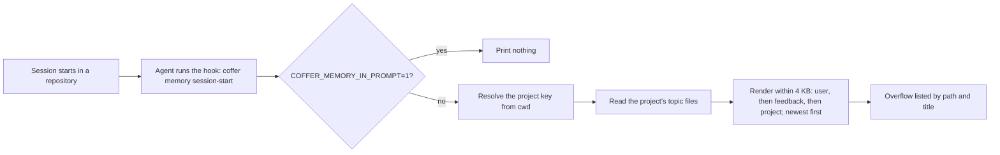
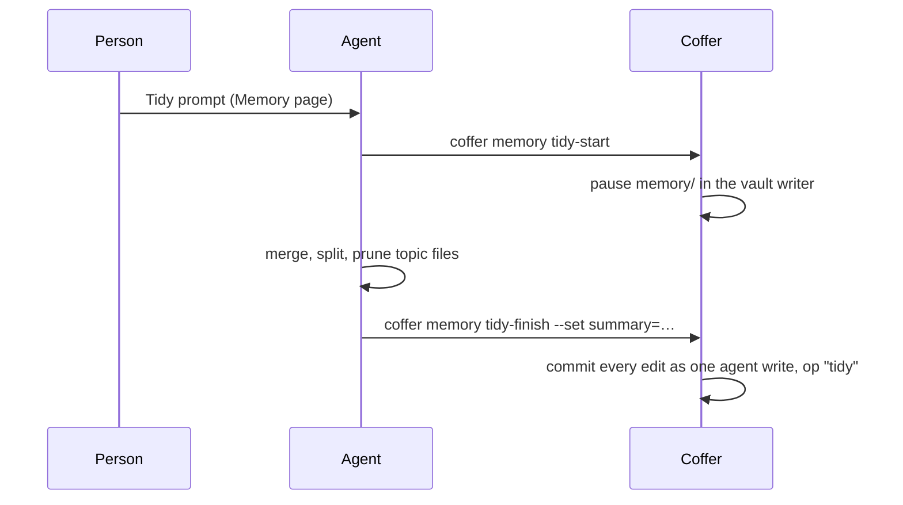

# Memory

This page explains how Coffer's memory layer works: one hub of Markdown files in the vault that every agent reads and writes with its own file tools, one session-start hook per agent that hands a session its project's memories, and a tidy recorded as one change. It is written for engineers who want the mechanism and the reasoning behind it. For the task-oriented view, see the [Memory guide](/guides/memory).

## The problem

Every coding agent keeps its own memory, and none can see another's or follow the person to another machine. An earlier build closed that gap by syncing: it read Claude Code's and Codex's memory into a hub and wrote the hub back into each. That worked for two agents only, copied whatever the agents wrote (most of it task logs), and needed an echo filter, a ledger, a preview and an undo to make writing into someone else's files safe.

The design now is the one most memory systems converged on: Markdown files as the source of truth, the working agent writing them itself, and a compact text handed over at session start with the rest read on demand.

1. **One hub.** `vault/memory/projects/<project>/`, one file per topic. Vault sync carries it between machines like any vault file.
2. **Agents write.** The rules are in the `coffer-guide` skill; the agent edits the files with its own tools. There is no MCP memory tool.
3. **Coffer hands over.** A `SessionStart` hook in each agent prints the project's memories; Coffer's own turns put the same text in the system prompt.
4. **Agents tidy.** A Tidy hand-off is committed as one change.

Coffer reads and writes no agent's native memory. The decision and the options weighed are in the ADR [Keep Memory in One Place in the Vault, Written by the Agents Themselves](https://github.com/wyx-sg/Coffer/blob/main/docs/decisions/keep-memory-in-one-place-agents-write-themselves.md).

Memory is about the person; [knowledge](/architecture/knowledge) is about the world. Memory holds who the person is, how to work with them and a project's state the repository does not record, and is pushed into every session. Knowledge holds how outside systems, teams and processes work, and agents pull it on demand through the `coffer-guide` catalogue. Handing memory to every session is the bounded exception to [pull, not push](/architecture/design-principles#pull-not-push): it is the one thing needed in every turn that nobody pulls, and it stays within 4 KB.

## The hub

```text
vault/memory/projects/<project>/<topic>.md
```

`<project>` is the project key with every character outside `[A-Za-z0-9._-]` turned into `-`. The key is the repository's normalised `origin` URL (`github.com/acme/payments`), or the repository folder's name when it has no remote, so two clones on two machines share one folder. A session outside any repository has no project and is handed nothing.

A topic file has frontmatter `title`, `type` (`user`, `feedback` or `project`) and `updated` (`YYYY-MM-DD`), and a body of one memory per line, each at most 400 characters. The format is Coffer's, fixed, and stated in `coffer-guide`; the person does not edit it, because the hook, the cap and the Memory page all read it. A file is read leniently: a missing title falls back to the file name, and each way a file breaks the format is named (`no_title`, `bad_type`, `no_updated`, `no_memories`, `long_line`) and shown, never fixed by Coffer.

Every change is a vault commit naming its writer: an agent's edit is committed by the vault scanner as a `disk` write, an edit or delete on the Memory page is a `user` write, a tidy is one `agent` write with operation `tidy`.

## Handing a session its memories



`coffer memory session-start` reads the hook's JSON from standard input (its `cwd`), resolves the repository, reads the hub's files directly with no daemon call, and prints a `<coffer-memory project="…">` block: a line naming the folder and pointing at the rules, then each topic as a `## Title (type, updated date)` section. Topics are ordered by type (who the person is, then how to work with them, then the project) and newest first within a type. What does not fit in 4 KB is listed by path and title for the agent to read when relevant. Input it cannot read, a cwd outside a repository, or any error prints nothing and exits 0, so a hook never fails a session.

Coffer's own turns (Conversations, channels, scheduled tasks) put the same text at the top of the system prompt and set `COFFER_MEMORY_IN_PROMPT=1` in the agent's environment, so the hook in that session prints nothing and the memories are not handed over twice.

## The hook in each agent

The agent descriptor names where the hook goes, as plain data (`session_hook`): a JSON file in the agent's config directory and the event.

| Agent | File | Entry |
| --- | --- | --- |
| Claude Code | `<config_dir>/settings.json` | `hooks.SessionStart[].hooks[] = {"type": "command", "command": "<coffer> memory session-start"}` |
| Codex | `<config_dir>/hooks.json` | the same shape |

A reconcile target, `memory_hook`, keeps one entry per registered agent: it adds Coffer's beside the agent's own hooks, replaces it when the `coffer` command's path changes, and removes it, alone, when memory is switched off or the agent is removed. A hook is Coffer's when its command runs `memory session-start`. The write goes through the same safe-write path as every agent config write (backup, atomic replace). Each change is audited as `memory_hook_installed` or `memory_hook_removed`. Codex runs a new or changed hook only after the person reviews it once.

An agent whose descriptor names no hook place is handed memories only in Coffer's own turns. A new agent takes part by declaring its `session_hook`; nothing else in the layer is per agent.

## Tidying as one change



While a tidy is open the vault writer pauses `memory/`: the agent's edits stay in the working tree and the scanner does not commit them one by one. Finishing commits them all as one commit whose summary is the agent's report, so History shows one version and restoring the one before it undoes the whole tidy. A tidy whose hub has not changed for 30 minutes is closed, committing what it did; the open tidy lives in the daemon's memory only, so a restart closes it too.

A periodic tidy is a scheduled task the person creates from the Memory page with the Tidy prompt. Coffer runs no memory timer of its own.

## Upgrading from memory sync

At daemon start, for every registered agent, Coffer removes what an older build wrote into it: the `<!-- coffer:memory-sync:begin -->` block in each Claude Code `MEMORY.md` (deleting a file the block was all of), `coffer_*.md` files, and the `extensions/coffer/` folder in each Codex memory folder, along with the old machine-local ledger and preview. The agent's own memories are untouched. Hub entries an older build published, one per file with `id` and `origin`, are rewritten in place to the topic format as one `daemon` write.

## Audit

| Event | When |
| --- | --- |
| `memory_hook_installed` | the reconciler added Coffer's hook to an agent |
| `memory_hook_removed` | the reconciler removed it (memory off, or the agent removed) |

Edits to the files are not audit events: the vault's history is their record. Rows of the retired sync events (`memory_synced`, `memory_sync_undone`) stay readable.

## No table, no resource kind

The hub is files in the vault, and an open tidy is held in the daemon's memory. The layer adds no table and no resource kind.

## Trade-offs and alternatives

- **Keep syncing into each agent's own memory.** Each agent would load shared memories natively, but only two agents could take part, every new agent needs a reader and a writer for a moving format, and the echo filter, ledger, preview and undo exist only for writing into others' files.
- **Capture every tool call and compress with a model (claude-mem's design).** Independent of any agent's memory, but a model call per session, a database and a compressor: Coffer would become a memory system doing what agents already do.
- **MCP tools to save and search.** The simplest delivery, but nothing reaches a session unless the agent calls a tool, and Coffer measured that agents do not.
- **Render the hub into each agent's instruction file.** No hook, but Coffer writes into files the person edits, per agent, with markers and backups again.

Costs of the chosen design: memory depends on agents following the guide's rules; an agent's own memory keeps running beside the hub unless the person switches it off; and two machines editing one topic file before a sync can conflict, which is rare for one person and usually merges cleanly because lines are appended.

## Where it lives {#where-it-lives-in-the-code}

| Concern | Where |
| --- | --- |
| Project keys, the topic format and its problems, the session text | the domain layer's `memory` package |
| The hub service, the tidy, the context a turn carries, the hook reconcile target | the application layer's `memory` package |
| The hub store, frontmatter, repository resolution, the upgrade cleanup | the infrastructure layer's `memory` package |
| Where each agent's hook goes (`session_hook`) | the agent descriptor |
| The `/api/v1/memory` routes and the wiring | the HTTP surface |
| `coffer memory`, including `session-start` | the CLI surface |

## Related

- Spec: [memory](https://github.com/wyx-sg/Coffer/blob/main/openspec/specs/memory/spec.md)
- Decision record: [Keep Memory in One Place in the Vault, Written by the Agents Themselves](https://github.com/wyx-sg/Coffer/blob/main/docs/decisions/keep-memory-in-one-place-agents-write-themselves.md)
- Research note: [agent memory](https://github.com/wyx-sg/Coffer/blob/main/docs/research/agent-memory.md)
- [Memory guide](/guides/memory) · [Knowledge architecture](/architecture/knowledge) · [Vault sync](/architecture/vault-sync) · [Agent facets](/architecture/agent-facets)
