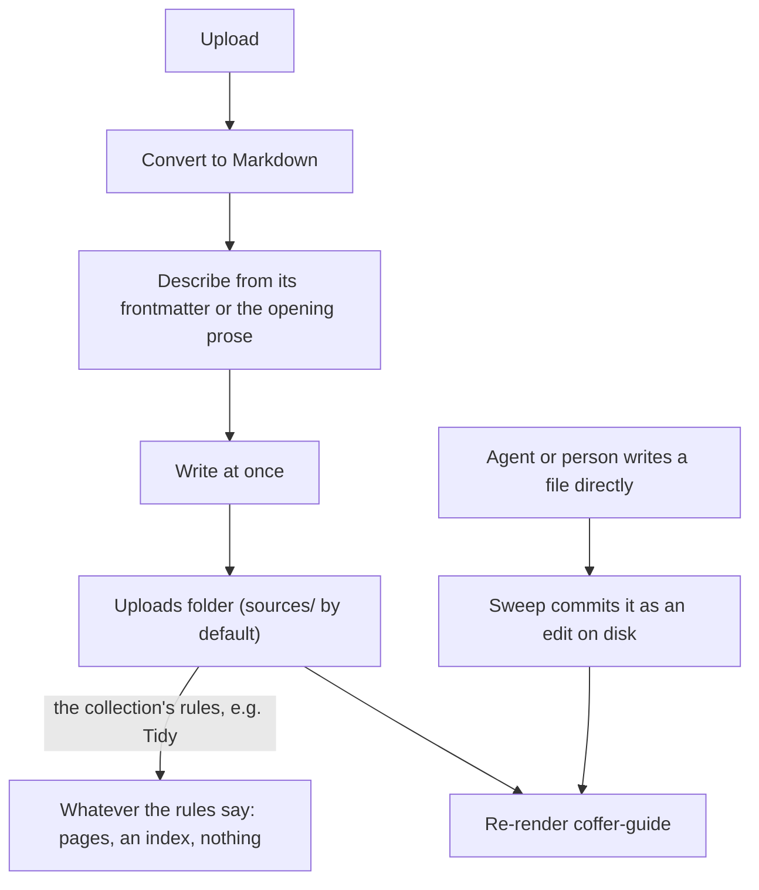
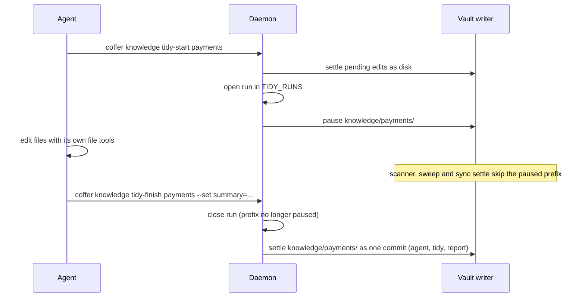
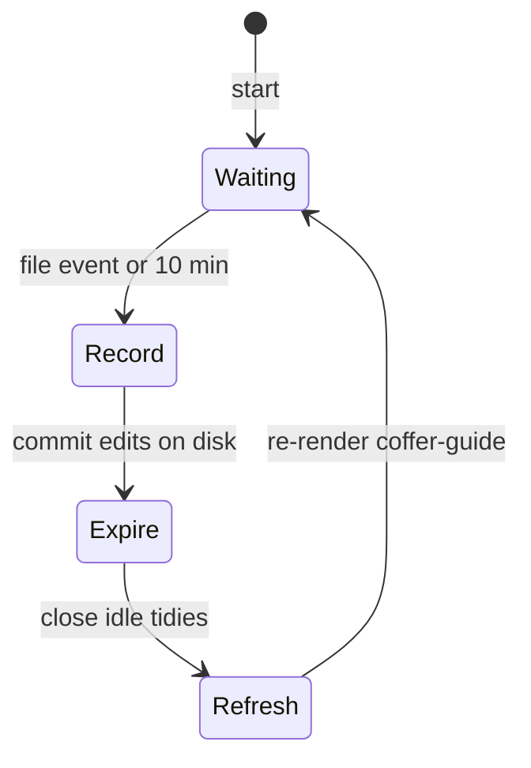

# 知识 {#knowledge}

这一页讲 Coffer 的知识层是怎么搭的：为什么它是不带索引的纯文件，为什么知识集的格式归它自己、Coffer 只读其中很少的一点，新素材如何立即落进知识集的上传文件夹，链接如何解析、Coffer 如何报告失效链接，知识集如何从模板起步，智能体如何按知识集自己的规则文件编写和整理，一次整理如何变成一次可以撤销的改动，每次写入如何作为 git 能显示、智能体能找回的版本保留下来，目录如何通过 `coffer-guide` 技能到达智能体，以及它如何与保险库同步共存。本页面向想了解机制和理由的工程师。日常使用请看[知识指南](/zh/guides/knowledge)。

## 问题 {#the-problem}

知识是开发者对自己工作环境的了解：哪个团队负责某个服务、某个仓库的约定、某个坑以及怎么绕开它。好几个智能体需要读它，人和智能体都需要往里加东西。有四种失败模式塑造了这个设计：

- **副本会分叉。** 如果每个智能体各记各的笔记，一个智能体上午学到的东西，另一个下午就看不到。
- **检索工具没人用。** 需要智能体记得去调用的工具，算不上检索。有一次对 448 个 Claude Code 会话做了审计，当时语料已经建在一组知识工具和一个投递的技能后面，结果发现那个技能从没被加载过，也没有任何知识工具被调用过。而 Coffer 支持的每个智能体本来就有 `Read` 和 `Grep`，并且一直在用。
- **手工维护的链接会腐烂。** 同一份语料里，398 个内部文件引用中有 343 个是死链，每一个都是写进正文的文件名，被后来的一次改名弄坏了。
- **一种格式不适合所有知识集。** 由保留来源编译而成的 wiki（Karpathy 的 “LLM Wiki”）能让知识累积、可追溯，Coffer 曾把这种格式定给每个知识集：`pages/` 和 `sources/`、五种页面类型、必填的 frontmatter、十一种计算出来的发现。后来真实的知识集带来了自己的纲要（自己的页面类型、一份来源目录、两个复查期限），智能体要协调两套说明；规则写在 Coffer 的代码里，知识集改不了；而接入的 Obsidian 库本来就按它自己的 `AGENTS.md` 来读。何况 Coffer 本来也强制不了这种格式：智能体用自己的工具写，所谓“必填”的键，只能事后作为一条发现报出来。

知识也不同于 [记忆](/zh/architecture/memory)。知识关于外部世界，因为有人把它放进来才出现。它按知识集组织，通过技能来拉取。记忆关于用户、怎么和用户合作，以及用户项目的状态，它在每个智能体的原生记忆里自己累积，Coffer 在智能体之间同步它。智能体按任务笔记记进记忆的内容（某个外部系统或团队怎么运作）属于这里；你让智能体把它写进某个知识集即可。

## 设计决策 {#design-decisions}

| 决策 | 理由 |
| --- | --- |
| 一个知识集是 `~/.coffer/vault/knowledge/<collection>/` 下的一棵 Markdown 文件目录树。 | 每个智能体读的是同样的字节，所以不会有副本分叉。在任何编辑器里做的修改，下一次读取就生效。 |
| 知识集的格式归它自己，写在它自己的规则文件里。除了 Coffer 写入的上传文件夹，Coffer 不赋予任何文件夹、页面类型或 frontmatter 键含义，也不要求任何文件带任何键。 | 同类工具（Obsidian、Logseq、Dendron、Foam、各种 LLM-wiki 实现）都把格式放在库自己的文件里。写在 Coffer 代码里的格式，是知识集改不了的第二套说明。见 [Knowledge Collections Own Their Format; Coffer Checks Only Links](https://github.com/wyx-sg/Coffer/blob/main/docs/decisions/knowledge-collections-own-their-format.md)。 |
| README 声明 Coffer 需要知道的东西，全部可选：描述（第一段）、`rules`、`entry` 和 `uploads`。接入的文件夹按同样的声明来读。 | 把知识集交给智能体、把上传放到某处，Coffer 只需要这四件事。保存的和接入的知识集用同一个读取器。 |
| 新知识集从模板复制一次（默认 `llm-wiki`，或 `blank`），之后 Coffer 不再读模板。 | 复制来的文件归知识集自己，所以 Coffer 升级永远不会在知识集不知情时改掉它的规则。wiki 的价值作为起点保留下来，而不是作为规则。 |
| 不建任何索引：没有表、没有全文索引、没有向量、没有缓存。链接和失效链接每次读取时从文件重建。 | 推导出来的东西不可能和文件不一致，也没有什么需要重建或对账。 |
| 文件的路径就是它所在的位置；它的 slug（文件名）是 `[[链接]]` 用的名字。文件名可以包含除 `/`、`\`、控制字符以外的任何字符，但不能以点开头。 | 人在文件管理器里、智能体在 grep 结果里看到的都是可读的名字。智能体自己的工具能写出的文件，网页界面就必须能读。 |
| 上传以转换后的 Markdown 保存在上传文件夹里，带图片的上传是一个放着文件和图片的文件夹；上传的文件本身留在上传它的那台 Mac 上，在保险库之外。 | 示意图和截图承载着智能体和人都需要的含义，去掉装饰和重复后体积很小；原文件是 git 会永远背着的大二进制文件，而智能体读 Markdown 一点也不差。见 [Knowledge Sources Keep Their Images; Originals Stay on This Mac](https://github.com/wyx-sg/Coffer/blob/main/docs/decisions/knowledge-sources-keep-their-images-and-originals-stay-on-this-mac.md)。 |
| 上传立即落地，直接写进上传文件夹。Coffer 不设暂存文件夹。 | 不需要等模型连接或某一轮处理。上传的东西立刻就能被每个智能体读到。 |
| 文件用 `[[slug]]` 或相对路径链接，Coffer 在读取时相对于包含链接的文件解析每个链接；有歧义的 slug 优先选发出链接的文件所在文件夹里的那个。 | slug 在移动后依然有效；相对路径是每个 Markdown 阅读器和智能体本来就会写的。不管哪种，坏掉的链接都会立刻报告，而不是悄悄腐烂。见 [Knowledge Files Stay Where Their Writer Put Them](https://github.com/wyx-sg/Coffer/blob/main/docs/decisions/knowledge-files-stay-where-their-writer-put-them.md)。 |
| Coffer 只报告失效链接（失效、有歧义、越界），别的都不报告，一条都不修。上传文件夹里的文件不检查。 | 失效链接不依赖任何格式，所以它是每个知识集都值得有的那一项检查，几乎每个同类工具都报告它。页面是否完整、是否最新、出处是否充分是判断，由智能体按知识集的规则来做。导入的素材保留了导出工具的文字，所以其中的 `[[` 不是链接。 |
| Coffer 不在知识上运行任何模型。一次整理检查和修什么、一条事实归哪里、哪句话过时了，都由智能体按知识集的规则文件来判断。 | 人本来就在用的智能体有文件工具、更强的模型，而且人在旁边看着。Coffer 自己再跑一个无人值守的模型，需要它自己的连接，没有连接时它的活就没人干。 |
| 整理只在人按下**整理**或**整理全部**时开始。整理从不自己启动智能体运行。 | 无人值守的智能体运行会在人不知情时花掉他的额度，并留下没人发起的对话。 |
| 一次整理是一次提交：智能体工作期间，这个知识集在保险库写入器里被暂停，结束时把所有编辑连同智能体的汇报一次提交。一次整理可以作为一次新提交整体撤销。 | 边界由历史本身来保存，所以改动记录、文件的历史和同步看到的都是一个单元，撤销就是一次提交的逆操作。放在别处的分组会成为历史的第二份记录。 |
| Coffer 不移动任何文件。 | 移动会弄坏所有指向这个文件的相对链接。文件放在哪里由写它的人决定；Coffer 报告坏掉的东西。 |
| Confluence 页面导出会变成一个可读的 Markdown 文件：宏按它显示的内容读取，附件保存在它自己的文件夹里、和文件放在一起，导出文件作为原文件留在这台 Mac 上，元数据放在唯一的 frontmatter 块里，并附一份漏掉了什么的报告。重新导入需要明确操作，并把旧文件标为被新文件 `superseded_by`。 | 没人读得懂的文件不算知识，而悄悄丢东西看起来就像一次干净的导入。见 [Confluence Pages Import as Readable Sources](https://github.com/wyx-sg/Coffer/blob/main/docs/decisions/confluence-pages-import-as-readable-sources.md)。 |
| 每次被接受的写入都是一次注明写入者的 git 提交。 | 智能体改写的是唯一的一份。谁改了什么的历史让每次改动都可查，每个版本都只差一条 `git` 命令或一次交给智能体，它也就是知识集的改动记录。 |
| 没有检索工具。目录放在 Coffer 自己的技能里，写明每个知识集的规则文件和入口页，不教任何格式。 | 智能体用它们已经在用的工具读文件。这一层的职责，是把正确的绝对路径摆到模型面前，把知识集的规则摆到它的写入面前。 |
| 智能体用自己的文件工具写知识集里的文件来添加知识。没有面向智能体的工具：Coffer 唯一常驻列出的内置 MCP 工具是 `coffer__search_tools`。 | 智能体本来就会写文件。规则文件告诉它们写在哪里，扫描负责提交它们的改动。 |
| 不按知识集设门槛：没有按智能体的生效范围，也没有启用开关。每个知识集都提供给每个智能体。 | 技能把整个知识根目录交给每个智能体。按智能体过滤或关掉某个知识集，只会让列表变短，根目录仍然暴露在外。 |

## 知识集目录树 {#the-collection-tree}

```text
~/.coffer/vault/knowledge/             # inside the vault repository
├── payments/                        # one collection = one knowledge Resource (started from llm-wiki)
│   ├── README.md                    # first paragraph is the description; frontmatter declares rules, entry, uploads
│   ├── AGENTS.md                    # its rules file, copied from the template and now its own
│   ├── index.md                     # its start page
│   ├── pages/
│   │   ├── session-ownership.md
│   │   └── infra/
│   │       └── cache.md
│   ├── sources/                     # its uploads folder (the default)
│   │   ├── notes.md                 # an upload without pictures: converted Markdown + frontmatter
│   │   ├── q3-review/               # an upload with pictures: one folder, named by its title slug
│   │   │   ├── q3-review.md         # the upload, named like its folder
│   │   │   └── image-1.png          # linked from it as image-1.png
│   │   └── account-core/            # an imported Confluence page and its attachments
└── personal/                        # started blank: a README and whatever its writers add
    └── ...
```

- **一个知识集**是一个顶层目录，也是一个类型为 `knowledge` 的资源，存为 `vault/resources/knowledge/<name>.json`。它由人在网页界面或用 `coffer knowledge create` 有意创建。读、写、智能体放到别处的文件和工作目录都不会创建知识集，也没有什么会从智能体的 cwd 推出一个边界。知识层在任何地方都不加表。
- **README** 位于知识集根目录。它在第一个 `##` 小节之前的第一段就是这个知识集的描述。每次列出时都从磁盘读取，从不复制进资源文件，因为人第一次编辑 README 时副本就错了。它不计入知识集的文件数。知识集没有自己的标题：所有界面都按文件夹名显示它，资源更新会拒绝标题。在网页界面编辑描述，正好改写那第一段（没有时插入到第一个小节之前），README 的其余部分不动，作为一次注明用户的提交；之后会重新渲染指南技能，因为智能体就是靠描述认出这个知识集的。
- **其他一切都归知识集自己。** 除了 Coffer 写入上传的上传文件夹，Coffer 不赋予任何文件夹含义，也不给任何文件分种类：每个可见的 Markdown 文件都一样地被列出、计数、编入目录和检查链接，没有一个被要求带某个键。Coffer 从不移动文件。
- **带图片的上传是一个文件夹**，在上传文件夹里，转换后的文件和它的图片或附件放在一起（见[图片和原文件](#pictures-and-originals)和 [Confluence 页面](#confluence-pages)），所以可以整体移动、改名和删除。它有意设为可见：保险库会忽略隐藏条目，而图片必须和链接它们的文件一起提交、同步。
- **隐藏条目**（以点开头）不计入任何计数，也不进目录和检查，没有任何界面列出或读取它们。Coffer 在知识集里不保留任何自己的隐藏文件夹。保险库仓库的 `.git/info/exclude` 会忽略知识集里所有隐藏条目，所以它们既不提交也不同步。这包括 `.obsidian/`，所以作为 Obsidian 库打开的知识集文件夹，不会把 Obsidian 的设置带进历史（见[在 Obsidian 中打开知识集](#opening-a-collection-in-obsidian)）。

### 知识集声明什么 {#what-a-collection-declares}

`infrastructure/knowledge/collection_settings.py` 每次调用时读取知识集 README 的 frontmatter，并对照它的文件解析三个键，每个都是可选的：

| 键 | 解析为 | 不写或无效时 |
| --- | --- | --- |
| `rules` | 一个存在且不隐藏的文件相对知识集的路径。它可以爬进另一个知识集（`../shared/rules.md`）：保存的知识集以知识根目录为界，接入的文件夹以它自身为界。 | 根目录下 `AGENTS.md`、`CLAUDE.md`、`README.md` 中第一个存在的；都没有时为空。 |
| `entry` | 同上，用于开始阅读的页面。 | 空：目录改为列出知识集的文件。 |
| `uploads` | 知识集里的一个普通文件夹；不能是绝对路径、隐藏的或 `..`。 | `sources`。 |

解析不了的声明会被忽略，而不是被拒绝，所以 README 里的一个笔误永远不会让读取失败。列表带着 `rules_file`、`entry_file` 和 `uploads_dir`，网页界面在知识集页面上把前两个显示为链接，指南在每个知识集的目录条目里写明它们。其他任何键，不管在 README 里还是在别处，对 Coffer 都没有含义：在知识集自定格式之前建的知识集，保留它的 `type`、`sources` 和 `verified` 键作为自己的键。见 [Knowledge Collections Own Their Format; Coffer Checks Only Links](https://github.com/wyx-sg/Coffer/blob/main/docs/decisions/knowledge-collections-own-their-format.md)。

### 模板 {#templates}

`POST /api/v1/knowledge/collections` 接受 `template`，默认 `llm-wiki`，或者 `blank`；其他值返回 422。`application/knowledge/templates.py` 在创建知识集的那次提交里，把模板的文件从 `skill_assets/templates/<name>/` 复制进新文件夹，并把 `{name}` 和 `{description}` 填进 README。`llm-wiki` 写一个声明了 `rules: AGENTS.md` 和 `entry: index.md` 的 README、一个写着 wiki 规则的 `AGENTS.md`（结构、页面类型、90 天的核对期限、写页面、整合来源、一次整理检查什么），以及一个空的 `index.md`。`blank` 只写 README。Coffer 不会再读任何模板，所以后续版本改了模板，已有的知识集也不受影响。

### 路径与 slug {#path-and-slug}

文件的路径就是它的身份；frontmatter 里没有 `id` 键，也没有什么把 id 映射到路径。它的 **slug** 是去掉 `.md` 的文件名，也是 `[[链接]]` 用的名字（见[链接与失效链接](#links-and-broken-links)）。Coffer 写的文件按标题的 slug 命名：NFKC 规范化并转小写，保留 CJK 字符，最长 80 个字符，重名时加 `-2`、`-3` 等后缀。别人写的文件，可以取路径段允许的任何名字。

### Frontmatter {#frontmatter}

Coffer 不要求任何 frontmatter，只读任何文件的两个键，而且只用来显示它：`title`（没有就用第一个 `# ` 标题，再没有就用文件名；`collection_settings.title_of`）和 `aliases`，`[[链接]]` 可以用的其他名字，和 Obsidian 的读法一样。文件有 `description` 时，目录里会显示它。

Coffer 写进上传文件夹的文件：

```yaml
---
title: Q3 review
description: The quarterly review of the payments gateway.
actor: user
created_at: '2026-10-01T09:00:00.000+00:00'
updated_at: '2026-10-01T09:00:00.000+00:00'
original: q3-review.pdf     # the uploaded file, kept on the Mac that uploaded it
original_sha256: 1a2b3c4d…  # names that copy
---
```

导入的 Confluence 页面：

```yaml
---
title: Account Core
description: …
origin:
  system: confluence
  url: https://confluence.example/pages/viewpage.action?pageId=42
  page_id: '42'
  space: ACC
  version: 7
  fetched_at: '2026-10-13T08:00:00+00:00'
  format: confluence-storage
import_report:
  body: partial             # or converted
  complete: false
  attachments_kept: 5
  missing: ['gone.png: not downloaded with the page']
  unsupported: ['jira: a Jira issue list']
actor: user
original: account-core.json
original_sha256: 9f86d0…
---
```

Coffer 按固定顺序写这些键：`title`、`description`、`actor`（`agent` 或 `user`）、`created_at`、`updated_at`，从上传文件转换来的文件再加上 `original` 和 `original_sha256`；上传本身带的 frontmatter（导入页面的 `origin`、`import_report`，或导出工具的键）接在同一个块里，从不作为正文里的第二个块。重新导入会给旧文件加上 `superseded_by`。人或智能体加的其他任何键，Coffer 每次重写文件时都会原样保留解析后的值。这一点很重要，因为丢掉一个不认识的键，就会悄悄删掉人写的 `tags:`。

frontmatter 解析失败时降级而不抛错：没有分隔线的文件，或者分隔线里 YAML 格式有误的文件，得到空的 frontmatter 和它的正文，所以一个手改时多了个冒号的文件，不会让整个知识集的遍历失败。

### 所有路径由一个模块负责 {#one-module-owns-every-path}

知识基础设施里的一个模块（`infrastructure/knowledge/paths.py`）构造所有路径，并命名上传文件夹；别处都不构造路径。每个路径段都要经过一道检查，拒绝空的、全是点的、以点开头的段，以及任何 `/`、`\` 或控制字符，所以 `payments/.scratch/x.md` 在任何界面上都无法访问，而 `Login (v2).md` 可以。解析后的路径还会在它最近的已存在祖先上对照知识根目录检查，所以根目录里的符号链接目录没法把写入带出去。写入先写到一个用 `O_EXCL | O_NOFOLLOW` 打开的同级临时文件，再做一次原子重命名，并通过保险库唯一的写入器提交。根目录永远是 `~/.coffer/vault/knowledge`，不能改。

## 从素材到上传文件夹 {#from-material-to-the-uploads-folder}

Coffer 提供的每个入口，最后都落成知识集上传文件夹里的一个 Markdown 文件，没有一个需要等待。知识集里的其他东西都由人和智能体来写，不由 Coffer 写。

| 入口 | 界面 | 结果 |
| --- | --- | --- |
| 上传，先转换成 Markdown | 知识页面、`coffer knowledge upload` | 上传文件夹里的一个 Markdown 文件（有图片时是带着图片的一个文件夹），以及这台 Mac 上的原文件 |
| Confluence 页面导出（JSON） | 知识页面、`coffer knowledge upload` | 一个可读的 Markdown 文件，和它的附件放在一个文件夹里，以及一份导入报告 |
| 直接写进知识集的文件 | 智能体自己的文件工具，或人的编辑器 | 那个文件，作为在磁盘上编辑提交 |

网页界面没有手工输入文件的表单：人在自己的编辑器里写，或者上传。网页界面以只读方式显示每个文件，并在编辑器里打开它。



### 提交 {#submission}

上传先检查知识集存在，然后往知识集的上传文件夹里写一个文件。它的正文就是转换出的文字。它的 frontmatter 从文字里填：`title` 取第一个 `# ` 标题（没有就用文件名），`description` 取第一段正文（没有就用标题），`actor` 是提交它的人或智能体。它按标题的 slug 命名，从不覆盖已有文件，因为两次标题相同的提交就是两个文件。提交注明提交者，并记录一条 `knowledge_written` 审计事件。之后 Coffer 在守护进程的事件流上以 `knowledge` 事件广播这个知识集，因为文件变了，而知识集的记录并没有被写。

之后怎么处理它，由知识集的规则决定。在 `llm-wiki` 知识集里，它是一个等着编译进页面的来源，人按下**整理**时由智能体来做（见[整理是智能体的事](#tidying-is-the-agent-s-job)）。

上传的回应带着新文件的路径。

### 上传 {#uploads}

上传按顺序经过四个步骤：

1. **限定上传。** 每次调用一个文件，最大 20 MiB，不选文件夹。在花力气转换之前，先拒绝未知的知识集。
2. **转换。** 转换器注册表先问每个转换器是否认领这份内容（Confluence 转换器认领读起来是页面导出的 `.json` 文件），再按扩展名分派。先走透传（Markdown、文本和源码文件），然后是 CSV，其余都交给 MarkItDown，它同时取出图片（见[图片和原文件](#pictures-and-originals)）。不支持的类型会以 `INGEST_REJECTED` 和 `reason: unsupported_type` 拒绝。转换后没有文本的（比如纯图片 PDF）也会拒绝。两种情况下都不写任何东西：没有文件、没有图片，也没有原文件。
3. **描述。** 描述取上传内容自己 frontmatter 里的 `description` 或 `summary`，没有就取转换出的文字的第一段正文，再没有就取标题。它从不为空。没有任何模型来写它。
4. **写入这份 Markdown**，`actor: user`，存为 `<上传文件夹>/<slug>.md`；有图片时存为 `<上传文件夹>/<slug>/<slug>.md`，图片在同一次提交里放在它旁边；除非走的是透传转换器，frontmatter 里还会写上 `original` 和 `original_sha256`。重名时给文件名加上后缀（`-2`）。文件提交之后，上传的字节保存在这台 Mac 上；保存失败只记日志，丢的只是本机副本。

如果 Confluence 页面的页面 id（取自 `origin.page_id`，或其 URL 里的 `pageId`，在外层或较旧的内层 frontmatter 里）已经在知识集的上传文件夹里且没有被替换，会在写入任何东西之前以 `409 KNOWLEDGE_SOURCE_EXISTS` 拒绝。`preview=true` 运行转换，返回标题、文件和报告，但不写入；`replace=true` 写入新文件，并在同一次提交里把旧文件的 `superseded_by` 设为它。

20 MiB 的上限不变。

### Confluence 页面 {#confluence-pages}

`infrastructure/knowledge/converters/confluence/` 读取页面导出（`page.read`：存储格式、标题、页面 id、版本、空间、URL，以及以 base64 携带的附件），先用 BeautifulSoup 转换存储格式，再交给 markdownify。`macros.py` 把每个 `ac:structured-macro` 改写成读者看到的那样的普通 HTML：只做排版的宏交回它的内容，面板变成带标签的引用，`code`/`noformat` 保留文字和语言，作为附件的 draw.io 图表显示它的图片，画在页面里的变成一个查看器链接，PlantUML 以代码块显示源码，生成的内容（`toc`、`children`）丢掉并记录下来，不认识的宏保留其内容，或记为不支持。`storage.py` 把 `ac:image`、`ac:link` 和 `ri:attachment` 变成指向页面文件夹下的链接，并把带合并单元格的表格保留为 HTML。每个结果都落在一个 `Context` 上，最后成为 `ImportReport`：正文 `converted` 或 `partial`，然后附件和宏分别列出保留、已转换、丢掉、缺失和不支持的条目及原因。

页面的文件放在文件旁边、以页面标题命名的文件夹里，按名字链接；重新导入会得到它自己的文件夹（`-2`），所以较新的版本从不覆盖较旧版本的文件。导出文件本身是转换后文件的原文件，像任何上传一样保存在这台 Mac 上（`originals.keep`），从不进保险库。画在页面里的 draw.io 图表变成一个查看器链接（`diagrams.viewer_link`），像 draw.io 自己导出的链接那样把图表放在 `#R` 片段里；页面原有的查看器链接保持原样。Coffer 不为图表另存任何文件，不渲染任何东西，也不向任何外部服务发送任何东西：浏览器从不把片段发给服务器。

在这个转换器之前写入的文件，正文里可能还带着导出工具的注释标记和第二个 frontmatter 块。Coffer 不改写它：`source_view.readable_body` 在读取时去掉内层块并展开这些标记（`GET /api/v1/knowledge/file` 上的 `readable_body`），`source_view.origin` 从任一个块里读出它来自哪里。阅读器显示 `readable_body`，并注明这是转换后的视图。

### 图片和原文件 {#pictures-and-originals}

**图片。** 由 `infrastructure/knowledge/converters/images.py` 取出。MarkItDown 以 `keep_data_uris` 运行，所以 Office 或 HTML 文档里的图片以内联的 `data:` URI 到达；每一张都被解码，并替换成一个简单的名字（`image-1.png`）。PDF 的文本层不带图片，所以由 pdfminer 读出每一页上的图像，列在正文之后的 `## Images` 下，每页一个 `Page N:` 标题。保留的数量有上限：一边不到 48 px 的图片算装饰，丢掉且不留痕迹；超过 5 MB 的丢掉；重复的图片（同样的字节，比如每张幻灯片上的标志）只保留一份，它出现过的每个位置都链接这一个文件；一次上传最多保留 40 张；浏览器不能显示的格式用 Pillow 重新编码为 PNG。读不出来的图片跳过；纯图片 PDF 仍然拒绝，因为没有文字。

`infrastructure/knowledge/assets.py` 在写文件之前先给这次上传的文件夹命名，用它的标题 slug（被占用时加 `-2`、`-3` …）；里面的文件和文件夹同名，所以同一个页面导入两次也不会共用一个 slug。Markdown 继续用简单名字 `image-N.ext` 链接每张图片，无论文件夹挪到哪里，都在它旁边解析得到。图片在和文件同一个保险库事务里写入，所以文件和它的图片是一次提交、改动流里的一条改动、一次撤销。删除文件会留下它的文件夹；孤立的图片没有人清理。

`GET /api/v1/knowledge/asset?path=` 返回图片的字节和媒体类型，支持 `png`、`jpg`、`jpeg`、`gif`、`webp` 和 `svg`，最大 10 MB，经过和读取相同的路径守卫，接入的文件夹则经过它自己的守卫。其他一律是 `404 KNOWLEDGE_FILE_NOT_FOUND`。Web 界面的阅读器把 Markdown 文档里每个相对图片链接按文档路径解析，通过这个路由取回（它需要守护进程的令牌，浏览器不能把它当普通 URL 加载），以 data URL 显示；从树里打开的图片也这样显示。这个路由读取的是普通文件，所以没有对应的命令。

**原文件。** `infrastructure/knowledge/originals.py` 把上传的字节保存在 `~/.coffer/local/knowledge-originals/<sha256><.ext>`，权限 `0600`，同样的内容只写一次，经由临时文件再重命名。它属于本机类别，所以从不提交、从不同步。读取时根据文件的 `original` 和 `original_sha256` 解析出 `original_path`：副本在这里时是绝对路径，文件来自另一台 Mac 时是 `null`。`GET /api/v1/knowledge/file` 同时带上 `original` 和 `original_path`。Web 界面在文件标题下显示**原文件 `<name>`**，文件名是一个按钮，请守护进程用默认应用打开它（`POST /api/v1/fs/open`）；没有本机副本时，显示原文件在上传的那台 Mac 上。Markdown 或文本上传不保留原文件。文件被删时不会删除原文件，所以撤销找回的文件还能找到它。

`markitdown` 是延迟导入的。一条 import-linter 契约把它限定在知识转换器和消息渠道的文档提取里。

### 直接编辑 {#direct-edits}

直接写、改、删一个文件，无论是在你的编辑器里还是用智能体自己的文件工具，都是修改知识的完整方式。不需要导入或注册步骤，改动在下一次读取时就生效。扫描会把它作为在磁盘上编辑提交（见[历史](#history)）。通过 Coffer 删除文件是人在 Web 界面里的动作。Coffer 不提供任何能删除东西的工具。

Web 界面不编辑文件：文件的窗格是只读的（预览和源码），带**在编辑器中打开**和**在访达中显示**，所以没有保存路由、没有文件指纹，也没有保存过期的拒绝。Coffer 的路由表里没有任何一条会写文件的文字。

## 链接与失效链接 {#links-and-broken-links}

`infrastructure/knowledge/link_graph.py` 把一个知识集遍历一次，在内存里建一个 `LinkGraph`：每个可见的 Markdown 文件和它的链接，以及 `[[链接]]` 可以用来指它的名字（它的 slug 和 frontmatter 里的 `aliases`）。什么都不存；每次读取都重建。一个知识集最多几百个文件，遍历一次只要几毫秒。

### 链接 {#links}

链接是 `[[target]]` 或 `[[target|text]]`，或者指向某个文件的标准 Markdown 链接、图片或引用定义（`infrastructure/knowledge/links.py`），出现在 Markdown 文件正文中代码片段和围栏代码块之外的任何位置，所以作为示例写出来的链接不算链接。相对链接相对于包含它的文件来读（以 `/` 开头的相对于知识集文件夹，和 Obsidian 从库根读的方式一样），可以指向另一个知识集里的文件；爬出知识根目录的是**越界**的，指不到文件或指向隐藏文件的是**失效**的。网页链接（任何 scheme）不检查。`target` 对照每个文件的 slug 和 `aliases` 解析。匹配时忽略大小写和 Unicode 宽度（和文件名一样做 NFKC 规范化），并容忍结尾的 `.md` 或开头的文件夹，所以写成路径的链接也能解析。什么都指不到的 target 是**失效**的。指到不止一个文件时，解析到和发出链接的文件在同一文件夹里的那个，就像读者指的是旁边那个；那里没有时就是**有歧义**的。

文件的读取（`infrastructure/knowledge/file_links.py`）为每个链接带上它的 `kind`（`wiki` 或 `path`）、它解析到的路径（或者没有），以及它是否 `outside` 或 `ambiguous`，所以网页界面能按链接打开它指向的文件，并标出失效的链接。上传文件夹里的文件不带 `wiki` 链接：其中的 `[[` 是导出工具写下的文字。

### 检查 {#the-check}

Coffer 每次读取时从这张图算出知识集的失效链接，一条都不存，一条都不修：

| 发现 | 规则 |
| --- | --- |
| `dead_link` | 什么都解析不到的链接，带着文件和 target。 |
| `ambiguous_link` | 解析到不止一个文件、且其中没有一个在发出链接的文件所在文件夹里的 `[[链接]]`。`others` 是候选文件。 |
| `outside_link` | 爬出知识根目录的相对链接。 |

每个 Markdown 文件都会被检查，README 和规则文件也不例外，只有上传文件夹下的文件除外：导入的素材把导出工具的链接作为它的记录保留。别的都不算发现。文件是否完整、是否最新、出处是否充分、放的文件夹对不对，由知识集的规则来说，由智能体来判断。

`GET /api/v1/knowledge/collections/{uid}/check` 返回知识集和它的失效链接，`coffer knowledge check` 打印它们。知识集列表带着 `note_count`（它的 Markdown 文件数，不算 README）、`finding_count`、`rules_file`、`entry_file`、`uploads_dir`、整理交接和 `tidy_running`，每个知识集各遍历一次算出来。没有任何路由会修一条发现。

`GET /api/v1/knowledge/collections/{uid}/files`（`coffer knowledge files`）返回一个知识集的每个 Markdown 文件及其标题、描述、写入者和时间，来自树用的同一次遍历：也就是失效链接和改动记录两节显示的标题。它是一个单独的路由，好让列表保持便宜。

## 整理是智能体的事 {#tidying-is-the-agent-s-job}

决定一次整理检查什么、把一条事实放到它该在的地方、把回答同一个问题的文件合成一个、改正错误，这些都是判断，由知识集的规则来定。Coffer 一个都不做。人本来就在用的智能体有文件工具，人也在旁边看着，所以由它读知识集的规则文件，人用一个按钮启动它。见决策 [Tidying Knowledge Is the Agent's Job, One Hand-Off Recorded as One Change](https://github.com/wyx-sg/Coffer/blob/main/docs/decisions/tidying-knowledge-is-the-agents-job.md) 和 [Knowledge Collections Own Their Format; Coffer Checks Only Links](https://github.com/wyx-sg/Coffer/blob/main/docs/decisions/knowledge-collections-own-their-format.md)。

### 指南教了什么 {#what-the-guide-teaches}

知识功能开着时，指南的知识部分不教任何格式。它说每个知识集在自己的规则文件里定格式，并给出四条指示：

- **在知识集里写之前，先读它的规则文件并照着做**；它优先于智能体默认会做的任何事。没有规则文件的知识集，按它现有文件的写法来写。
- **从入口页开始读**，知识集指定了入口页时；否则就搜索它的文件夹，因为目录只给出它的文件数。
- **把弄清楚的东西写回去**：通过读代码、某个系统或某份文档找到、知识集里还没有的答案，写到知识集规则说的地方，并用一句话告诉人加了什么。不写猜测、观点，或只在那次对话里成立的东西。
- **整理一个知识集**：一次一个知识集，先运行 `coffer knowledge tidy-start <collection>`；读规则文件并按它整理；修好 `coffer knowledge check` 列出的每个失效链接；拿不准的（两个文件说法冲突却看不出哪个对、要删掉大段内容、要改规则文件）不动，写进汇报；然后运行 `coffer knowledge tidy-finish <collection> --set summary="<汇报>"`，汇报以**缺口**结尾。只被要求检查或审阅时，智能体只汇报，什么都不改。

它还写明了不管什么格式 Coffer 都会对知识集做的事：保留历史、报告失效链接、把上传连同 Coffer 自己的键写进上传文件夹，此外什么都不做。

代码不强制知识集的任何规则。它们是知识集自己文件里的文字，防止坏编辑的是历史和链接检查，而不是在写入时拒绝。`llm-wiki` 模板的 `AGENTS.md` 带着过去 Coffer 自己的那些规则：页面放在 `pages/` 下，一个主题一个；来源保留，除了 `ingest: skipped`、`superseded_by` 和 `summary` 之外从不编辑；frontmatter 带 `title`、`type`、`description`、`sources`、`aliases` 和 `verified`；整合等待中的来源；整理时整合来源、重新核对超过期限的页面、补全不完整的页面、合并、拆分，并让 `index.md` 保持最新。

### 「整理」交接 {#the-tidy-hand-off}

提示词由守护进程写，用的是其他所有交接都用的同一个交接模块（`application/knowledge/tidy_handoff.py`，由 `domain/handoff` 渲染）。读取一个知识集会带上 `tidy_handoff`：它写明知识集、它的绝对路径、它的规则文件、Markdown 文件数和它的失效链接及路径（最多 40 行，之后写明省略了几条），并列出步骤：`tidy-start`，按规则文件整理并修好失效链接，拿不准的留给汇报，`tidy-finish` 并附一份以缺口结尾的汇报。`GET /api/v1/knowledge/tidy-handoff` 一次为所有知识集返回同样的提示词：写明知识根目录，以及每个知识集的路径、文件数和失效链接数，请智能体按同样的步骤一个一个处理，并用 `coffer knowledge check <collection>` 读出每个知识集的失效链接。

Web 界面在知识集页面上提供**整理**，在知识页面页头提供**整理全部**。按下任何一个，都会在首选终端里启动默认的交接智能体，把这份提示词作为它的第一条消息，走的是与其他所有交接相同的路径。没有可用的托管智能体时，按钮只提供**复制提示词**。人按下的是一个以这件事命名的按钮，提示词只编辑 Coffer 自己的文件，而且整次整理可以撤销。

没有第二个只报告的交接。什么都不改的检查与整理自己的步骤重复；想先听意见的人，在整理打开的会话里直接说，指南会告诉智能体这时什么都不改。

### 一次整理就是一次改动 {#a-tidy-is-one-change}

智能体用自己的工具编辑文件，磁盘上发现的编辑通常会在安静下来后提交为 `disk` 写入。这样一次整理就成了一串没有分界、没有汇报的 `disk` 提交。为此，智能体用提示词里写明的两条命令把它的工作括起来：



- **开始**（`POST /api/v1/knowledge/collections/{uid}/tidy/start`）先把知识集里已有的改动提交为 `disk`，让这次整理只包含智能体做的事，然后在 `TIDY_RUNS`（`infrastructure/knowledge/tidy_runs.py`）里登记一次运行。对已开始的整理再开始一次，保持原样。
- **进行中**，`VaultWriter.set_paused` 把知识集的路径前缀交给写入者，每次调用都从登记表里读。`pending()` 和 `settle()` 跳过暂停的路径，所以保险库的扫描器、扫描、Coffer 的其他写入和同步的一轮都不会提交它们。一轮同步要改动的文件若在暂停中，它会等待，就像对待任何未提交的编辑一样。读取看到的是磁盘上的文件。
- **结束**（`POST .../tidy/finish`，请求体 `{summary}`）先关闭运行，再把知识集待提交的路径作为一次提交：写入者 `agent`，操作 `tidy`，汇报（合并空白，截到 4,000 个字符）作为摘要，`Coffer-Status: reported`。它返回这次改动；什么都没改时返回 `change: null`。没有开始的整理时调用结束，仍会把知识集待提交的编辑作为一次整理提交。
- **闲置到期。** 每次运行都记着一个指纹：知识集待提交的路径及其摘要。扫描每次触发都比较它；有变化就重置闲置计时，闲置 30 分钟的运行会被关闭，不带汇报，`Coffer-Status: expired`。所以不会因为智能体停下来就让知识集一直暂停。
- **只在内存里。** 登记表是对一次进行中的会话的记账，不是知识，所以既不存储也不同步。守护进程重启会忘掉进行中的运行；下一次落定会把它的编辑提交为普通的 `disk` 写入，丢掉的只是分组。

知识集的读取带有 `tidy_running`，知识集页面会提示整理正在进行。开始和结束各记一条 `knowledge_edited` 审计事件（`tidy: started`、`tidy: finished`，带版本和文件数）。这项决策以及其他方案（给每次磁盘提交加 trailer 并在读取时分组、在界面里按时间分组、另建一个运行记录存储）见 [Tidying Knowledge Is the Agent's Job, One Hand-Off Recorded as One Change](https://github.com/wyx-sg/Coffer/blob/main/docs/decisions/tidying-knowledge-is-the-agents-job.md)。

### 撤销一次整理 {#undoing-a-tidy}

`POST /api/v1/knowledge/changes/{version}/undo`（`coffer knowledge undo`，请求体 `{force}`）把这次改动动过的每个知识文件放回它之前的样子（`collection_writes.undo_change`）。对每个路径，它读三个版本：这次改动时的字节、磁盘上现在的字节、这次改动的父提交里的字节。任何一个路径现在的字节和改动时不同，就说明之后有过编辑，撤销会以 `409 KNOWLEDGE_UNDO_CONFLICT` 拒绝，`details.documents` 列出这些路径，什么都不写，除非设置了 `force`。否则每个路径都换回父提交里的字节，之前不存在的就删除，全部在一次记录事务里完成：一次由用户写入的提交，操作 `restore`，`Coffer-Undoes: <version>`。没有动过任何知识文件、或文件已经和父提交一致的版本，会以 `400 KNOWLEDGE_NOT_A_CHANGE` 拒绝。撤销记一条 `knowledge_edited` 审计事件，带 `undoes`、路径和它丢掉的之后的编辑。那次整理留在历史里，排在撤销之前；被丢掉的编辑也留在历史里。

这个路由适用于任何动过知识文件的改动；Web 界面把它放在改动记录里一次整理那一条上，叫**撤销这次整理…**，确认对话框会在发送 `force` 之前按标题列出之后被改过的文件。

### 没有什么会无人值守地整理 {#nothing-tidies-unattended}

整理只在人按下它，或请自己的智能体去做时才运行。定时启动智能体运行会在人不知情时消耗他的额度，还会留下没人开过的对话。机械的扫描和机械的检查归 Coffer；判断不归。

### 优先级 {#precedence}

两种说法冲突时哪个胜出，是知识集的规则，不是 Coffer 的。`llm-wiki` 模板的规则说：新的说法胜出，除非旧的被来源、日期、命令输出或代码证明是对的；被取代的说法保持可读，并写明它改动的日期；任何写入者都不例外。知识集也可以另作规定。

保护数据的是机械手段。Coffer 不在页面上保存人的任何文字，所以浏览器里的过期副本不会撤回智能体的编辑。Coffer 自己做的改写会保留它没设置的每个 frontmatter 键。智能体的每次编辑都是历史里的一个版本，可以从文件的历史里恢复某个版本。

## 在 Obsidian 中打开知识集 {#opening-a-collection-in-obsidian}

知识集的结构正是 Obsidian 原生能读的：普通 Markdown、按文件名解析的 `[[slug]]` 链接，以及 `aliases` frontmatter。Obsidian 在守护进程检测的编辑器列表里（`application/fs/editor_service.py`），只有 `GET /api/v1/fs/editors` 列出它时，Web 界面才会在知识集和文件的 ⋯ 菜单里提供**在 Obsidian 中打开**，通过 `POST /api/v1/fs/open` 用它打开路径。Obsidian 把设置存在 `.obsidian/` 里，这是保险库忽略的隐藏条目。在 Obsidian 里保存和在任何编辑器里一样，是一次磁盘上的编辑，Obsidian 的相对路径链接也和 `[[slug]]` 一样被跟随和检查。Obsidian 在 `pages/` 之外新建的笔记会留在原处，所以指南让人把 Obsidian 新建笔记的默认位置设成 `pages/`。

## 接入的外部文件夹 {#linked-folders}

**接入的外部文件夹**是一个人在这台机器任意位置、用自己的工具维护的知识集，比如一个 Obsidian 库，Coffer 只把它共享给智能体。它和知识集是同一个 `knowledge` 类型，只是配置不同，但知识集的那套机制它一样都没有：知识根目录下没有目录树，没有上传文件夹，没有历史，不参与扫描、检查和整理。它按和保存的知识集相同的声明来读（见[知识集声明什么](#what-a-collection-declares)）。理由见 [A Linked Knowledge Folder Is Shared in Place, Read-Only to Coffer, and Recorded Machine-Local](https://github.com/wyx-sg/Coffer/blob/main/docs/decisions/linked-knowledge-folders-are-read-only-and-machine-local.md)。

### 只留在本机的记录 {#the-machine-local-row}

`POST /api/v1/knowledge/collections/link`（`application/knowledge/linking.py`，`coffer knowledge link`）检查文件夹，然后注册一个配置为 `{"folder": "<绝对路径>"}` 的资源。`KnowledgeConfig` 只有这一个可选字段；Coffer 自己保存的知识集不设置它，磁盘上仍是 `{}`。这个类型的 `storage_row` 钩子（`application/knowledge/kind.py`）把指向文件夹的记录归入 `local` 类，所以文件是 `~/.coffer/local/resources/knowledge/<name>.json`（主目录写成 `${HOME}`），从不提交、从不同步；智能体和渠道也是这样留在本机的。名称默认取文件夹自己的名字，只是一个标签：对接入的文件夹，`on_rename` 什么都不做，`on_delete` 跳过目录清理、只重新渲染指南，所以断开接入时每个文件都留在原处。

### 读取路径 {#the-read-path}

`infrastructure/knowledge/linked.py` 是唯一接触接入文件夹的代码，而且只读。它有自己的路径守卫，因为文件夹在 `paths.py` 守护的根目录之外，而人自己的文件名可能含有 `paths.py` 拒绝的字符：它拒绝隐藏的路径段、反斜杠或 NUL，以及任何解析到文件夹之外的路径（包括指向外面的符号链接）。各个界面仍然以名称开头来指代接入的文件夹，即 `<名称>/<文件夹内的路径>`，所以目录树和文件路由不用改就能服务它；行指向文件夹时，`KnowledgeService.find_collection` 把读取交给 `linked.py`。遍历会跳过隐藏目录、`node_modules` 和 `__pycache__`，最多 5000 个 Markdown 文件；超过 2 MB 的文件会列出，但不读取正文。笔记的标题取 frontmatter 的 `title`，没有就取第一个 `# ` 标题，再没有就用文件名。知识集列表带有 `linked`、`note_count`、`rules_file` 和 `entry_file`（由 `collection_settings.read` 以文件夹自身为界解析，所以 `rules` 声明没法伸出文件夹），以及取自文件夹自己 `README.md` 的描述；文件夹不见了时，列出来就是没有笔记。

### 在指南里 {#in-the-guide}

`guide_render.py` 在 `coffer-guide` 目录里给接入的文件夹单独一节，排在 Coffer 自己保存的知识集之后：`### <名称> (linked folder)`、它的 README 描述、主目录写成 `~` 的路径（这样不同机器渲染出的内容逐字节一致）、每个知识集都有的那行写明规则文件和入口页的话，并说明不要整理它或往里上传；然后和任何知识集一样，指定了入口页时给出笔记数，否则按顶层文件夹给出笔记数。指南的说明部分有一段话概括同样的意思；文件夹里有笔记时，技能的描述会写出它的主题。

### 被拒绝的操作 {#what-is-refused}

`KnowledgeService.collection_rows()` 只返回 Coffer 自己保存的知识集，所以扫描、全部整理和历史都看不到接入的文件夹。每次写入、整理、检查和描述编辑都要经过 `owned_collection(uid)` 或 `require_collection(relpath)`，它们抛出 `CollectionIsLinked`，回答为 `409 KNOWLEDGE_COLLECTION_LINKED`；上传和删除文件也会得到同样的拒绝。接入不存在的文件夹、相对路径、Coffer 自己的目录或包含它的文件夹（主目录、磁盘根目录）会得到 `400 KNOWLEDGE_FOLDER_REFUSED`；名字已被占用，或文件夹已经接入过，会得到 `409 KNOWLEDGE_COLLECTION_EXISTS`。

## 扫描 {#the-sweep}

扫描是守护进程里跑在共用可唤醒循环上的后台 worker，不调用任何模型。`knowledge/` 下有文件变化时它就运行（借用保险库扫描器的文件监听，一连串事件只跑一次），打开 `knowledge` 功能时也会运行，此外每 10 分钟兜底一次。



每次运行，worker 恰好做三件事：

1. **提交磁盘上的编辑。** 自上次提交以来树里变过的任何东西，比如人的编辑器或智能体的文件工具，都会通过保险库写入者提交为在磁盘上编辑，这样历史保持最新，智能体写的东西也不会被算作 Coffer 的。有进行中整理的知识集处于暂停状态，不动它（见[一次整理就是一次改动](#a-tidy-is-one-change)）。
2. **关闭闲置的整理。** 知识集 30 分钟没有变化的整理，会在那之后的第一次运行中作为一次改动提交，不带汇报，状态为 `expired`。
3. **重新渲染指南技能**，这样手工添加的文件也会被计入目录。渲染出的字节没变就什么都不写。

某一项失败只记日志，从不终止循环。扫描不移动任何文件：文件放在哪里由它的写入者决定（见 [Knowledge Files Stay Where Their Writer Put Them](https://github.com/wyx-sg/Coffer/blob/main/docs/decisions/knowledge-files-stay-where-their-writer-put-them.md)）。`knowledge` 功能关闭期间，扫描跳过它的各轮，知识集原样留在磁盘上。关闭时取消任务，不等待。

扫描在每台机器上都运行。它只写它提升的东西和它记录的编辑，而且这些写入和其他写入一样走保险库的普通写入者，所以它不会对[保险库同步](/zh/architecture/vault-sync)的一轮持有任何东西，也不等任何一轮。因为它不改写任何文件的内容，两台机器扫描同一个保险库，也不可能把同一个条目并进两个不同的页面。

## 历史 {#history}

对知识集的每一次被接受的写入，都是一次写明 **写入者** 的 git 提交，这遵循「每次保险库写入都是一次写明写入者的已校验提交」这项决策。因此一个文件的历史就是一串版本，每个版本有写入者、时间和 diff，用 git 读取；任何版本都可以找回。知识集的历史就是它的改动记录；不需要维护一个 `log.md`。

### 写入者 {#writers}

| 写入者 | 涵盖什么 |
| --- | --- |
| `user` | 人的上传、删除、对删除的撤销或对整理的撤销、知识集描述的修改，以及知识集的创建、改名和移除。 |
| `agent` | 一次整理（操作 `tidy`，智能体的汇报作为摘要），以及智能体通过 `coffer knowledge upload` 做的上传，写明是哪个智能体。 |
| `daemon` | 早期版本的 Coffer 在它的扫描把零散文档归入 `pages/` 时做的提交（操作 `layout`）。它留在历史里；Web 界面把它显示为 **Coffer**。 |
| `curation` | 早期版本的 Coffer 作为整理轮次做的提交。它在历史里保留这个标签。 |
| `sync` | 保险库同步应用的路径。 |
| `disk` | 在树里发现的其他任何改动：人自己的编辑器、智能体自己的文件工具。 |

在 Coffer 之外做的改动从不算作 Coffer 的。保险库的扫描器会在文件安静下来之后，把人或智能体自己的工具改的东西提交为 **在磁盘上编辑**；每次扫描触发和每次读取改动流之前，它也会这么做，只有被进行中的整理暂停的知识集除外。

### 存在哪里 {#where-it-lives}

历史就是保险库仓库本身的历史：知识集位于 `~/.coffer/vault` 的 `knowledge/` 下，所以一个文件的历史就是这个仓库里那个文件的历史，读取方式是 `git -C ~/.coffer/vault log -p -- knowledge/<collection>/<path>`。Coffer 的知识路由为改动流读取它（`GET /api/v1/knowledge/changes`，可以按知识集过滤），知识集页面的**改动记录**列出它，删除的撤销也读它。改动记录把一次整理显示为带汇报的一条，并把相隔不到 10 分钟的连续 `disk` 改动合成一条方便阅读；这个分组是页面做的，历史里什么都不变。

知识提交带有保险库的 trailer，外加知识专用的那些（`Coffer-Writer`、`Coffer-Operation`、`Coffer-Actor`、`Coffer-Agent`、`Coffer-Collection`、`Coffer-Item`、`Coffer-Status`、`Coffer-Restored-From`、`Coffer-Undoes`）；一次整理的 `Coffer-Status` 是 `reported` 或 `expired`。git 运行时，用户的全局和系统配置被固定到 `/dev/null`，所以个人的 hook、签名规则或别名都改变不了记录的内容。保险库依赖 git：没有 git 时，守护进程会[等待 git](/zh/architecture/daemon#waiting-for-git)，并把安装交给智能体。

### 撤销删除与较早的版本 {#undoing-a-delete-and-older-versions}

文件的**历史**按钮会在整个知识区域打开它的历史（地址里带 `?history=1`），列出它的版本，显示选中版本的 diff 并可以恢复它，由 `GET /api/v1/vault/history`、`GET /api/v1/vault/diff` 和 `POST /api/v1/vault/restore` 提供（见[持久化](/zh/architecture/persistence)）。历史打开时树和文件都让开，旧的 `/history` 路径段会重定向到历史。树里展开了哪些知识集和文件夹保存在浏览器的本地存储里（`coffer.knowledge.tree.*`），所以回来时树还是离开时的样子。恢复是 Coffer 自己的写入：一次由用户写入的新提交，带 `Coffer-Operation: restore` 和 `Coffer-Restored-From: <commit>`，并记为一个 `vault_file_restored` 审计事件。读取历史之后文件又变了，就会被拒绝，返回 `VAULT_FILE_STALE`；之前的历史保持完整。提示消失之后，被删除的文件就没有窗格可以打开历史了，但它的版本仍留在保险库的 git 历史里，所以可以用 git 取删除之前的那个版本找回。

删除有它自己的撤销，只在提示里的**撤销**还开着的时候。一次删除（一个文件或整个知识集）本身就是改动流里的一条改动，列出它移除的每个文件。撤销（`POST /knowledge/changes/{version}/restore`）会从删除之前的那次提交读出每个被删的文件，逐字节写回，作为一次写明用户、带 `Coffer-Restored-From` 的新提交。文件回到它的知识集。知识集会先写回它的页面、来源和 README，最后才以原来的名字写一个新的资源文件，所以中途失败不会留下注册行，也不会留下残缺的目录。如果恢复会覆盖东西，就什么都不写：同一路径上已有文件，或同名知识集已存在，都会被拒绝；恢复一条不是删除的改动也会被拒绝。一次恢复会记录一条 `knowledge_edited` 审计事件，写明它撤回的是哪次删除。知识集的注册信息无法从 git 找回，所以**删除知识集**会先询问；删除文件则不用，因为它的文件只隔着一次恢复。

## coffer-guide 技能 {#the-coffer-guide-skill}

目录通过 Coffer 自己的技能 `coffer-guide` 到达智能体。它是一个普通的 `skill` 资源：`~/.coffer/derived/skills/coffer-guide/` 下一个主文件夹，一个来源为 `builtin` 的派生资源文件，并像任何导入的技能一样以同样的目录链接投递到每个智能体里。见 [技能](/zh/guides/skills)。知识层只贡献 **文字**，别的什么都不管。

### 渲染 {#rendering}

渲染器（`application/knowledge/guide_render.py`）是纯函数式的：文本进、文本出，除了它自己包里的资源文件，没有端口，也不访问文件系统。它渲染：

- **frontmatter 里的描述。** 这是唯一始终在模型上下文里的部分。它说出 Coffer 和它的内置工具、各知识集涵盖的主题（每个主题取自该知识集 README 的第一句），以及在知识功能开着时，这个技能教人如何写下、整理和检查知识，这样被要求整理知识的智能体能认出它。上限 1024 个字符，这是各种技能导入方里最严的限制；超出时从尾部整条丢掉主题，而不是截断句子。它通过一个不限宽度的 YAML dumper 输出，所以 README 里含有 `: ` 或 ` #` 也不会弄坏或悄悄截断这个块。
- **正文。** 先是作为包数据发布的手写说明书。它讲内置工具、工具分层契约、知识根目录，以及没有任何 Coffer 工具会等待审批。知识功能开着时，它还带有[指南教了什么](#what-the-guide-teaches)里的指示，不带任何格式。后面跟着生成的目录：知识根目录，以及每个知识集的描述和一行话，写明它的文件夹、它的规则文件（“写之前先读，格式以它为准，优先于本文件说的任何话”，或者说明它没有规则文件）和它的入口页。有入口页的知识集给出 Markdown 文件数；没有的按文件夹列出文件，每个带相对于知识集的路径、标题和描述。说明书告诉智能体用自己的工具读文件，入口页没能带到的字面字符串就在知识集里 grep，并把学到的东西写到知识集规则说的地方。

正文只有在模型打开它时才付出成本；描述则常驻在每个会话里。这就是 Coffer 只发一个技能而不是一组技能的原因。目录不按名字列出任何文件。有入口页的知识集给出它的文件数；没有入口页的，给出每个顶层文件夹的文件数，并让智能体去搜索文件夹。所以正文的长度取决于知识集的布局，而不是内容多少，也就不需要预算。智能体从入口页或用自己已有的搜索工具找到文件（见 [The Guide Catalogue Counts Files, It Does Not List Them](https://github.com/wyx-sg/Coffer/blob/main/docs/decisions/the-guide-catalogue-counts-files.md)）。

### 确定性、逐字节一致的输出 {#deterministic-byte-identical-output}

渲染出的 `SKILL.md` 是构建和传入目录的纯函数。绝对家目录、时间戳、构建路径都不会进入其中。知识根目录写作 `~/.coffer/vault/knowledge`。

确定性在本地就有回报。技能类型的内置 seed 步骤把渲染出的文字与主文件夹比较，如果完全一致，就什么都不写、不审计、不重新投递。所以一次没有任何变化的启动或扫描触发不会留下任何痕迹，资源的版本哈希意味着「内容变了」，而不是「时间过去了」。

### 为什么不参与同步 {#why-it-is-withheld-from-sync}

指南依赖本机自己的输入：它的知识根目录在哪里。两台知识完全相同、但根目录不同的机器会渲染出不同的字节，各自在自己那里都是对的。如果任一方发布了自己的副本，另一方就会覆盖它，在下一次触发时重新渲染并发布回去，结果两台机器每次触发都产生一次提交和一条审计事件，无休无止。所以技能类型把这一个资源归入派生类别：它的资源文件和文件夹都在 `~/.coffer/derived/` 下，在保险库仓库之外，同步在两个方向上都带不走它们。每台机器渲染自己的那份。见 [保险库同步](/zh/architecture/vault-sync)。

### 接合点与触发时机 {#the-join-and-its-triggers}

知识类型和技能类型不能互相导入。渲染器和技能类型的 seed 只在组合根里的一个模块中相遇，两者之间的接缝是一段 Markdown 字符串。刷新用一把锁把并发调用串行化，并且从不抛出异常：渲染或写入失败时，之前的主文件夹保持不动。它在这些时候运行：

- 启动时，在技能偏移自愈之后、后台 worker 启动之前；
- 扫描接收或归置了一个文件，或收到一次提交之后；
- 创建或删除知识集时；
- 每次扫描触发时，这样有人手工添加的文件也会被编入目录。

## 为什么没有检索工具，也没有 embedding {#why-no-retrieval-tool-and-no-embeddings}

知识层不暴露任何工具。Coffer 唯一始终列出的内置 MCP 工具是 `coffer__search_tools`，它用来找上游工具；知识没有 `list`、`grep`、`read`、`search`、`write` 或 `delete` 工具。会话审计显示这类工具从没被调用过，而 `Read`、`Grep`、`Edit` 和 `Write` 整天都在用。所以读就是读文件，写就是写文件，力气花在告诉智能体什么上：技能描述里带可匹配的主题，正文里带绝对路径以及写下、整合、整理和检查的规则。网关的 `initialize` 说明会点出内置工具并指向这个技能，但不带目录。

Coffer 不做任何 embedding。它没有向量存储、没有 embedding 模型，也没有 FTS 索引。一条 import-linter 契约在整个仓库范围内禁止 `llama_index`、`mem0`、`chromadb`、`sentence_transformers`、`sqlite_vec` 和 `fastembed`。这些库每一个都想拥有一个派生存储，而派生存储会和文件分叉。知识图谱存储（GraphRAG 一类）出于同样的理由被否决：纯 Markdown 里带类型的 `[[链接]]` 就能拿到大部分关联上的好处，而不需要一个人打不开的数据库。这个设计依靠模型读目录，只要目录放得进上下文就行得通：可以到几百个页面，超出之后由上面的预算把它缩短。字面匹配只是占位，并不是对语义检索下的结论。语义检索以后只可能作为一个可丢弃的旁路回来，文件仍是唯一的事实来源。

## 权衡 {#trade-offs}

- **智能体改写文件，Coffer 在它们动手前不做任何审查。** 保障措施就是任何文件编辑都有的那些，再加上链接检查：每次改动都是写明写入者的一个版本，任何文件都可以从它的历史或通过 git 回到任何版本，失效链接会立刻报告，一次整理以智能体自己报告它改了什么、留下什么给人决定作结。出了错的整理可以整体撤销，也可以把单个文件恢复到整理之前。
- **规则写得不好的知识集，除了失效链接，得不到 Coffer 的任何帮助。** Coffer 不再标出不完整、没有出处或过期的页面；规则要求这些检查的知识集，在下一次整理时由智能体来做，规则没写的就没有。网页界面不显示页面类型、待整理的来源或重新核对标记，因为那些属于某种格式，而不属于 Coffer。
- **编译要花智能体的 token。** 在 `llm-wiki` 知识集里，上传会作为来源等着，直到智能体在整理时整合它；与直接从原始来源检索相比，这样的成本很高，所以它的规则保留了在 `sources/` 里 grep 作为查找确切事实的退路。
- **糟糕的转换只能在上传它的那台 Mac 上对照原文件核对。** 原文件只保存在那里，那台 Mac 丢了它也就丢了；Markdown 和它的图片在每台 Mac 上都在。
- **图片让保险库变大，残留的也会留着。** 每张保留的图片都永久留在 git 历史里。删除上传的文件会把图片留在它的文件夹里，以及上传那台 Mac 上的原文件；两者都不会自动清理。
- **一次整理期间，知识集的编辑不提交。** 在智能体结束、或知识集 30 分钟没有变化之前，它的编辑只在磁盘上，要改动其中某个文件的一轮同步会等待。重启丢掉的只是分组，从不丢编辑。
- **没有任何东西维持结构。** Coffer 什么都不归置，也不检查任何文件夹，所以知识集保持它的规则和写入者给它的形状。检查报告失效和越界的链接，而不报告放在意外文件夹里的文件，因为没有哪个文件夹是错的。
- **Confluence 导入保留每个版本的文件。** 重新导入会写一个新文件夹，带它自己的附件，旧的那个留给被它替换的文件；保险库每导入一个版本就增长一些。
- **历史随每次写入增长。** 没有任何东西会修剪它。它就在文件旁边，保存着后来被并掉或被删掉的文字。
- **用户内容只会经由人选定的智能体离开本机。** Coffer 不把任何知识发给任何模型。整理会把它发给智能体自己的提供商，和每个对话一样。
- **这里的一切都不是访问控制。** 有 shell 工具的智能体可以读知识根目录下的任何文件。每个知识集都会告诉每个智能体；不让智能体看到某个知识集的唯一办法是删除它。
- **智能体自己的文件工具不留读取遥测。** Coffer 既看不到智能体用自己工具做的读取，也看不到写入。智能体自己的对话记录是事后衡量读取的依据，保险库历史则指明磁盘上变了什么。
- **接入的外部文件夹不享有这些机制。** 没有历史、检查、整理，也不经 Coffer 同步：它由自己的工具维护，在第二台 Mac 上需要接入那台 Mac 上的副本。
- **归档条目的 actor 是自报的。** 扫描保留智能体写下的 `actor`；没有任何东西验证它。frontmatter 归知识集自己：Coffer 不要求任何文件带任何键。
- **之前建的知识集保留着 Coffer 不再读的键。** 它们的 `type`、`sources` 和 `verified` 原样保留，要由它们自己的规则说明怎么处理；在 README 写明 `rules` 之前，README 本身就是它们的规则文件。

## 在代码里的位置 {#where-it-lives-in-the-code}

| 包 | 职责 |
| --- | --- |
| `application/knowledge/` | 知识集及其模板（`templates.py`、`skill_assets/templates/`）、写进上传文件夹的上传、扫描、整理提示词（`tidy_handoff.py`）、一次整理的开始、结束和到期（`tidy_service.py`）、改动流、撤销删除或整理（`collection_writes.py`）、接入外部文件夹（`linking.py`），以及 `coffer-guide` 的文字和目录（`guide_render.py`） |
| `infrastructure/knowledge/` | 路径和路径守卫、文件读写、frontmatter、命名、知识集的声明（`collection_settings.py`）、目录、链接和失效链接（`link_graph.py`、`links.py`、`file_links.py`）、Confluence 导入（`converters/confluence/`、`source_imports.py`、`source_view.py`）、历史仓库及其暂停的知识集（`history.py`）、进行中的整理（`tidy_runs.py`）、读取接入的文件夹（`linked.py`）、转换器及取出图片（`converters/images.py`）、上传的图片（`assets.py`）、本机原文件（`originals.py`） |
| `domain/handoff` | 每个交接提示词（包括整理）渲染的唯一位置 |
| `surfaces/http/` | 扫描的装配和启动；渲染器到技能 seed 的接合；Web 界面的知识路由、检查和文件路由、整理的开始、结束和撤销路由，以及历史交接 |

所有路径都在 `backend/coffer/` 下。

## 相关 {#related}

- 规格：[knowledge](https://github.com/wyx-sg/Coffer/blob/main/openspec/specs/knowledge/spec.md)、[knowledge 数据模型](https://github.com/wyx-sg/Coffer/blob/main/openspec/specs/knowledge/data-model.md)、[skill-manager](https://github.com/wyx-sg/Coffer/blob/main/openspec/specs/skill-manager/spec.md)
- 决策：[Knowledge Collections Own Their Format; Coffer Checks Only Links](https://github.com/wyx-sg/Coffer/blob/main/docs/decisions/knowledge-collections-own-their-format.md)、[Knowledge Is a Directory of Markdown Files, Not an Index](https://github.com/wyx-sg/Coffer/blob/main/docs/decisions/knowledge-is-plain-files.md)、[Tidying Knowledge Is the Agent's Job, One Hand-Off Recorded as One Change](https://github.com/wyx-sg/Coffer/blob/main/docs/decisions/tidying-knowledge-is-the-agents-job.md)、[Every Vault Write Is One Validated, Compare-and-Swap Commit That Names Its Writer](https://github.com/wyx-sg/Coffer/blob/main/docs/decisions/every-vault-write-is-a-validated-commit-naming-its-writer.md)、[Coffer Ships Its Own Skill](https://github.com/wyx-sg/Coffer/blob/main/docs/decisions/coffer-ships-its-own-skill.md)、[A Linked Knowledge Folder Is Shared in Place, Read-Only to Coffer, and Recorded Machine-Local](https://github.com/wyx-sg/Coffer/blob/main/docs/decisions/linked-knowledge-folders-are-read-only-and-machine-local.md)、[Knowledge Sources Keep Their Images; Originals Stay on This Mac](https://github.com/wyx-sg/Coffer/blob/main/docs/decisions/knowledge-sources-keep-their-images-and-originals-stay-on-this-mac.md)、[原则 → 治理](/zh/architecture/principles#governance)
- 研究：[Knowledge structures](https://github.com/wyx-sg/Coffer/blob/main/docs/research/knowledge-structures.md)
- 页面：[知识指南](/zh/guides/knowledge)、[记忆](/zh/architecture/memory)、[保险库同步](/zh/architecture/vault-sync)、[MCP 网关](/zh/architecture/mcp-gateway)、[资源框架](/zh/architecture/resource-framework)、[MCP 工具参考](/zh/reference/mcp-tools)、[`coffer knowledge`](/zh/reference/cli/knowledge)
