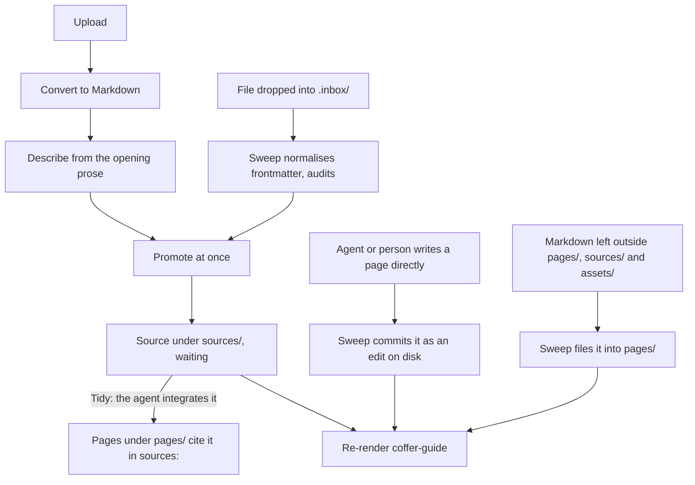
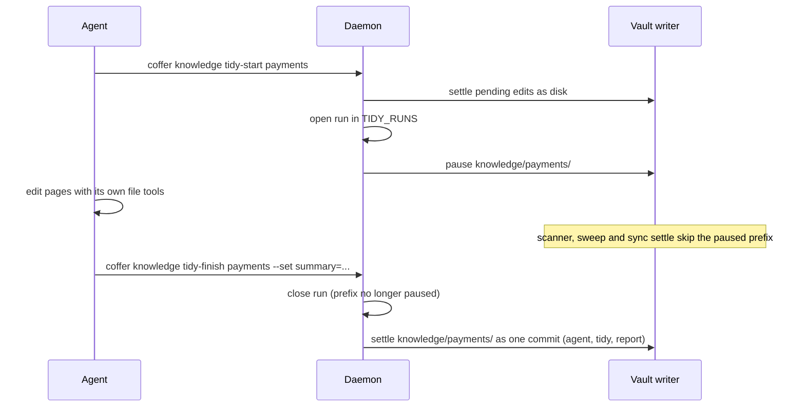
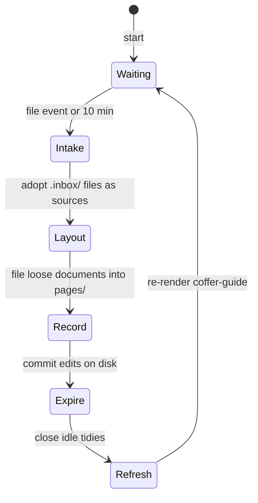

# 知识 {#knowledge}

这一页讲 Coffer 的知识层是怎么搭的：为什么它是不带索引的纯文件，为什么一个知识集是由保留下来的来源编译而成的页面 wiki，新素材如何立即变成来源，页面如何链接以及 Coffer 如何检查它们，智能体如何按 `coffer-guide` 技能教的规则写入、整合和整理，一次整理如何成为一次可以撤销的改动，每一次写入如何保存为 git 能显示、智能体能找回的版本，目录如何通过这个技能到达智能体，以及它如何与保险库同步共存。它面向想了解机制和背后理由的工程师。日常使用见 [知识指南](/zh/guides/knowledge)。

## 问题 {#the-problem}

知识是开发者对自己工作环境的了解：哪个团队负责某个服务、某个仓库的约定、某个坑以及怎么绕开它。好几个智能体需要读它，人和智能体都需要往里加东西。有四种失败模式塑造了这个设计：

- **副本会分叉。** 如果每个智能体各记各的笔记，一个智能体上午学到的东西，另一个下午就看不到。
- **检索工具没人用。** 需要智能体记得去调用的工具，算不上检索。有一次对 448 个 Claude Code 会话做了审计，当时语料已经建在一组知识工具和一个投递的技能后面，结果发现那个技能从没被加载过，也没有任何知识工具被调用过。而 Coffer 支持的每个智能体本来就有 `Read` 和 `Grep`，并且一直在用。
- **手工维护的链接会腐烂。** 同一份语料里，398 个内部文件引用中有 343 个是死链，每一个都是写进正文的文件名，被后来的一次改名弄坏了。
- **自由格式的文档不会累积。** 当每次上传都只是多出来的一篇独立文档、在整理并入其他内容时被原地改写、文档之间又不许互相提及时，知识集长成的是一堆载体，而不是一个个主题：没有任何东西记录哪些上传已经并进去了，没有任何东西能把一句话追溯到它的出处，智能体只能靠 grep 关键词去找相关材料。

知识也不同于 [记忆](/zh/architecture/memory)。知识关于外部世界，因为有人把它放进来才出现。它按知识集组织，通过技能来拉取。记忆关于用户和用户的项目，它在每个智能体的原生记忆里自己累积，Coffer 在智能体之间同步它。

## 设计决策 {#design-decisions}

| 决策 | 理由 |
| --- | --- |
| 一个知识集是 `~/.coffer/vault/knowledge/<collection>/` 下的一棵 Markdown 文件目录树。 | 每个智能体读的是同样的字节，所以不会有副本分叉。一个人在自己编辑器里的修改，下一次读取就生效。 |
| 每个知识集是一个 wiki：一个作为纲要的 `README.md`、保留下来的 `sources/` 和被编辑的 `pages/`。 | 这是 LLM Wiki 模式：素材按到达时的样子保留，智能体把它编译成一个个会累积的主题页面。见 [Knowledge Is a Wiki of Pages Compiled From Kept Sources](https://github.com/wyx-sg/Coffer/blob/main/docs/decisions/knowledge-is-a-wiki-of-pages-compiled-from-kept-sources.md)。 |
| 不要任何索引：没有表、没有 FTS、没有向量、没有缓存。链接图和检查在每次读取时从文件重建。 | 没有派生物，就不会有东西和文件不一致。没什么需要重建或调和。 |
| 文件的路径就是它所在的位置；页面或来源的 slug（它的文件名）是链接用的名字。 | 可读的 slug 就是人在文件管理器里看到的、智能体在 grep 结果里看到的东西，而且它不受整理时文件夹移动的影响。 |
| 元数据放在 YAML frontmatter 里。 | 只有文件本身是每个写入者（人、智能体和 Coffer）都看得到的。 |
| 上传保留转换出的 Markdown，图片放在 `assets/` 下；上传的文件本身留在上传它的那台 Mac 上，在保险库之外。来源从不编辑。 | 示意图和截图承载着智能体和人都需要的含义，去掉装饰和重复之后体积很小；原文件是 git 会永远背着的大二进制文件，而智能体读 Markdown 并不差。页面里的一句话也能追溯到它引用的来源。见 [Knowledge Sources Keep Their Images; Originals Stay on This Mac](https://github.com/wyx-sg/Coffer/blob/main/docs/decisions/knowledge-sources-keep-their-images-and-originals-stay-on-this-mac.md)。 |
| 素材立即变成来源。上传一到就保留下来，放进隐藏 `.inbox/` 的文件由下一次扫描保留。 | 没有任何东西要等模型连接或某一轮。提交的东西一分钟之内每个智能体都读得到。 |
| 哪些来源在等待，由页面的 `sources:` 列表推导出来。 | 一份记录已摄入内容的清单，会是第二份可能与页面不一致的记录。 |
| 页面用 `[[slug]]` 链接，从不用路径，Coffer 在读取时解析每个链接。 | 语料重组时路径会变；slug 只随改名而变，而改名弄坏的链接会立刻被报告出来，而不是悄悄腐烂。 |
| Coffer 在每次读取时算出机械的发现，一个都不修。修它们以及超出它们的判断，归智能体，在唯一的**整理**交接里完成，整理的提示词带着这些发现：能确定的就改，拿不准的写进汇报。 | 失效链接和缺失的 frontmatter 是遍历一次就能找到的事实；矛盾和过时是判断。单独一个只报告的交接与整理重复，而「先别改」在整理打开的会话里说一句就够了。 |
| 知识靠标记保持更新：页面依据的来源被标了 `superseded_by`，或者页面的 `verified` 日期早于 README 的 `verify_after_days`，就是一条发现，由下一次整理清掉。什么都不隐藏，什么都不删除。 | 我们调研过的产品，没有一个会把来源过期这件事传递到依据它写成的页面上；能保持更新的 wiki 用的是定时加待办队列。两者都只是每次读取时每个页面做一次比较。见 [Knowledge Stays Current Through Flags Coffer Computes and an Agent Clears](https://github.com/wyx-sg/Coffer/blob/main/docs/decisions/knowledge-stays-current-through-flags-coffer-computes.md)。 |
| Coffer 不在知识上运行任何模型。一条事实该放在哪里、哪些页面回答的是同一个问题、哪句话已经过时，由智能体按 `coffer-guide` 技能教的规则来判断。 | 人本来就在用的智能体有文件工具、更强的模型，还有人在看着。Coffer 自己另带一个无人值守的模型，需要它自己的连接，没配置时它的活就没人做。 |
| 只有人按下**整理**或**整理全部**时，才开始整理。Coffer 不会自己启动智能体运行。 | 无人值守的智能体运行会在人不知情时消耗他的额度，还会留下没人开过的对话。 |
| 一次整理就是一次提交：智能体工作期间，知识集在保险库写入者里被暂停，结束时把所有编辑连同智能体的汇报一次提交。一次整理可以作为一次新提交整体撤销。 | 分界就在历史本身里，所以改动记录、文件历史和同步看到的是同一个单位，撤销就是一次提交的逆操作。放在别处的分组，就成了历史的第二份记录。 |
| Coffer 只为维持结构而移动文件。 | 留在 `pages/`、`sources/` 和 `assets/` 之外的 Markdown 文档是放错了位置的页面；把它归位是机械的事，一次提交，不改写内容。 |
| 每一次被接受的写入都是一次写明写入者的 git 提交。 | 智能体改写的是唯一的那份副本。有了谁改了什么的历史，每次改动都可查看，每个版本都只隔着一次 `git` 或一次交给智能体的操作，而它也就是知识集的改动记录。 |
| 新的说法胜出，除非旧的说法被证明是对的。没有哪个写入者可以例外。 | 一句话可信与否，看它是什么时候说的、背后有什么证据，而不是谁写的：人的修改和智能体的修改都可能过时或出错。保险库的历史和从文件历史做的恢复是补救途径。 |
| 没有检索工具，目录搭在 Coffer 自己的技能里。 | 智能体用它们已经在用的工具读文件。知识层的任务是把正确的绝对路径摆到模型面前。 |
| 智能体用自己的文件工具直接写知识集的页面来添加知识。没有面向智能体的工具：Coffer 唯一始终列出的内置 MCP 工具是 `coffer__search_tools`。 | 智能体本来就会写文件。指南告诉它们写在哪里，扫描负责提交它们改的东西。 |
| 知识集没有闸门：没有按智能体的生效范围，也没有启用开关。每个知识集都提供给每个智能体。 | 技能把整个知识根目录交给了每个智能体。按智能体过滤或关掉某个知识集，只会缩短一张列表，而根目录照样暴露。 |

## 知识集目录树 {#the-collection-tree}

```text
~/.coffer/vault/knowledge/             # inside the vault repository
├── payments/                        # one collection = one knowledge Resource
│   ├── README.md                    # the schema; first paragraph is the description, then page types and rules
│   ├── sources/
│   │   ├── q3-review.md             # a source: converted Markdown + frontmatter
│   │   └── oncall-notes.md          # a source from a Markdown upload
│   ├── assets/
│   │   └── q3-review-1a2b3c4d/      # an upload's pictures: <title-slug>-<first 8 hex of its sha256>
│   │       └── image-1.png          # linked from the source as ../assets/q3-review-1a2b3c4d/image-1.png
│   ├── pages/
│   │   ├── session-ownership.md     # a page
│   │   └── infra/
│   │       └── cache.md             # nesting is allowed and means nothing
│   └── .inbox/                      # drop zone, adopted into sources/ by the sweep (hidden)
│       └── rate-limit-change.md
└── personal/
    └── ...
```

- **知识集** 是一个顶层目录，也是一个 `knowledge` 类型的资源，存为 `vault/resources/knowledge/<name>.json`。由人有意地在 Web 界面里创建它。读取、写入、智能体放到别处的文件和工作目录都不会自动创建知识集，也没有任何东西会从智能体的 cwd 推导出边界。知识层在任何地方都没有加表。
- **README** 位于知识集根目录，是这个知识集的纲要。它在第一个 `##` 小节之前的第一段就是这个知识集的描述；后面的小节是这个知识集的规则。新知识集的 README 会把默认值写出来（`collection_files.default_readme`）：frontmatter `verify_after_days: 90`、标题、描述、列出 `overview`、`concept`、`entity`、`how-to` 和 `decision` 的**页面类型**一节，以及**规则**一节，让人看到自己可以改什么。每次列出时都从磁盘读取，从不复制进资源文件，因为一旦有人编辑了 README，副本就错了。它关于页面类型和规则的内容优先于指南的默认规则，指南也是这样告诉智能体的。README 从不作为页面或来源列出，也不计数。知识集没有自己的标题：每个界面都用文件夹名展示它，资源更新也会拒绝标题。在 Web 界面里编辑描述只改写第一段（没有描述时插在第一个小节之上），README 其余部分保持不动，作为一次写明用户的提交；之后会重新渲染指南技能，因为智能体正是靠描述来认出这个知识集的。
- **文件是什么** 由它所在的位置决定。路径模块的 `kind_of` 对 `pages/` 下的 Markdown 文件返回 `page`，对 `sources/` 下的返回 `source`，其他一律返回 `file`，这类文件会被列出，但既不进目录，也不参与检查。
- `pages/` 和 `sources/` 里的**嵌套** 由归档页面的一方决定，可能是人，也可能是智能体。Coffer 不赋予这些文件夹任何含义；只有 `pages/`、`sources/` 和 `assets/` 这几个目录本身有含义。
- **`assets/`** 放从上传里取出的图片，每次上传一个文件夹（见[图片和原文件](#pictures-and-originals)）。它特意是可见的：保险库忽略隐藏条目，而图片必须和链接它们的来源一起提交、一起同步。图片是普通的 `file`。
- **隐藏条目**（以点开头）不计入任何计数，也不进目录和检查，没有任何界面会列出或读取它们。在知识集内部，Coffer 会读的是 `.inbox/`，它是一个投放区：留在那里的 Markdown 文件会被下一次扫描接收为来源。保险库仓库的 `.git/info/exclude` 忽略知识集里其他所有隐藏条目，所以它们既不会被提交，也不会被同步。这包括 `.obsidian/`，所以作为 Obsidian 库打开的知识集文件夹，不会把 Obsidian 的设置带进历史（见[在 Obsidian 中打开知识集](#opening-a-collection-in-obsidian)）。`.history/` 和 `.raw/` 并不存在：被替换的文字在 git 历史里，上传在知识集里保留为 `sources/` 里的 Markdown 来源和 `assets/` 里的图片。

### 路径与 slug {#path-and-slug}

文件名是由标题派生的 slug。slug 经过 NFKC 规范化并转为小写。CJK 字符保留，因为音译出来的名字谁都认不出。长度上限 80 个字符。重名时追加 `-2`、`-3`，以此类推：

```text
payments/pages/session-ownership.md
payments/pages/session-ownership-2.md
```

文件的路径就是它的身份；frontmatter 里没有 `id` 键，也没有任何东西把 id 映射到路径。页面或来源的 **slug** 是它去掉 `.md` 的文件名，链接用的就是这个名字（见[链接与检查](#links-and-the-check)）。两个位于不同文件夹的页面共用一个 slug，是一条发现，不是 Coffer 来解决的事。

### Frontmatter {#frontmatter}

页面：

```yaml
---
title: Session ownership
type: concept
description: Which team owns the session service and how to reach them.
sources: [q3-review, oncall-notes]
aliases: [sessions]
verified: '2026-10-12'      # when the page was last checked against its sources or the code
actor: agent
created_at: '2026-09-20T08:14:03.512+00:00'
updated_at: '2026-09-22T10:02:41.107+00:00'
reviewed_by: alice          # a key a person added; always preserved
---
```

来源：

```yaml
---
title: Q3 review
description: The quarterly review of the payments gateway.
actor: user
created_at: '2026-10-01T09:00:00.000+00:00'
updated_at: '2026-10-01T09:00:00.000+00:00'
original: q3-review.pdf     # the uploaded file, kept on the Mac that uploaded it
original_sha256: 1a2b3c4d…  # names that copy
---
```

Coffer 按固定顺序写来源的键：`title`、`description`、`actor`（`agent` 或 `user`）、`created_at`、`updated_at`，从上传文件转换来的来源再加上 `original` 和 `original_sha256`。智能体可以给来源加三个键，它们只描述来源，不改动它的内容：`ingest: skipped`、写明替换它的新来源的 `superseded_by: <slug>`，以及用一两句话说明它讲什么的 `summary`。Coffer 不写页面：页面的 `title`、`type`、`description`、`sources`（来源的 slug）、`aliases`、`verified`、`actor` 和时间戳，由写页面的一方按指南所教来写。`verified` 在读取页面时原样返回，并与 README 的 `verify_after_days` 比较（见[机械检查](#the-mechanical-check)）。默认的页面类型是 `concept`、`entity`、`how-to`、`decision` 和 `overview`；Coffer 接受任何非空字符串，所以定义了自己类型的 README 说了算。人加的任何其他键，在 Coffer 改写文件时都会保留，解析出的值不变。这一点很重要，因为丢掉一个不认识的键，就等于悄悄删掉了人写的 `tags:`。

frontmatter 的解析会降级而不是抛错：没有围栏的文件，或者围栏里的 YAML 格式不对的文件，会得到空的 frontmatter 和它的正文，所以一个手工编辑时多了个冒号的文件，不会弄坏整个知识集的遍历。

### 所有路径由一个模块负责 {#one-module-owns-every-path}

知识基础设施里有一个模块（`infrastructure/knowledge/paths.py`）负责构建所有路径，并命名 `pages/`、`sources/` 和 `assets/`，别处都不构建路径。每一段都要经过一个守卫，它拒绝空段、全是点的段、以点开头的段以及不在白名单里的段，所以 `payments/.inbox/x.md` 从任何界面都无法寻址。解析后的路径还会在它最近的已存在祖先上与知识根目录比对，所以根目录里的一个符号链接目录没法把写入带到外面去。写入先写到一个用 `O_EXCL | O_NOFOLLOW` 打开的同级临时文件，再做一次原子重命名，并通过保险库唯一的写入者提交。根目录永远是 `~/.coffer/vault/knowledge`，不能覆盖。

## 从素材到来源 {#from-material-to-source}

Coffer 提供的每个入口都以一个来源结束。没有哪个需要等。页面由人和智能体来写，不由 Coffer 写。

| 入口 | 界面 | 结果 |
| --- | --- | --- |
| 上传，先转换为 Markdown | 知识页面、`coffer knowledge upload` | 一个来源、`assets/` 下它的图片，以及留在这台 Mac 上的原文件 |
| 放进 `<collection>/.inbox/` 的 Markdown 文件 | Coffer 之外的智能体、另一台机器，或旧版指南；由扫描接收 | 一个来源 |
| 直接写进 `pages/` 的页面 | 智能体自己的文件工具，或人的编辑器 | 一个页面，作为在磁盘上编辑提交 |

没有任何入口会在指定路径创建页面，Web 界面里也没有手工输入页面的表单：人在自己的编辑器里写，或者上传。Web 界面只读地显示每个文件，并在编辑器里打开它。



### 提交 {#submission}

上传会先检查知识集是否存在，然后在知识集的 `sources/` 下写一个来源。它的正文就是转换出的文本原样。它的 frontmatter 由文本填充：`title` 取第一个 `# ` 标题（没有就用文件名），`description` 取第一段正文（没有就用标题），`actor` 记提交者。它以标题的 slug 命名，从不覆盖已有来源，因为两次同标题的提交就是两个来源。提交写明提交者，并记录一条 `knowledge_written` 审计事件。之后 Coffer 在守护进程的事件流上以 `knowledge` 事件宣告这个知识集，因为文件的变化并不涉及对知识集那一行的任何写入。

Coffer 从不把任何东西合并进页面。把来源编译进页面，是人按下**整理**时智能体的事（见[整理是智能体的事](#tidying-is-the-agent-s-job)）；在那之前，来源一直等待。

上传的答复会带上新来源的路径。

### 放进收件箱的文件 {#a-file-dropped-into-the-inbox}

文件可能出现在 `<collection>/.inbox/<any-name>.md`：来自 Coffer 之外的智能体、另一台机器上较旧的构建，或旧版指南。扫描会识别出没有任何 Coffer 界面写过的新收件箱文件，对它做**规范化**，然后用提交所用的同一个操作把它提升进 `sources/`：

- `title` 保留原样，没有就用第一个 `# ` 标题，再没有就用文件名的主干。
- `description` 保留原样，没有就用第一段正文，再没有就用标题，和上传用的回退一样。
- `actor` 按所写保留（它是自报的），没有就是 `agent`。
- `created_at` 和 `updated_at` 保留原样，没有就用扫描发现这个文件的时间。
- 写入者设置的其他键全部保留。

每个文件记录一条 `knowledge_written` 审计事件，当 actor 取自文件时会带标记。写在不是知识集的顶层目录里的 Markdown 文件不会被处理，也不会进目录，因为只有人才能创建知识集。收件箱里不是 Markdown 的文件原样留着，记录日志，不会被提升。

### 上传 {#uploads}

上传按顺序经过四个步骤：

1. **限定上传。** 每次调用一个文件，最大 20 MiB，不选文件夹。在花力气转换之前，先拒绝未知的知识集。
2. **转换。** 转换器注册表按扩展名分派。先走透传（Markdown、文本和源码文件），然后是 CSV，其余都交给 MarkItDown，它同时取出图片（见[图片和原文件](#pictures-and-originals)）。不支持的类型会以 `INGEST_REJECTED` 和 `reason: unsupported_type` 拒绝。转换后没有文本的（比如纯图片 PDF）也会拒绝。两种情况下都不写任何东西：没有来源、没有图片、没有原文件，也没有收件箱文件。
3. **描述。** 描述取来源的第一段正文，再没有就取标题。它从不为空。没有任何模型来写它。
4. **提升这份 Markdown**，`actor: user`，存为 `sources/<slug>.md`，它的图片在同一次提交里放进 `assets/`；除非走的是透传转换器，frontmatter 里还会写上 `original` 和 `original_sha256`。重名时给来源的名字加上后缀（`-2`）。来源提交之后，上传的字节保存在这台 Mac 上；保存失败只记日志，丢的只是本机副本。

20 MiB 的上限不变。

### 图片和原文件 {#pictures-and-originals}

**图片。** 由 `infrastructure/knowledge/converters/images.py` 取出。MarkItDown 以 `keep_data_uris` 运行，所以 Office 或 HTML 文档里的图片以内联的 `data:` URI 到达；每一张都被解码，并替换成一个简单的名字（`image-1.png`）。PDF 的文本层不带图片，所以由 pdfminer 读出每一页上的图像，列在正文之后的 `## Images` 下，每页一个 `Page N:` 标题。保留的数量有上限：一边不到 48 px 的图片算装饰，丢掉且不留痕迹；超过 5 MB 的丢掉；重复的图片（同样的字节，比如每张幻灯片上的标志）只保留一份，它出现过的每个位置都链接这一个文件；一次上传最多保留 40 张；浏览器不能显示的格式用 Pillow 重新编码为 PNG。读不出来的图片跳过；纯图片 PDF 仍然拒绝，因为没有文字。

`infrastructure/knowledge/assets.py` 在写来源之前先给这次上传的文件夹命名，即 `<标题 slug>-<上传内容 SHA-256 的前 8 位十六进制>`，把 Markdown 里的每个简单名字改写成 `../assets/<文件夹>/image-N.ext`，并在和来源同一个保险库事务里写入图片，所以来源和它的图片是一次提交、改动流里的一条改动、一次撤销。删除来源会留下它的文件夹；孤立的图片没有人清理。

`GET /api/v1/knowledge/asset?path=` 返回图片的字节和媒体类型，支持 `png`、`jpg`、`jpeg`、`gif`、`webp` 和 `svg`，最大 10 MB，经过和读取相同的路径守卫，接入的文件夹则经过它自己的守卫。其他一律是 `404 KNOWLEDGE_FILE_NOT_FOUND`。Web 界面的阅读器把 Markdown 文档里每个相对图片链接按文档路径解析，通过这个路由取回（它需要守护进程的令牌，浏览器不能把它当普通 URL 加载），以 data URL 显示；从树里打开的图片也这样显示。这个路由读取的是普通文件，所以没有对应的命令。

**原文件。** `infrastructure/knowledge/originals.py` 把上传的字节保存在 `~/.coffer/local/knowledge-originals/<sha256><.ext>`，权限 `0600`，同样的内容只写一次，经由临时文件再重命名。它属于本机类别，所以从不提交、从不同步。读取时根据来源的 `original` 和 `original_sha256` 解析出 `original_path`：副本在这里时是绝对路径，来源来自另一台 Mac 时是 `null`。`GET /api/v1/knowledge/file` 同时带上 `original` 和 `original_path`。Web 界面在来源标题下显示**原文件 `<name>`**，文件名是一个按钮，请守护进程用默认应用打开它（`POST /api/v1/fs/open`）；没有本机副本时，显示原文件在上传的那台 Mac 上。Markdown 或文本上传不保留原文件。来源被删时不会删除原文件，所以撤销找回的来源还能找到它。

`markitdown` 是延迟导入的。一条 import-linter 契约把它限定在知识转换器和消息渠道的文档提取里。

### 直接编辑 {#direct-edits}

直接写、改、删一个页面，无论是在你的编辑器里还是用智能体自己的文件工具，都是修改知识的完整方式。不需要导入或注册步骤，改动在下一次读取时就生效。扫描会把它作为在磁盘上编辑提交（见[历史](#history)）。通过 Coffer 删除页面或来源是人在 Web 界面里的动作。Coffer 不提供任何能删除东西的工具。

Web 界面不编辑文件：文件的窗格是只读的（预览和源码），带**在编辑器中打开**和**在访达中显示**，所以没有保存路由、没有文件指纹，也没有保存过期的拒绝。Coffer 的路由表里没有任何一条会写页面的文字。

## 链接与检查 {#links-and-the-check}

`infrastructure/knowledge/wiki.py` 把一个知识集的 `pages/` 和 `sources/` 遍历一次，构建出内存里的 `WikiGraph`：每个页面连同解析后的 frontmatter 和出站链接，每个来源连同它是否被跳过，以及把名字解析到文件的映射表。什么都不存储；每次读取都重新构建。一个知识集最多几百个文件，一次遍历只需几毫秒。

### 链接 {#links}

链接写作 `[[target]]` 或 `[[target|text]]`，可以出现在页面正文中代码片段和围栏代码块以外的任何地方，所以作为示例写出来的链接不算链接。`target` 会对照每个页面的 slug、每个页面的 `aliases` 和每个来源的 slug 来解析。匹配时忽略大小写和 Unicode 宽度，用的是文件名所用的同一种 NFKC 规范化，并容忍末尾的 `.md` 或开头的文件夹，所以写成路径的链接照样能解析。什么都指不到的 target 是**失效**的；指到不止一个不同文件的是**有歧义**的。页面的 `sources:` 条目只对照来源的 slug 解析；什么都指不到的条目是**缺失的来源**。

读取页面时，会带上每个链接及其解析到的路径（或没有），以及每个来源条目的路径和标题；读取来源时，会带上引用它的页面、它是否在等待、替换它的来源（slug、路径和标题，指不到来源时路径为空）以及它的摘要。树的列表会带上每个文件的种类和来源是否在等待，所以 Web 界面不需要第二次调用就能标出等待中的来源。

### 等待中的来源 {#waiting-sources}

只要没有页面在 `sources:` 里列出某个来源的 slug，而它的 frontmatter 既没有设置 `ingest: skipped`，也没有设置 `superseded_by`，这个来源就处于**等待**状态。这在每次读取时从页面推导出来；Coffer 不保留任何其他关于哪些已整合的记录。页面引用一个来源，就是整合它的含义。

### 机械检查 {#the-mechanical-check}

Coffer 在每次读取时从这张图算出知识集的发现，一个都不保存，一个都不修：

| 发现 | 规则 |
| --- | --- |
| `dead_link` | 一个什么都解析不到的链接，带页面和 target。 |
| `ambiguous_link` | 一个解析到不止一个文件的链接。 |
| `duplicate_slug` | 两个页面共用一个 slug，或者一个别名指到两个页面。 |
| `missing_source` | 一个指不到任何来源的 `sources:` 条目，或者来源里指不到任何来源的 `superseded_by`。 |
| `superseded_source` | 页面引用了一个已被替换的来源，却没有引用替换链上任何更新的来源。`others` 是最新的替换者。 |
| `incomplete_page` | 缺少 `title`、`type` 或 `description` 的页面。 |
| `unsourced_page` | 没有 `sources:` 的页面。 |
| `stale_page` | `verified` 缺失、不是日期，或早于知识集期限的页面。target 是原样写着的 `verified`，缺失时为空。 |
| `orphan_page` | 知识集有两个或更多页面时，没有任何其他页面链接到的页面。`type` 为 `overview` 的页面除外：overview 是入口。 |
| `waiting_source` | 一个等待中的来源。 |

**替换。** `superseded_by` 像 `sources:` 条目一样按来源的 slug 解析，只有恰好指到一个来源时才算替换。`WikiGraph.successors` 从一个来源沿着替换链往下走（v1 → v2 → v3），遇到重复就停，所以循环不会卡住读取。只有页面一个更新的来源都没引用时才会被标出，这条发现写明链上最后一个来源，也就是整理时应该拿来重新核对的那一个。已被替换的来源从不等待。

**重新核对的期限。** `wiki.build` 每次都从 README 的 frontmatter 读 `verify_after_days`：没有时是 90，`0` 会关闭这个知识集的 `stale_page`，负数或不是整数的值按 90 算，而不是让读取失败。`verified` 按日期读（时间戳只取日期部分）。

`GET /api/v1/knowledge/collections/{uid}/check` 返回知识集和它的发现，`coffer knowledge check` 打印它们。知识集列表带有 `page_count`、`source_count`、`waiting_source_count` 和 `finding_count`，每个知识集遍历一次算出，还带有整理交接和 `tidy_running`。没有任何路由会修复一条发现。

`GET /api/v1/knowledge/collections/{uid}/files`（`coffer knowledge files`）返回一个知识集的每个页面和来源，带标题、描述、写入者、时间、种类、页面类型、页面是否 `stale`，以及来源的待整理标记、`superseded_by`（它解析到的路径）、`summary`、`cited_count` 和 `skipped`，用的是树所用的同一次遍历。内容里的来源按等待中、当前、已被替换的顺序排列。知识集页面的**内容**按页面类型把它分组；它是单独的路由，好让列表保持轻量。

## 整理是智能体的事 {#tidying-is-the-agent-s-job}

把来源编译进页面，把一条事实放到它该在的地方，把回答同一个问题的页面合成一个，把回答好几个问题的页面拆开，纠正错误的内容，这些都是判断。Coffer 一样都不做。人平时用的智能体有文件工具，还有人在看着，所以判断放在它加载的 `coffer-guide` 技能里，由人用一个按钮来启动。见决策[整理知识是智能体的事：一次交接，记成一次改动](https://github.com/wyx-sg/Coffer/blob/main/docs/decisions/tidying-knowledge-is-the-agents-job.md)。

### 指南教了什么 {#what-the-guide-teaches}

知识功能开着时，指南的知识部分描述结构（README 是纲要，它的页面类型和规则优先于指南的默认规则，还有它的 `verify_after_days`；保留下来的 `sources/` 和被编辑的 `pages/`），并带有三条指示。

**写一个页面。** 智能体学到持久的东西时，用自己的文件工具把这条事实直接写进知识集的页面，遵循七条规则：

1. **找到它的归属。** 读目录，在 `pages/` 里 grep 这个主题。把事实并入拥有它的那个页面里它该在的小节，只有没有页面拥有这个主题时才在 `pages/` 下新建页面。
2. **一个字都不丢。** 整合，不要重新生成。被重写的页面里原有的每条事实都要保留。
3. **按主题组织，不按来源。** 不要出现「今天新增」这样的小节。
4. **新的说法胜出，除非旧的说法被证明是对的**：来源、日期、命令输出或代码，不论谁写的哪一条。被取代的说法仍然看得到，并注明改正的日期。
5. **用 `[[slug]]` 链接页面，从不用路径。** 给页面改名时，更新指向它的链接，或把旧 slug 留在 `aliases` 里。
6. **从不编辑来源**，只能加上 `ingest: skipped`、`superseded_by` 或 `summary`。
7. **给每个页面写 frontmatter**：`title`、`type`、一行说明这个页面回答什么问题的 `description`、它的 `sources`、可能有的 `aliases`、最近一次对照来源或代码核实的日期 `verified: YYYY-MM-DD`，以及 `actor: agent`。人加的键不动。出处写在 `sources` 和 `verified` 里，从不在正文里写一段列出读过什么。

这一节还告诉智能体**把查出来的答案写回去**：读了来源、代码或某个系统才找到、页面里还没有的答案，要在结束前写进拥有这个主题的页面，设好 `sources` 和 `verified`，并用一句话告诉人它加了什么。猜测、观点或只在那次对话里成立的东西不写。

**整合来源。** 从最早的开始，完整读每个等待中的来源和 README；把它的内容并进拥有相应主题的页面，为没有页面的主题新建页面，把来源的 slug 加进因它而改动的每个页面的 `sources`，给来源写上 `summary`，给被它替换的旧来源标上 `superseded_by` 并重新核对引用旧来源的页面，并给没有任何值得保留内容的来源标记 `ingest: skipped`。

**整理一个知识集。** 一次一个知识集：改动任何东西之前运行 `coffer knowledge tidy-start <collection>`；整合它等待中的来源；修好提示词列出或 `coffer knowledge check` 打印的机械发现；对照来源或代码重新核对每个需要重新核对的页面，并把 `verified` 设为今天，核对不了的留给汇报；给每个没有 `summary` 的来源补上；读 README 和每个页面的标题与描述，再完整读页面；合并回答同一个问题的页面，保留每条事实和每个来源，并把被合并掉的 slug 留在保留下来的页面的 `aliases` 里；拆分回答好几个问题的页面，并把拆出的部分互相链接；修正错误、过时或矛盾之处，以及没有说明页面回答什么问题的描述，并给没有页面的主题建一个页面；拿不准的不动手（两个页面说法冲突却看不出哪个对、要删掉大段内容、要改 README 里的页面类型），写进汇报；最后运行 `coffer knowledge tidy-finish <collection> --set summary="<汇报>"`，汇报写明整合或跳过了哪些来源，合并、拆分、修正、重新核对和删除了什么，以及留给人决定的事，最后是**缺口**：页面回答不了的问题、没有页面负责的主题，以及值得去找的来源。只被要求检查或审阅时，智能体只报告，什么都不改。

代码不强制其中任何一条规则。它们是技能里的文字，防范一次糟糕编辑的是历史和机械检查，而不是写入时的拒绝。

### 「整理」交接 {#the-tidy-hand-off}

提示词由守护进程写，用的是其他所有交接都用的同一个交接模块（`application/knowledge/tidy_handoff.py`，由 `domain/handoff` 渲染）。读取一个知识集会带上 `tidy_handoff`，它写明知识集名、绝对路径、页面数、待整理来源数，以及按种类分组的机械发现及其路径（最多 40 行，之后写明还省略了多少条），并列出步骤：`tidy-start`、整合等待中的来源、修好这些发现、合并拆分修正、重新核对过期页面并给来源写摘要、拿不准的写进汇报、用以缺口结尾的汇报 `tidy-finish`。`GET /api/v1/knowledge/tidy-handoff` 为所有知识集一次返回同类提示词：它写明知识根目录以及每个知识集的路径和页面数、待整理来源数、发现数，请智能体按同样的步骤一个一个地处理，并用 `coffer knowledge check <collection>` 读出每个知识集的发现。

Web 界面在知识集页面上提供**整理**，在知识页面页头提供**整理全部**。按下任何一个，都会在首选终端里启动默认的交接智能体，把这份提示词作为它的第一条消息，走的是与其他所有交接相同的路径。没有可用的托管智能体时，按钮只提供**复制提示词**。人按下的是一个以这件事命名的按钮，提示词只编辑 Coffer 自己的文件，而且整次整理可以撤销。

没有第二个只报告的交接。什么都不改的检查与整理自己的步骤重复；想先听意见的人，在整理打开的会话里直接说，指南会告诉智能体这时什么都不改。

### 一次整理就是一次改动 {#a-tidy-is-one-change}

智能体用自己的工具编辑文件，磁盘上发现的编辑通常会在安静下来后提交为 `disk` 写入。这样一次整理就成了一串没有分界、没有汇报的 `disk` 提交。为此，智能体用提示词里写明的两条命令把它的工作括起来：



- **开始**（`POST /api/v1/knowledge/collections/{uid}/tidy/start`）先把知识集里已有的改动提交为 `disk`，让这次整理只包含智能体做的事，然后在 `TIDY_RUNS`（`infrastructure/knowledge/tidy_runs.py`）里登记一次运行。对已开始的整理再开始一次，保持原样。
- **进行中**，`VaultWriter.set_paused` 把知识集的路径前缀交给写入者，每次调用都从登记表里读。`pending()` 和 `settle()` 跳过暂停的路径，所以保险库的扫描器、扫描、Coffer 的其他写入和同步的一轮都不会提交它们。一轮同步要改动的文件若在暂停中，它会等待，就像对待任何未提交的编辑一样。读取看到的是磁盘上的文件。
- **结束**（`POST .../tidy/finish`，请求体 `{summary}`）先关闭运行，再把知识集待提交的路径作为一次提交：写入者 `agent`，操作 `tidy`，汇报（合并空白，截到 4,000 个字符）作为摘要，`Coffer-Status: reported`。它返回这次改动；什么都没改时返回 `change: null`。没有开始的整理时调用结束，仍会把知识集待提交的编辑作为一次整理提交。
- **闲置到期。** 每次运行都记着一个指纹：知识集待提交的路径及其摘要。扫描每次触发都比较它；有变化就重置闲置计时，闲置 30 分钟的运行会被关闭，不带汇报，`Coffer-Status: expired`。所以不会因为智能体停下来就让知识集一直暂停。
- **只在内存里。** 登记表是对一次进行中的会话的记账，不是知识，所以既不存储也不同步。守护进程重启会忘掉进行中的运行；下一次落定会把它的编辑提交为普通的 `disk` 写入，丢掉的只是分组。

知识集的读取带有 `tidy_running`，知识集页面会提示整理正在进行。开始和结束各记一条 `knowledge_edited` 审计事件（`tidy: started`、`tidy: finished`，带版本和文件数）。这项决策以及其他方案（给每次磁盘提交加 trailer 并在读取时分组、在界面里按时间分组、另建一个运行记录存储）见 [Tidying Knowledge Is the Agent's Job, One Hand-Off Recorded as One Change](https://github.com/wyx-sg/Coffer/blob/main/docs/decisions/tidying-knowledge-is-the-agents-job.md)。

### 撤销一次整理 {#undoing-a-tidy}

`POST /api/v1/knowledge/changes/{version}/undo`（`coffer knowledge undo`，请求体 `{force}`）把这次改动动过的每个知识文件放回它之前的样子（`collection_writes.undo_change`）。对每个路径，它读三个版本：这次改动时的字节、磁盘上现在的字节、这次改动的父提交里的字节。任何一个路径现在的字节和改动时不同，就说明之后有过编辑，撤销会以 `409 KNOWLEDGE_UNDO_CONFLICT` 拒绝，`details.documents` 列出这些路径，什么都不写，除非设置了 `force`。否则每个路径都换回父提交里的字节，之前不存在的就删除，全部在一次记录事务里完成：一次由用户写入的提交，操作 `restore`，`Coffer-Undoes: <version>`。没有动过任何知识文件、或文件已经和父提交一致的版本，会以 `400 KNOWLEDGE_NOT_A_CHANGE` 拒绝。撤销记一条 `knowledge_edited` 审计事件，带 `undoes`、路径和它丢掉的之后的编辑。那次整理留在历史里，排在撤销之前；被丢掉的编辑也留在历史里。

这个路由适用于任何动过知识文件的改动；Web 界面把它放在改动记录里一次整理那一条上，叫**撤销这次整理…**，确认对话框会在发送 `force` 之前按标题列出之后被改过的文件。

### 没有什么会无人值守地整理 {#nothing-tidies-unattended}

整理只在人按下它，或请自己的智能体去做时才运行。定时启动智能体运行会在人不知情时消耗他的额度，还会留下没人开过的对话。机械的扫描和机械的检查归 Coffer；判断不归。

### 优先级 {#precedence}

有两条规则关乎判断，所以放在指南里，不在代码里：

- **新的说法胜出，除非旧的说法被证明是对的。** 新素材与某个页面矛盾时，页面会被改正，除非来源、日期、命令输出或代码表明较旧的说法才是对的。被取代的说法仍然看得到，并注明改动的日期，例如「（此前记录为 X；2026-09-20 改正）」。
- **没有哪个写入者可以例外。** 人、智能体和一次整理，都按一句话是什么时候说的、背后有什么证据来评判，而不是按谁写的。

保护数据的是机械手段。Coffer 不在页面上保存人的任何文字，所以浏览器里的旧副本不可能回滚智能体的编辑。Coffer 自己做的改写会保留它没设置的每个 frontmatter 键。智能体的每次编辑都是历史里的一个版本，版本可以从文件的历史恢复。

## 在 Obsidian 中打开知识集 {#opening-a-collection-in-obsidian}

知识集的结构正是 Obsidian 原生能读的：普通 Markdown、按文件名解析的 `[[slug]]` 链接，以及 `aliases` frontmatter。Obsidian 在守护进程检测的编辑器列表里（`application/fs/editor_service.py`），只有 `GET /api/v1/fs/editors` 列出它时，Web 界面才会在知识集和文件的 ⋯ 菜单里提供**在 Obsidian 中打开**，通过 `POST /api/v1/fs/open` 用它打开路径。Obsidian 把设置存在 `.obsidian/` 里，这是保险库忽略的隐藏条目。在 Obsidian 里保存和在任何编辑器里一样，是一次磁盘上的编辑；Obsidian 在 `pages/` 和 `sources/` 之外新建的笔记会被扫描移进 `pages/`，所以指南让人把 Obsidian 新建笔记的默认位置设成 `pages/`。

## 接入的外部文件夹 {#linked-folders}

**接入的外部文件夹**是一个人在这台机器任意位置、用自己的工具维护的知识集，比如一个 Obsidian 库，Coffer 只把它共享给智能体。它和知识集是同一个 `knowledge` 类型，只是配置不同，但知识集的那套机制它一样都没有：知识根目录下没有目录树，没有 wiki 结构，没有历史，不参与扫描、检查和整理。理由见 [A Linked Knowledge Folder Is Shared in Place, Read-Only to Coffer, and Recorded Machine-Local](https://github.com/wyx-sg/Coffer/blob/main/docs/decisions/linked-knowledge-folders-are-read-only-and-machine-local.md)。

### 只留在本机的记录 {#the-machine-local-row}

`POST /api/v1/knowledge/collections/link`（`application/knowledge/linking.py`，`coffer knowledge link`）检查文件夹，然后注册一个配置为 `{"folder": "<绝对路径>"}` 的资源。`KnowledgeConfig` 只有这一个可选字段；Coffer 自己保存的知识集不设置它，磁盘上仍是 `{}`。这个类型的 `storage_row` 钩子（`application/knowledge/kind.py`）把指向文件夹的记录归入 `local` 类，所以文件是 `~/.coffer/local/resources/knowledge/<name>.json`（主目录写成 `${HOME}`），从不提交、从不同步；智能体和渠道也是这样留在本机的。名称默认取文件夹自己的名字，只是一个标签：对接入的文件夹，`on_rename` 什么都不做，`on_delete` 跳过目录清理、只重新渲染指南，所以断开接入时每个文件都留在原处。

### 读取路径 {#the-read-path}

`infrastructure/knowledge/linked.py` 是唯一接触接入文件夹的代码，而且只读。它有自己的路径守卫，因为文件夹在 `paths.py` 守护的根目录之外，而人自己的文件名可能含有 `paths.py` 拒绝的字符：它拒绝隐藏的路径段、反斜杠或 NUL，以及任何解析到文件夹之外的路径（包括指向外面的符号链接）。各个界面仍然以名称开头来指代接入的文件夹，即 `<名称>/<文件夹内的路径>`，所以目录树和文件路由不用改就能服务它；行指向文件夹时，`KnowledgeService.find_collection` 把读取交给 `linked.py`。遍历会跳过隐藏目录、`node_modules` 和 `__pycache__`，最多 5000 个 Markdown 文件；超过 2 MB 的文件会列出，但不读取正文。笔记的标题取 frontmatter 的 `title`，没有就取第一个 `# ` 标题，再没有就用文件名。知识集列表带有 `linked`、`note_count`、`rules_file`（根目录下 `AGENTS.md`、`CLAUDE.md`、`README.md` 中第一个存在的），以及取自文件夹自己 `README.md` 的描述；文件夹不见了时，列出来就是没有笔记。

### 在指南里 {#in-the-guide}

`guide_render.py` 在 `coffer-guide` 目录里给接入的文件夹单独一节，排在 Coffer 自己保存的知识集之后：`### <名称> (linked folder)`、它的 README 描述、主目录写成 `~` 的路径（这样不同机器渲染出的内容逐字节一致）、一行话让智能体在往里写任何东西之前先遵守文件夹自己的规则文件（没有规则文件时，只按现有笔记的写法来写），并说明 Coffer 的 `pages/`、`sources/`、收件箱和整理在这里都不适用；然后按文件夹内的相对路径和标题列出笔记。目录缩减到只剩数量时，接入的文件夹只列笔记数。指南的说明部分有一段话概括同样的意思；文件夹里有笔记时，技能的描述会写出它的主题。

### 被拒绝的操作 {#what-is-refused}

`KnowledgeService.collection_rows()` 只返回 Coffer 自己保存的知识集，所以扫描、全部整理和历史都看不到接入的文件夹。每次写入、整理、检查和描述编辑都要经过 `owned_collection(uid)` 或 `require_collection(relpath)`，它们抛出 `CollectionIsLinked`，回答为 `409 KNOWLEDGE_COLLECTION_LINKED`；上传和删除文件也会得到同样的拒绝。接入不存在的文件夹、相对路径、Coffer 自己的目录或包含它的文件夹（主目录、磁盘根目录）会得到 `400 KNOWLEDGE_FOLDER_REFUSED`；名字已被占用，或文件夹已经接入过，会得到 `409 KNOWLEDGE_COLLECTION_EXISTS`。

## 扫描 {#the-sweep}

扫描是守护进程里跑在共用可唤醒循环上的后台 worker，不调用任何模型。`knowledge/` 下有文件变化时它就运行（借用保险库扫描器的文件监听，一连串事件只跑一次），打开 `knowledge` 功能时也会运行，此外每 10 分钟兜底一次。还在静默一分钟内的零散文档，会在那一分钟过去后再触发一次运行，因为这件事没有文件事件来通知。



每次运行，worker 恰好做五件事：

1. **接收 `.inbox/` 文件。** 知识集收件箱里每个新的 Markdown 文件都会被规范化，并作为来源保留在 `sources/` 下（见[放进收件箱的文件](#a-file-dropped-into-the-inbox)）。它提升的东西，都会以 `knowledge` 事件宣告。
2. **归置零散文档。** 知识集里位于 `pages/`、`sources/`、`assets/` 和隐藏条目之外、不是根目录 `README.md`、并且 60 秒没被动过的 Markdown 文件，会被移到 `pages/<相同的相对路径>`，重名时加后缀。一个知识集在一次触发中的所有移动是一次由 `daemon` 写入者以 `layout` 操作做的提交，文字从不改写。这一分钟的静默期保证不会把智能体还在写的文件从它手底下挪走。在页面和来源出现之前建的知识集，就是这样在升级后的第一次扫描时归入新结构的；写错位置的智能体也会在一分钟内被纠正。`infrastructure/knowledge/layout.py` 负责找出并移动文件；`application/knowledge/layout.py` 负责提交。
3. **提交磁盘上的编辑。** 自上次提交以来树里变过的任何东西，比如人的编辑器或智能体的文件工具，都会通过保险库写入者提交为在磁盘上编辑，这样历史保持最新，智能体写的东西也不会被算作 Coffer 的。有进行中整理的知识集处于暂停状态，不动它（见[一次整理就是一次改动](#a-tidy-is-one-change)）。
4. **关闭闲置的整理。** 知识集 30 分钟没有变化的整理，会在那之后的第一次运行中作为一次改动提交，不带汇报，状态为 `expired`。
5. **重新渲染指南技能**，这样手工添加的页面也会被编入目录。渲染出的字节没变就什么都不写。

某一项失败只记日志，从不终止循环；某个移动不了的文件会记日志并跳过。`knowledge` 功能关闭期间，扫描跳过它的各轮，知识集原样留在磁盘上。关闭时取消任务，不等待。

扫描在每台机器上都运行。它只写它提升的东西和它做的移动，而且这些写入和其他写入一样走保险库的普通写入者，所以它不会对[保险库同步](/zh/architecture/vault-sync)的一轮持有任何东西，也不等任何一轮。因为它不改写任何文件的内容，两台机器扫描同一个保险库，也不可能把同一个条目并进两个不同的页面。

## 历史 {#history}

对知识集的每一次被接受的写入，都是一次写明 **写入者** 的 git 提交，这遵循「每次保险库写入都是一次写明写入者的已校验提交」这项决策。因此一个文件的历史就是一串版本，每个版本有写入者、时间和 diff，用 git 读取；任何版本都可以找回。知识集的历史就是它的改动记录；不需要维护一个 `log.md`。

### 写入者 {#writers}

| 写入者 | 涵盖什么 |
| --- | --- |
| `user` | 人的上传、删除、对删除的撤销或对整理的撤销、知识集描述的修改，以及知识集的创建、改名和移除。 |
| `agent` | 一次整理（操作 `tidy`，智能体的汇报作为摘要），以及智能体的提交到达即被提升，写明是哪个智能体，比如它放进收件箱的文件。 |
| `daemon` | 扫描把零散文档移进 `pages/`（操作 `layout`）。Web 界面把它显示为 **Coffer**。 |
| `curation` | 早期版本的 Coffer 作为整理轮次做的提交。它在历史里保留这个标签。 |
| `sync` | 保险库同步应用的路径。 |
| `disk` | 在树里发现的其他任何改动：人自己的编辑器、智能体自己的文件工具。 |

在 Coffer 之外做的改动从不算作 Coffer 的。保险库的扫描器会在文件安静下来之后，把人或智能体自己的工具改的东西提交为 **在磁盘上编辑**；每次扫描触发和每次读取改动流之前，它也会这么做，只有被进行中的整理暂停的知识集除外。

### 存在哪里 {#where-it-lives}

历史就是保险库仓库本身的历史：知识集位于 `~/.coffer/vault` 的 `knowledge/` 下，所以一个文件的历史就是这个仓库里那个文件的历史，读取方式是 `git -C ~/.coffer/vault log -p -- knowledge/<collection>/<path>`。Coffer 的知识路由为改动流读取它（`GET /api/v1/knowledge/changes`，可以按知识集过滤），知识集页面的**改动记录**列出它，删除的撤销也读它。改动记录把一次整理显示为带汇报的一条，并把相隔不到 10 分钟的连续 `disk` 改动合成一条方便阅读；这个分组是页面做的，历史里什么都不变。

知识提交带有保险库的 trailer，外加知识专用的那些（`Coffer-Writer`、`Coffer-Operation`、`Coffer-Actor`、`Coffer-Agent`、`Coffer-Collection`、`Coffer-Item`、`Coffer-Status`、`Coffer-Restored-From`、`Coffer-Undoes`）；一次整理的 `Coffer-Status` 是 `reported` 或 `expired`。git 运行时，用户的全局和系统配置被固定到 `/dev/null`，所以个人的 hook、签名规则或别名都改变不了记录的内容。保险库依赖 git：没有 git 时，守护进程会[等待 git](/zh/architecture/daemon#waiting-for-git)，并把安装交给智能体。

### 撤销删除与较早的版本 {#undoing-a-delete-and-older-versions}

文件的**历史**按钮会在整个知识区域打开它的历史（地址里带 `?history=1`），列出它的版本，显示选中版本的 diff 并可以恢复它，由 `GET /api/v1/vault/history`、`GET /api/v1/vault/diff` 和 `POST /api/v1/vault/restore` 提供（见[持久化](/zh/architecture/persistence)）。历史打开时树和文件都让开，旧的 `/history` 路径段会重定向到历史。树里展开了哪些知识集和文件夹保存在浏览器的本地存储里（`coffer.knowledge.tree.*`），所以回来时树还是离开时的样子。恢复是 Coffer 自己的写入：一次由用户写入的新提交，带 `Coffer-Operation: restore` 和 `Coffer-Restored-From: <commit>`，并记为一个 `vault_file_restored` 审计事件。读取历史之后文件又变了，就会被拒绝，返回 `VAULT_FILE_STALE`；之前的历史保持完整。提示消失之后，被删除的文件就没有窗格可以打开历史了，但它的版本仍留在保险库的 git 历史里，所以可以用 git 取删除之前的那个版本找回。

删除有它自己的撤销，只在提示里的**撤销**还开着的时候。一次删除（一个文件或整个知识集）本身就是改动流里的一条改动，列出它移除的每个文件。撤销（`POST /knowledge/changes/{version}/restore`）会从删除之前的那次提交读出每个被删的文件，逐字节写回，作为一次写明用户、带 `Coffer-Restored-From` 的新提交。文件回到它的知识集。知识集会先写回它的页面、来源、README 以及仍留在它收件箱里的文件，最后才以原来的名字写一个新的资源文件，所以中途失败不会留下注册行，也不会留下残缺的目录。如果恢复会覆盖东西，就什么都不写：同一路径上已有文件，或同名知识集已存在，都会被拒绝；恢复一条不是删除的改动也会被拒绝。一次恢复会记录一条 `knowledge_edited` 审计事件，写明它撤回的是哪次删除。知识集的注册信息无法从 git 找回，所以**删除知识集**会先询问；删除文件则不用，因为它的文件只隔着一次恢复。

## coffer-guide 技能 {#the-coffer-guide-skill}

目录通过 Coffer 自己的技能 `coffer-guide` 到达智能体。它是一个普通的 `skill` 资源：`~/.coffer/derived/skills/coffer-guide/` 下一个主文件夹，一个来源为 `builtin` 的派生资源文件，并像任何导入的技能一样以同样的目录链接投递到每个智能体里。见 [技能](/zh/guides/skills)。知识层只贡献 **文字**，别的什么都不管。

### 渲染 {#rendering}

渲染器（`application/knowledge/guide_render.py`）是纯函数式的：文本进、文本出，除了它自己包里的资源文件，没有端口，也不访问文件系统。它渲染：

- **frontmatter 里的描述。** 这是唯一始终在模型上下文里的部分。它说出 Coffer 和它的内置工具、各知识集涵盖的主题（每个主题取自该知识集 README 的第一句），以及在知识功能开着时，这个技能教人如何写下、整理和检查知识，这样被要求整理知识的智能体能认出它。上限 1024 个字符，这是各种技能导入方里最严的限制；超出时从尾部整条丢掉主题，而不是截断句子。它通过一个不限宽度的 YAML dumper 输出，所以 README 里含有 `: ` 或 ` #` 也不会弄坏或悄悄截断这个块。
- **正文。** 先是作为包数据发布的手写说明书。它讲内置工具、工具分层契约、知识根目录，以及没有任何 Coffer 工具会等待审批。知识功能开着时，它还带有结构和[整理是智能体的事](#tidying-is-the-agent-s-job)的三条指示。后面跟着生成的目录：知识根目录，以及每个知识集的 README 路径、按 `type` 分组的页面（没有类型的页面归在「untyped」下，每个页面带相对于知识集的路径、标题和描述）、每个来源及其路径和标题（标着 *(waiting)* 或 *(superseded by `sources/<file>`)*，后面跟着它的 `summary`），以及它一共有多少个来源。说明书告诉智能体用自己的工具读文件，页面里没有的确切事实就在 `sources/` 里 grep，并把学到的东西直接写进知识集的页面。

正文只有在模型打开它时才付出成本；描述则常驻在每个会话里。这就是 Coffer 只发一个技能而不是一组技能的原因。一条目录条目大约 40 个 token；实测一份 58 篇文档的目录约 5.2K token。目录的预算是 60,000 个字符：超出时，整个目录去掉所有描述和摘要，只列出等待中的来源；再超出时，只列出每个知识集的页面、来源和待整理数量以及要搜索的目录。两种情况下它都会说明自己被缩短了。

### 确定性、逐字节一致的输出 {#deterministic-byte-identical-output}

渲染出的 `SKILL.md` 是构建和传入目录的纯函数。绝对家目录、时间戳、构建路径都不会进入其中。知识根目录写作 `~/.coffer/vault/knowledge`。

确定性在本地就有回报。技能类型的内置 seed 步骤把渲染出的文字与主文件夹比较，如果完全一致，就什么都不写、不审计、不重新投递。所以一次没有任何变化的启动或扫描触发不会留下任何痕迹，资源的版本哈希意味着「内容变了」，而不是「时间过去了」。

### 为什么不参与同步 {#why-it-is-withheld-from-sync}

指南依赖本机自己的输入：它的知识根目录在哪里。两台知识完全相同、但根目录不同的机器会渲染出不同的字节，各自在自己那里都是对的。如果任一方发布了自己的副本，另一方就会覆盖它，在下一次触发时重新渲染并发布回去，结果两台机器每次触发都产生一次提交和一条审计事件，无休无止。所以技能类型把这一个资源归入派生类别：它的资源文件和文件夹都在 `~/.coffer/derived/` 下，在保险库仓库之外，同步在两个方向上都带不走它们。每台机器渲染自己的那份。见 [保险库同步](/zh/architecture/vault-sync)。

### 接合点与触发时机 {#the-join-and-its-triggers}

知识类型和技能类型不能互相导入。渲染器和技能类型的 seed 只在组合根里的一个模块中相遇，两者之间的接缝是一段 Markdown 字符串。刷新用一把锁把并发调用串行化，并且从不抛出异常：渲染或写入失败时，之前的主文件夹保持不动。它在这些时候运行：

- 启动时，在技能偏移自愈之后、后台 worker 启动之前；
- 扫描接收或归置了一个文件，或收到一次提交之后；
- 创建或删除知识集时；
- 每次扫描触发时，这样有人手工添加的页面也会被编入目录。

## 为什么没有检索工具，也没有 embedding {#why-no-retrieval-tool-and-no-embeddings}

知识层不暴露任何工具。Coffer 唯一始终列出的内置 MCP 工具是 `coffer__search_tools`，它用来找上游工具；知识没有 `list`、`grep`、`read`、`search`、`write` 或 `delete` 工具。会话审计显示这类工具从没被调用过，而 `Read`、`Grep`、`Edit` 和 `Write` 整天都在用。所以读就是读文件，写就是写文件，力气花在告诉智能体什么上：技能描述里带可匹配的主题，正文里带绝对路径以及写下、整合、整理和检查的规则。网关的 `initialize` 说明会点出内置工具并指向这个技能，但不带目录。

Coffer 不做任何 embedding。它没有向量存储、没有 embedding 模型，也没有 FTS 索引。一条 import-linter 契约在整个仓库范围内禁止 `llama_index`、`mem0`、`chromadb`、`sentence_transformers`、`sqlite_vec` 和 `fastembed`。这些库每一个都想拥有一个派生存储，而派生存储会和文件分叉。知识图谱存储（GraphRAG 一类）出于同样的理由被否决：纯 Markdown 里带类型的 `[[链接]]` 就能拿到大部分关联上的好处，而不需要一个人打不开的数据库。这个设计依靠模型读目录，只要目录放得进上下文就行得通：可以到几百个页面，超出之后由上面的预算把它缩短。字面匹配只是占位，并不是对语义检索下的结论。语义检索以后只可能作为一个可丢弃的旁路回来，文件仍是唯一的事实来源。

## 权衡 {#trade-offs}

- **智能体改写页面，Coffer 在它们动手前不做任何审查。** 保障措施就是任何文件编辑都有的那些，再加上检查：每次改动都是写明写入者的一个版本，任何文件都可以从它的历史或通过 git 回到任何版本，机械检查会立刻报告坏掉的链接或缺少来源的页面，一次整理以智能体自己报告它整合、合并、拆分、修正和删除了什么、留下什么给人决定作结。出了错的整理可以整体撤销，也可以把单个文件恢复到整理之前。
- **在有人整理之前，来源会一直等待。** 上传或放进来的文件会一直作为来源留着，直到智能体整合它。人看得到待整理的数量，也看得到**整理**按钮，没有任何东西会在人背后编译页面。
- **编译要花智能体的 token。** 与直接从原始来源检索相比，一次摄入的成本很高，所以指南保留了在 `sources/` 里 grep 作为查找确切事实的退路。
- **糟糕的转换只能在上传它的那台 Mac 上对照原文件核对。** 原文件只保存在那里，那台 Mac 丢了它也就丢了；Markdown 和它的图片在每台 Mac 上都在。
- **图片让保险库变大，残留的也会留着。** 每张保留的图片都永久留在 git 历史里。删除来源会留下它的 `assets/` 文件夹，以及上传那台 Mac 上的原文件；两者都不会自动清理。
- **一次整理期间，知识集的编辑不提交。** 在智能体结束、或知识集 30 分钟没有变化之前，它的编辑只在磁盘上，要改动其中某个文件的一轮同步会等待。重启丢掉的只是分组，从不丢编辑。
- **扫描会移动文件。** 归置零散文档会改变它的路径。链接用的是 slug 而不是路径，目录也会重新生成，所以除了人的记忆，没有任何东西指向旧路径；这次移动是一次提交，可以恢复。
- **历史随每次写入增长。** 没有任何东西会修剪它。它就在文件旁边，保存着后来被并掉或被删掉的文字。
- **用户内容只会经由人选定的智能体离开本机。** Coffer 不把任何知识发给任何模型。整理会把它发给智能体自己的提供商，和每个对话一样。
- **这里的一切都不是访问控制。** 有 shell 工具的智能体可以读知识根目录下的任何文件。每个知识集都会告诉每个智能体；不让智能体看到某个知识集的唯一办法是删除它。
- **智能体自己的文件工具不留读取遥测。** Coffer 既看不到智能体用自己工具做的读取，也看不到写入。智能体自己的对话记录是事后衡量读取的依据，保险库历史则指明磁盘上变了什么。
- **接入的外部文件夹不享有这些机制。** 没有历史、检查、整理，也不经 Coffer 同步：它由自己的工具维护，在第二台 Mac 上需要接入那台 Mac 上的副本。
- **归档条目的 actor 是自报的。** 扫描保留智能体写下的 `actor`；没有任何东西验证它。页面上的 frontmatter 只是建议性的：没有来源的页面是一条发现，不是错误。

## 在代码里的位置 {#where-it-lives-in-the-code}

| 包 | 职责 |
| --- | --- |
| `application/knowledge/` | 知识集、提交并提升进 `sources/`、规范化放进来的收件箱文件、上传、扫描及其归置职责（`layout.py`）、整理提示词（`tidy_handoff.py`）、一次整理的开始、结束和到期（`tidy_service.py`）、改动流、撤销删除或整理（`collection_writes.py`）、接入外部文件夹（`linking.py`），以及 `coffer-guide` 的文字和目录（`guide_render.py`） |
| `infrastructure/knowledge/` | 路径、路径守卫以及文件属于哪一种、文件读写、frontmatter、命名、目录、wiki 图、链接和发现（`wiki.py`）、找出并移动零散文档（`layout.py`）、历史仓库及其暂停的知识集（`history.py`）、进行中的整理（`tidy_runs.py`）、读取接入的文件夹（`linked.py`）、转换器及取出图片（`converters/images.py`）、上传的图片（`assets.py`）、本机原文件（`originals.py`） |
| `domain/handoff` | 每个交接提示词（包括整理）渲染的唯一位置 |
| `surfaces/http/` | 扫描的装配和启动；渲染器到技能 seed 的接合；Web 界面的知识路由、检查和内容路由、整理的开始、结束和撤销路由，以及历史交接 |

所有路径都在 `backend/coffer/` 下。

## 相关 {#related}

- 规格：[knowledge](https://github.com/wyx-sg/Coffer/blob/main/openspec/specs/knowledge/spec.md)、[knowledge 数据模型](https://github.com/wyx-sg/Coffer/blob/main/openspec/specs/knowledge/data-model.md)、[skill-manager](https://github.com/wyx-sg/Coffer/blob/main/openspec/specs/skill-manager/spec.md)
- 决策：[Knowledge Is a Wiki of Pages Compiled From Kept Sources](https://github.com/wyx-sg/Coffer/blob/main/docs/decisions/knowledge-is-a-wiki-of-pages-compiled-from-kept-sources.md)、[Knowledge Is a Directory of Markdown Files, Not an Index](https://github.com/wyx-sg/Coffer/blob/main/docs/decisions/knowledge-is-plain-files.md)、[Tidying Knowledge Is the Agent's Job, One Hand-Off Recorded as One Change](https://github.com/wyx-sg/Coffer/blob/main/docs/decisions/tidying-knowledge-is-the-agents-job.md)、[Every Vault Write Is One Validated, Compare-and-Swap Commit That Names Its Writer](https://github.com/wyx-sg/Coffer/blob/main/docs/decisions/every-vault-write-is-a-validated-commit-naming-its-writer.md)、[Coffer Ships Its Own Skill](https://github.com/wyx-sg/Coffer/blob/main/docs/decisions/coffer-ships-its-own-skill.md)、[Knowledge Stays Current Through Flags Coffer Computes and an Agent Clears](https://github.com/wyx-sg/Coffer/blob/main/docs/decisions/knowledge-stays-current-through-flags-coffer-computes.md)、[A Linked Knowledge Folder Is Shared in Place, Read-Only to Coffer, and Recorded Machine-Local](https://github.com/wyx-sg/Coffer/blob/main/docs/decisions/linked-knowledge-folders-are-read-only-and-machine-local.md)、[Knowledge Sources Keep Their Images; Originals Stay on This Mac](https://github.com/wyx-sg/Coffer/blob/main/docs/decisions/knowledge-sources-keep-their-images-and-originals-stay-on-this-mac.md)、[原则 → 治理](/zh/architecture/principles#governance)
- 研究：[Knowledge structures](https://github.com/wyx-sg/Coffer/blob/main/docs/research/knowledge-structures.md)
- 页面：[知识指南](/zh/guides/knowledge)、[记忆](/zh/architecture/memory)、[保险库同步](/zh/architecture/vault-sync)、[MCP 网关](/zh/architecture/mcp-gateway)、[资源框架](/zh/architecture/resource-framework)、[MCP 工具参考](/zh/reference/mcp-tools)、[`coffer knowledge`](/zh/reference/cli/knowledge)
