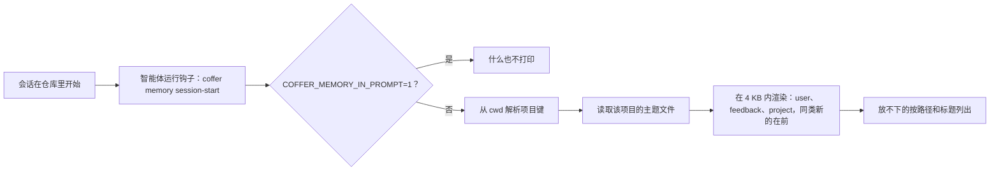
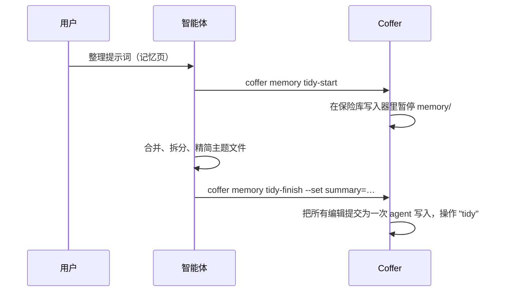

# 记忆 {#memory}

本页讲 Coffer 记忆层的工作原理：保险库里一个由 Markdown 文件组成的中心库，每个智能体都用自己的文件工具读写；每个智能体里一个会话开始钩子，把项目记忆交给会话；一次整理记成一次修改。本页面向想了解机制和背后理由的工程师。按任务组织的说明见[记忆指南](/zh/guides/memory)。

## 要解决的问题 {#the-problem}

每个编程智能体都有自己的记忆，看不到别的智能体的，也不会跟着人到另一台机器。早期版本用同步来弥补：把 Claude Code 和 Codex 的记忆读进中心库，再把中心库写回每个智能体。这只对两个智能体有效，会照单全收智能体写下的一切（大部分是任务流水），而且为了安全地往别人的文件里写，需要防回声过滤、副本台账、预览和撤销。

现在的设计是大多数记忆系统殊途同归的那一种：以 Markdown 文件为准，由正在工作的智能体自己写，会话开始时交给它一段精简文字，其余按需读取。

1. **一个中心库。** `vault/memory/projects/<project>/`，每个主题一个文件。保险库同步像对待其他保险库文件一样在机器之间传递它。
2. **智能体写。** 规则在 `coffer-guide` 技能里；智能体用自己的工具编辑文件。没有 MCP 记忆工具。
3. **Coffer 交给会话。** 每个智能体里的一个 `SessionStart` 钩子打印项目记忆；Coffer 自己的轮次把同样的文字放进系统提示词。
4. **智能体整理。** 一次整理交接提交为一次修改。

Coffer 不读写任何智能体的原生记忆。这个决定和权衡过的方案见 ADR [Keep Memory in One Place in the Vault, Written by the Agents Themselves](https://github.com/wyx-sg/Coffer/blob/main/docs/decisions/keep-memory-in-one-place-agents-write-themselves.md)。

记忆关于人；[知识](/zh/architecture/knowledge)关于世界。记忆保存这个人是谁、怎样和他合作、仓库里没有记录的项目状态，会推送进每个会话。知识保存外部系统、团队和流程怎样运作，智能体通过 `coffer-guide` 目录按需拉取。把记忆交给每个会话，是[拉取，而非推送](/zh/architecture/design-principles#pull-not-push)的一个有边界的例外：它是每一轮都要用、却没人会去拉的东西，并且限制在 4 KB 以内。

## 中心库 {#the-hub}

```text
vault/memory/projects/<project>/<topic>.md
```

`<project>` 是项目键，其中 `[A-Za-z0-9._-]` 以外的字符都换成 `-`。项目键是仓库规范化后的 `origin` 地址（`github.com/acme/payments`），没有远端时是仓库文件夹的名字，所以两台机器上的两个克隆共用一个文件夹。不在任何仓库里的会话没有项目，什么也拿不到。

主题文件的 frontmatter 有 `title`、`type`（`user`、`feedback` 或 `project`）和 `updated`（`YYYY-MM-DD`），正文每行一条记忆，每条最多 400 个字符。格式由 Coffer 固定，写在 `coffer-guide` 里；用户不能编辑，因为钩子、上限和记忆页都按它读。读文件时是宽松的：缺标题就用文件名，每种不符合格式的情况都有名字（`no_title`、`bad_type`、`no_updated`、`no_memories`、`long_line`）并显示出来，Coffer 从不替它修。

每次修改都是一次写明写入方的保险库提交：智能体的编辑由保险库扫描器以 `disk` 写入提交，记忆页上的编辑或删除是 `user` 写入，一次整理是一次操作为 `tidy` 的 `agent` 写入。

## 把记忆交给会话 {#handing-a-session-its-memories}



`coffer memory session-start` 从标准输入读取钩子的 JSON（其中的 `cwd`），解析出仓库，不经过守护进程、直接读中心库的文件，打印一段 `<coffer-memory project="…">`：先一行写明文件夹并指向规则，然后每个主题一节 `## 标题 (类型, updated 日期)`。主题按类型排序（这个人是谁，然后怎样和他合作，再然后是项目），同类里新的在前。4 KB 放不下的按路径和标题列出，供智能体在相关时读取。读不懂的输入、不在仓库里的 cwd 或任何错误都只会什么也不打印并以 0 退出，所以钩子永远不会让会话失败。

Coffer 自己的轮次（对话、消息渠道、定时任务）把同样的文字放在系统提示词最前面，并在智能体的环境里设置 `COFFER_MEMORY_IN_PROMPT=1`，这样那个会话里的钩子什么也不打印，记忆不会交两次。

## 每个智能体里的钩子 {#the-hook-in-each-agent}

智能体描述符以纯数据（`session_hook`）写明钩子放在哪里：智能体配置目录里的一个 JSON 文件和事件名。

| 智能体 | 文件 | 条目 |
| --- | --- | --- |
| Claude Code | `<config_dir>/settings.json` | `hooks.SessionStart[].hooks[] = {"type": "command", "command": "<coffer> memory session-start"}` |
| Codex | `<config_dir>/hooks.json` | 相同结构 |

一个协调目标 `memory_hook` 为每个已注册智能体保持一个条目：把 Coffer 的钩子加在智能体自己的钩子旁边，`coffer` 命令的路径变了就替换它，记忆关闭或智能体被移除时只移除它自己。命令里运行 `memory session-start` 的钩子就是 Coffer 的。写入走和所有智能体配置写入相同的安全写入路径（备份、原子替换）。每次变化都审计为 `memory_hook_installed` 或 `memory_hook_removed`。Codex 只在用户审核一次之后才运行新的或改过的钩子。

描述符没有写明钩子位置的智能体，只在 Coffer 自己的轮次里拿到记忆。新的智能体只要声明自己的 `session_hook` 就能参与；这一层里没有其他按智能体区分的东西。

## 整理记成一次修改 {#tidying-as-one-change}



整理进行中，保险库写入器暂停 `memory/`：智能体的编辑留在工作区，扫描器不会逐个提交。结束时把它们全部作为一次提交，摘要就是智能体的报告，所以历史里只有一个版本，恢复到它之前的版本就撤销了整次整理。中心库 30 分钟没有变化的整理会被关闭，已做的修改照样提交；进行中的整理只存在守护进程内存里，所以重启也会关闭它。

定期整理是用户在记忆页用整理提示词创建的定时任务。Coffer 自己不运行记忆定时器。

## 从记忆同步升级 {#upgrading-from-memory-sync}

守护进程启动时，Coffer 会对每个已注册智能体移除旧版本写进去的东西：每个 Claude Code `MEMORY.md` 里的 `<!-- coffer:memory-sync:begin -->` 那段（整段就是全部内容时删除文件）、`coffer_*.md` 文件，以及每个 Codex 记忆文件夹里的 `extensions/coffer/` 文件夹，还有旧的本机台账和预览。智能体自己的记忆不受影响。旧版本发布的中心库条目（每条一个文件，带 `id` 和 `origin`）会就地改写成主题格式，作为一次 `daemon` 写入。

## 审计 {#audit}

| 事件 | 时机 |
| --- | --- |
| `memory_hook_installed` | 协调器把 Coffer 的钩子加进某个智能体 |
| `memory_hook_removed` | 协调器移除了它（记忆关闭，或智能体被移除） |

对文件的编辑不是审计事件：保险库历史就是它们的记录。已停用的同步事件（`memory_synced`、`memory_sync_undone`）的旧记录仍然可读。

## 没有表，没有资源种类 {#no-table-no-resource-kind}

中心库是保险库里的文件，进行中的整理保存在守护进程内存里。这一层不新增表，也不新增资源种类。

## 取舍与备选方案 {#trade-offs-and-alternatives}

- **继续同步进每个智能体自己的记忆。** 每个智能体能原生加载共享记忆，但只有两个智能体能参与，每个新智能体都要为一个不断变化的格式写读取器和写入器，而防回声过滤、台账、预览和撤销都只是为了往别人的文件里写。
- **采集每次工具调用并用模型压缩（claude-mem 的设计）。** 不依赖任何智能体的记忆，但每个会话一次模型调用，外加数据库和压缩器：Coffer 会变成一个在做智能体已经在做的事的记忆系统。
- **用 MCP 工具保存和搜索。** 交付最简单，但只有智能体调用工具时才有东西进会话，而 Coffer 测过，智能体不会去调。
- **把中心库渲染进每个智能体的指令文件。** 不需要钩子，但 Coffer 又要按智能体、带标记和备份地往用户也在编辑的文件里写。

所选设计的代价：记忆依赖智能体遵守指南里的规则；除非用户关闭，智能体自己的记忆会和中心库并行运行；两台机器在同步之前改了同一个主题文件可能冲突，对一个人来说很少见，而且因为都是追加行，通常能干净合并。

## 代码位置 {#where-it-lives-in-the-code}

| 关注点 | 位置 |
| --- | --- |
| 项目键、主题格式及其问题、交给会话的文字 | 领域层的 `memory` 包 |
| 中心库服务、整理、一轮对话携带的记忆、钩子协调目标 | 应用层的 `memory` 包 |
| 中心库存储、frontmatter、仓库解析、升级清理 | 基础设施层的 `memory` 包 |
| 每个智能体的钩子放在哪里（`session_hook`） | 智能体描述符 |
| `/api/v1/memory` 路由和装配 | HTTP 接口层 |
| `coffer memory`，包括 `session-start` | CLI 接口层 |

## 相关内容 {#related}

- 规格：[memory](https://github.com/wyx-sg/Coffer/blob/main/openspec/specs/memory/spec.md)
- 决策记录：[Keep Memory in One Place in the Vault, Written by the Agents Themselves](https://github.com/wyx-sg/Coffer/blob/main/docs/decisions/keep-memory-in-one-place-agents-write-themselves.md)
- 调研笔记：[agent memory](https://github.com/wyx-sg/Coffer/blob/main/docs/research/agent-memory.md)
- [记忆指南](/zh/guides/memory) · [知识架构](/zh/architecture/knowledge) · [保险库同步](/zh/architecture/vault-sync) · [智能体切面](/zh/architecture/agent-facets)
